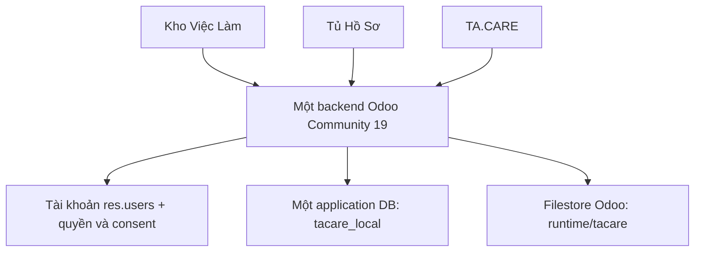

> Mới nhất: [SSO và đăng xuất đồng bộ ngày 20/10/2026](research/implementation_sso_2026-10-20.md). Cookie vẫn riêng từng tên miền, nhưng đăng nhập/đăng xuất nay được đồng bộ theo nhóm website được phép.

> Thay đổi mới nhất ngày 20/10/2026: xem [khôi phục giao diện, quyền 2/3 và popup đăng nhập](research/implementation_auth_restore_2026-10-20.md). Tủ hỗ trợ nhiều hồ sơ/tài khoản; admin có thư viện tất cả hồ sơ theo các công ty được cấp quyền.

# TA.CARE — Bàn giao tổng thể nghiệp vụ, kỹ thuật và trạng thái triển khai

> **Cập nhật tiếp 20/10/2026:** đọc kèm [báo cáo làm lại giao diện và nhiều hồ sơ](research/implementation_profile_refresh_2026-10-20.md). Một ứng viên hiện có thể tạo nhiều hồ sơ; carousel chỉ ở Kho/Tủ với hai thiết kế khác nhau. Những giới hạn “một hồ sơ/user” trong bản bàn giao cũ là trạng thái trước thay đổi này.

> **Cập nhật sau bản bàn giao:** chủ dự án đã cho phép triển khai demo local. Đọc kèm [báo cáo demo tuyển dụng/việc linh hoạt 19–20/10](research/implementation_flexible_demo_2026-10-19.md): có form, hai nhánh, carousel ảnh chụp thật, 20 tin và 15 hồ sơ giả lập. Các nhận định “chưa code/chỉ nghiên cứu” bên dưới mô tả thời điểm tạo bản bàn giao trước demo; map/matching nhánh mới vẫn để sau.

**Ngày tổng hợp: 19/10/2026.** Tài liệu dành cho chủ dự án, người phân tích nghiệp vụ, lập trình viên tiếp nhận và ChatGPT web. Nội dung chính được viết độc lập: có thể đọc file này mà không cần truy cập repository. Các đường dẫn là vị trí tham chiếu, không có nghĩa người đọc đã được cung cấp nội dung các file đó.

**Phạm vi phiên tạo tài liệu:** đọc source, tài liệu và lịch sử Git; viết bản bàn giao. Không sửa code ứng dụng, không truy vấn hoặc cập nhật DB, không khởi động Docker, không kiểm thử HTTP/ORM lại, không push/deploy. Những việc thực hiện ở các phiên trước được nhận diện qua tài liệu và source, không giả định có toàn bộ lịch sử hội thoại.

## 1. Đọc tài liệu này như thế nào?

### 1.1. Bốn mức bằng chứng

| Nhãn | Ý nghĩa |
| --- | --- |
| **SOURCE 19/10** | Đã đối chiếu với file code/cấu hình hiện có trong working tree ngày tổng hợp; không tự chứng minh container/production đang chạy đúng phiên bản đó. |
| **LOCAL QA 17/10** | Tài liệu triển khai gần nhất ghi nhận đã chạy kiểm tra trên `tacare_local` ngày 17/10/2026; không phải kết quả chạy mới hôm nay. |
| **NGHIÊN CỨU 19/10** | Yêu cầu hoặc đề xuất mở rộng đã được ghi nhận, chưa triển khai thành tính năng. |
| **CHƯA XÁC MINH** | Không có bằng chứng đủ để kết luận trong phiên bàn giao, đặc biệt trạng thái production và số liệu DB hiện tại. |

“Có model/trường” khác với “có form/route dùng được”; “chạy local” khác với “đã deploy production”; “kết nối accepted” khác với “đã tuyển/đã đặt lịch/đã hoàn thành việc”. Giữ các phân biệt này khi tiếp tục dự án.

### 1.2. Thứ tự ưu tiên khi có mâu thuẫn

1. Yêu cầu mới nhất của chủ dự án xác định phạm vi sản phẩm.
2. Source hiện tại xác định hành vi code đang viết; runtime chỉ được kết luận khi có kiểm tra môi trường cụ thể.
3. Báo cáo triển khai/QA có ngày mới hơn dùng để hiểu trạng thái local đã ghi nhận.
4. Tài liệu thiết kế, bản vẽ ERD/Database và prototype thể hiện mục tiêu hoặc mô phỏng, không tự là tính năng đã tích hợp.

Ví dụ: tài liệu audit ngày 14/10 từng ghi chưa có model nghiệp vụ, nhưng source hiện tại đã có. Không dùng nhận xét cũ đó để kết luận hệ thống vẫn chỉ là landing page.

## 2. TA.CARE là dự án gì?

TA.CARE kết nối **con người, năng lực có căn cứ và cơ hội/công việc** qua ba website cùng nền tảng. Chủ dự án đã đính chính: tuyển dụng nhân sự chỉ là một phần, không phải toàn bộ sản phẩm.

| Phần | Phạm vi | Trạng thái |
| --- | --- | --- |
| **1. Tuyển dụng** | Tổ chức đăng cơ hội; ứng viên tạo hồ sơ, tìm cơ hội, ứng tuyển; tổ chức xem hồ sơ được phép và mời trao đổi. | Có source và luồng local; chủ dự án đánh giá hiện tạm ổn. |
| **2. Tìm việc linh hoạt** | Doanh nghiệp hoặc cá nhân có nhu cầu; cá nhân có khả năng/thời gian nhận việc theo giờ, ca, ngày, đầu việc, dự án hoặc dạng khác phù hợp. Bao gồm C2C. | Đang nghiên cứu; chưa mở quyền C2C hay tích hợp matching theo lịch/bán kính/chuyến. |

“B2C/C2C” là cách gọi sản phẩm theo chủ dự án. Không dùng nhãn này thay cho kiểm tra chủ bản ghi, vai trò người đăng/nhận việc hoặc bản chất quan hệ hợp tác.

### 2.1. Vai trò ba website

| Website | Vai trò nghiệp vụ | Domain đang dùng trong code |
| --- | --- | --- |
| **Kho Việc Làm** | Kho nhu cầu/cơ hội: khám phá tin, đăng/quản lý tin, xem ứng viên theo quyền; tương lai thêm tin nhu cầu cá nhân. | `khovieclam.vn` |
| **Tủ Hồ Sơ** | Nơi cá nhân quản lý hồ sơ, kỹ năng, mong muốn, minh chứng và quyền chia sẻ. | `tuhoso.com` |
| **TA.CARE** | Nơi matching, đối chiếu, gửi/nhận kết nối và quản lý trao đổi. | `tacare.vn` |

Một số logo/tài liệu có nhắc `tuhoso.vn`, nhưng code và hướng dẫn local hiện dùng `tuhoso.com`. Không tự đổi domain; đây là điểm cần xác nhận khi làm việc về domain production.

### 2.2. Kiến trúc khái niệm



Đây là ba website record trên một backend và DB local, không phải ba sản phẩm lưu ba bản sao tài khoản/hồ sơ riêng. **Tài khoản dùng chung chưa tạo thành phiên đăng nhập dùng chung giữa các domain.**

## 3. Những giai đoạn đã làm từ trước đến nay

Các mốc dựa trên Git và tài liệu trong repository. Không suy rằng mỗi commit đã được đưa lên production.

| Thời gian | Công việc có bằng chứng | Nguồn/trạng thái |
| --- | --- | --- |
| 07/10/2026 | Khởi tạo repository, môi trường local, custom addons và workflow GitHub Actions triển khai. | Git: `40629b9`, `580f91d` cùng các commit khởi tạo. |
| 08/10/2026 | Tạo trang chủ cho ba thương hiệu; có bản vẽ ERD/Database mục tiêu. | Git `37adb94`; tài liệu mapping. |
| 14/10/2026 | Audit source cũ; phân biệt mục tiêu Odoo với demo độc lập; xây prototype tương tác bằng dữ liệu giả. | `docs/source_audit.md`, `prototype/`, tài liệu prototype. |
| 14–15/10/2026 | Hợp nhất local về một Odoo/DB và ba website; tích hợp hồ sơ, tin, kết nối, consent, schema, phân quyền; làm giao diện và kiểm tra local. | `docs/backend_local.md`; Git `ca589af`. |
| 15/10/2026 | Bảo toàn marker homepage cho HTTP deploy probe. | Git `8973876`; contract trong `AGENTS.md`. |
| 17/10/2026 | Kho Việc Làm F01–F12; membership/capability, ngành, yêu cầu có cấu trúc, lịch sử sửa và kiểm tra quyền. | Git `b858d4e`; traceability và báo cáo local. |
| 17/10/2026 | Thiết kế cấu trúc riêng ba website theo mẫu đã chọn, giữ nhận diện/logos. | Git `83c7d74`; sau đó tiếp tục có thay đổi working tree. |
| 17/10/2026, trạng thái local gần nhất được ghi | Form v2, 10 lĩnh vực/48 nhóm nghề, hồ sơ chín nhóm, điều chỉnh đối chiếu và thu nhập; ba homepage riêng, ảnh/font và kiểm tra browser/ORM. | `docs/research/implementation_forms_homepages_2026-10-17.md`; có phần chưa commit trong working tree. |
| 19/10/2026 | Chủ dự án mở rộng phạm vi: tuyển dụng + tìm việc linh hoạt B2C/C2C; nghiên cứu nền tảng, trường dữ liệu, vị trí, giá và teaser matching. | `docs/project_scope.md` và ba tài liệu nghiên cứu/bàn giao liên quan; chưa sửa code cho C2C. |
| 19/10/2026, phiên hiện tại | Kiểm kê lại source, model, route, cấu hình, lịch sử và các khác biệt; tạo file bàn giao tổng thể này, kèm prompt cho ChatGPT web. | Tài liệu này; không chạy lại ứng dụng. |

### 3.1. Mốc Git tại lúc tổng hợp

- Branch local: `main`.
- HEAD local: `83c7d743bdd86fc14a765a9e1d1731ae1d97f6be`.
- Working tree có nhiều file modified/untracked, bao gồm code và asset từ công việc trước. Vì vậy **checkout riêng HEAD chưa chắc tái tạo đúng trạng thái local mới nhất được mô tả**.
- Không kết luận remote branch, production hay máy khác đã có cùng code. Phiên này không fetch, push hoặc kiểm tra server.

## 4. Bảng trạng thái toàn hệ thống

| Thành phần | Hiện đã có | Giới hạn cần nhớ |
| --- | --- | --- |
| Ba website chung backend/DB | Cấu hình local và báo cáo QA có bằng chứng. | Chưa xác minh tình trạng đang chạy ngày 19/10. |
| Đăng nhập theo tài khoản/host | Role và nhóm quyền; kiểm tra host. | Chưa có cross-domain SSO. |
| Quản lý tổ chức/thành viên | `care.org.member`, hai capability riêng. | Còn fallback cho business cũ; chưa có migration đã duyệt. |
| Đăng/quản lý tin tuyển dụng | Nháp, đăng, sửa, dừng, đóng, mở lại, xóa nháp. | Tin công khai do business sửa đi qua revision; không tự mở C2C. |
| Danh mục nghề | 10 lĩnh vực, 48 nhóm nghề trong XML source. | Danh mục cấu hình, không phải tin hoặc doanh nghiệp thật. |
| Hồ sơ ứng viên | Form, mong muốn, kỹ năng, kinh nghiệm, minh chứng/link, quyền chia sẻ. | Một hồ sơ/user; nhiều nội dung CV còn dạng text. |
| Ứng tuyển | Tạo `hr.applicant` và `tacare.connection`. | Không chứng minh đã xây toàn bộ quy trình ATS của Odoo. |
| Mời trao đổi/kết nối | Gửi, phản hồi, rút pending, ghi kết quả, thông báo nội bộ. | Chưa phải booking, hợp đồng hay chấm công. |
| Consent | Discovery, matching, contact; thời hạn, bên nhận và field scope. | Contact hiện chỉ cho tổ chức cụ thể và email. |
| Matching hiện tại | Đối chiếu có giải thích, trạng thái đáp ứng/chưa biết/không đáp ứng; sắp xếp đơn giản. | Không phải mô hình AI đã huấn luyện hoặc matching C2C đầy đủ. |
| Lịch rảnh cấu trúc | Có `care.availability`. | Chưa có UI/luồng hoàn chỉnh, giữ lịch, ngoại lệ và tối ưu lịch. |
| Vùng phục vụ/tọa độ | Có model/trường. | Chưa tích hợp geocoding, bản đồ, radius hoặc route matching. |
| Nhiều khả năng nhận việc | Có `care.profile.capability`. | Chưa có luồng dịch vụ nhiều giá/lịch/vùng hoàn chỉnh. |
| Minh chứng hình ảnh/file | Có evidence và metadata tài liệu. | Form hiện chủ yếu mô tả/link; chưa tích hợp upload ảnh/CV. |
| OCR/đọc CV | Có `care.ocr.job`. | Metadata và constraint; chưa có provider/worker/route OCR. |
| Kết quả matching lưu bền | Có bốn model `care.match.*`. | Đối chiếu UI hiện không ghi snapshot matching vào đó. |
| Audit | Có model append-only; một số controller đã ghi sự kiện. | Không phải mọi thao tác được audit; chưa có worker audit riêng tích hợp. |
| Feedback dạng rating | Có `care.feedback`. | Chưa có luồng đánh giá 1–5 hoàn chỉnh; khác kết quả trao đổi đã có. |
| Integration/outbox | Có `care.integration.event`. | Chưa có worker/retry/đối tác tích hợp thực chạy. |
| C2C và việc theo chuyến | Đã nghiên cứu và ghi phạm vi. | Chưa mở tính năng/permission/schema mới. |
| Thanh toán/escrow/bảo hiểm/eKYC | Chưa có luồng tích hợp được chứng minh. | Không quảng bá đã hỗ trợ. |
| Production deploy | Có workflow và contract. | Không xác minh commit hoặc DB production hiện hành. |

## 5. Tài khoản, tổ chức và quyền

### 5.1. Các thực thể không được dùng lẫn

| Thực thể Odoo | Ý nghĩa trong dự án |
| --- | --- |
| `res.users` | Tài khoản đăng nhập; không phải hồ sơ nghề và không tự chứng minh sở hữu tổ chức/tin. |
| `res.partner` | Liên hệ cá nhân hoặc tổ chức; tổ chức nghiệp vụ không tự là `res.company`. |
| `res.company` | Đơn vị/phạm vi vận hành Odoo; không tạo một company mới cho mỗi khách tuyển dụng. |
| `res.groups` | Nhóm cấp quyền Odoo; kết hợp ACL, record rules và kiểm tra controller. |
| `care.org.member` | Liên kết user–tổ chức–company, role, trạng thái, capability. |
| `tacare.profile` | Hồ sơ năng lực của một user; không đồng nhất với user/partner. |

### 5.2. Role tài khoản hiện hành

`res.users.tacare_account_role` có `pending`, `business`, `candidate`. Nhãn `admin` trong controller được suy từ **`base.group_system`**, không phải một lựa chọn role portal có thể tự khai.

| Loại tài khoản | Website đăng nhập theo chính sách hiện tại | Quyền nghiệp vụ chính |
| --- | --- | --- |
| Business | Kho Việc Làm, TA.CARE | Theo tổ chức và capability được cấp. |
| Candidate | Tủ Hồ Sơ, TA.CARE | Hồ sơ và kết nối thuộc chính mình. |
| Pending | Chưa được cấp host nghiệp vụ theo role map. | Không có quyền tự nâng vai trò. |
| Odoo system admin | Ba website và backend theo quyền. | Quản trị và duyệt; không coi mọi internal user là system admin. |
| Guest | Trang công khai phù hợp. | Không ghi dữ liệu qua luồng bảo vệ. |

Code host guard cho phép Odoo internal/public theo cơ chế riêng; điều đó không đồng nghĩa mọi internal account có toàn bộ quyền admin web. Role field được giới hạn cho quản trị, có đồng bộ hai nhóm `group_tacare_business` và `group_tacare_candidate`, cùng kế thừa portal. Chưa có public self-grant business/candidate được chứng minh.

### 5.3. Quyền tổ chức

- Membership có role `owner`, `recruiter`, `viewer`; trạng thái `invited`, `active`, `suspended`.
- `owner` active có hai khả năng: quản lý tin và xử lý ứng viên.
- `recruiter` active hiện giữ khả năng xử lý ứng viên; quản lý tin phụ thuộc cờ phù hợp.
- Các tổ hợp khác dùng `can_manage_jobs` và `can_handle_candidates`, do quản trị cấp.
- Chỉ membership phù hợp company/tổ chức/trạng thái mới dùng cho hành động tương ứng.
- Business cũ chưa có membership còn fallback theo commercial partner. Tài khoản đã có membership không được tự fallback để vượt trạng thái suspended.
- Tổ chức trong membership phải là partner `is_company`; `partner.parent_id` không tự cấp quyền.

Quyền quản lý tin không tự bao gồm quyền xem/xử lý hồ sơ; quyền xử lý ứng viên không tự cho tạo/sửa tin. Theo báo cáo 17/10 đã thử cả `manage-only` và `handle-only` ở local.

## 6. Kho Việc Làm: nghiệp vụ đã làm

### 6.1. Các luồng F01–F12

| Mã | Hành vi đã có ở local/source |
| --- | --- |
| F01 | Tạo và lưu nháp tin, cho phép thiếu thông tin cần để đăng. |
| F02 | Kiểm tra dữ liệu, xem trước và đăng tin. |
| F03 | Sửa tin, ghi thay đổi/lịch sử; business sửa tin đang công khai tạo revision chờ admin. |
| F04 | Tạm ngừng tin đang hiển thị, chặn đề nghị mới. |
| F05 | Đăng lại tin tạm ngừng sau xác nhận và kiểm tra. |
| F06 | Đóng tin; không tự xóa kết nối cũ. |
| F07 | Mở lại tin đã đóng sau xác nhận và kiểm tra còn nhu cầu. |
| F08 | Xóa bản nháp đủ điều kiện sau xác nhận; không xóa tin đang/đã đăng qua route này. |
| F09 | Xem danh sách/chi tiết ứng viên và căn cứ theo đúng tin, tổ chức, capability và consent. |
| F10 | Gửi lời mời trao đổi; cần tin sẵn sàng, hồ sơ được phép và nội dung lời mời. |
| F11 | Xử lý đề nghị ứng tuyển đang chờ; kết nối cũ có thể tiếp tục được xử lý khi tin dừng. |
| F12 | Bên gửi rút lời mời còn pending theo quyền. |

### 6.2. Vòng đời tin theo code hiện tại

```text
draft → published
published → paused hoặc closed
paused → published hoặc closed
closed → published
```

Route đổi trạng thái yêu cầu xác nhận, kiểm tra quyền và khóa hàng tin bằng `FOR UPDATE`; route đăng lại kiểm tra điều kiện đăng hiện hành. Hạn chế xóa: chỉ `draft`, đúng quyền, có xác nhận và chưa có kết nối. Prototype cũ coi closed là kết thúc; **source Odoo mới cho mở lại closed**, không sao chép quy tắc demo cũ.

### 6.3. Form tuyển dụng v2

Form gom theo năm phần: vị trí; nội dung công việc/yêu cầu/quyền lợi; kỹ năng/kinh nghiệm; địa điểm/thời gian; thu nhập. Điều kiện chuyên biệt có phần mở rộng.

Các trường chính: tiêu đề, lĩnh vực, nhóm nghề, vị trí, mô tả, yêu cầu ứng viên, quyền lợi, kỹ năng bắt buộc/ưu tiên, nhóm “chỉ cần một trong”, kinh nghiệm liên quan tối thiểu, loại cơ hội, thời lượng, hình thức, tỉnh/thành, địa điểm, lịch, ngày bắt đầu, hạn nhận và cấu trúc thu nhập.

Tách riêng:

- Lĩnh vực hoạt động của doanh nghiệp với nghề đang tuyển.
- Nghề/vị trí với chuyên ngành đào tạo.
- Loại cơ hội với toàn thời gian/bán thời gian/linh hoạt.
- Office/hybrid/remote với lịch hoặc số ngày làm.
- Khoảng/từ/đến/thỏa thuận với lương cố định/tổng thu nhập, tiền tệ, kỳ và gross/net.

V2 yêu cầu khi đăng: tiêu đề hợp lệ, vị trí/nhóm nghề và lĩnh vực đúng nhau, loại cơ hội, thời lượng, hình thức, mô tả, nội dung yêu cầu hoặc chính sách đào tạo, hạn chưa qua; nếu không remote cần địa điểm và tỉnh/thành. Nếu chọn hiển thị tiền bằng số phải có giá trị phù hợp với kiểu khoảng/từ/đến. Có thể lưu nháp với ít dữ liệu hơn.

**Không còn ép mọi tin phải có ít nhất một kỹ năng bắt buộc.** Tin chấp nhận đào tạo từ đầu có thể đăng theo nội dung yêu cầu/chính sách phù hợp. Tài liệu F02 cũ nói luôn cần một điều kiện bắt buộc không phản ánh đủ form v2. Hạn nhận có thể trước ngày bắt đầu, và code kiểm tra hạn chưa qua theo ngày, không bắt buộc sau ngày bắt đầu.

### 6.4. Tin sửa đang công khai

Business sửa tin published tạo `care.job.revision`, giữ bản hiện hành cho tới admin duyệt. Payload có allowlist; không cho tự cập nhật quyền sở hữu hoặc trường ngoài phạm vi. Một tin không đồng thời tạo nhiều bản submitted qua luồng này. Admin duyệt áp dụng cùng transaction, đồng bộ yêu cầu/kỹ năng và kiểm tra lại điều kiện đăng; bản revision đã published bất biến.

Đây là cơ chế duyệt **bản sửa** đang chạy; không suy ra mọi tin mới đều có quy trình kiểm duyệt đầu vào giống hệt. Admin có ngữ cảnh xử lý riêng theo code.

### 6.5. Danh mục hiện có trong XML

| Lĩnh vực | Số nhóm nghề | Nhóm nghề được khai báo |
| --- | --- | --- |
| CNTT | 8 | Frontend, Backend, Fullstack, Mobile, QA, dữ liệu, DevOps/hạ tầng, an toàn thông tin. |
| Thương mại điện tử | 5 | Vận hành sàn, quản lý gian hàng, hàng hóa trực tuyến, livestream, CSKH TMĐT. |
| Marketing | 6 | Content, Performance, SEO, thương hiệu/truyền thông, Social Media, nghiên cứu thị trường. |
| Kinh doanh | 5 | B2B, bán lẻ, quản lý khách hàng, phát triển kinh doanh, telesales. |
| Y tế | 6 | Bác sĩ, điều dưỡng, dược sĩ, xét nghiệm, chẩn đoán hình ảnh, phục hồi chức năng. |
| Logistics | 6 | Kho, điều phối vận tải, chứng từ/hải quan, thu mua, chuỗi cung ứng, lái xe giao nhận. |
| Thiết kế | 6 | Đồ họa, UI/UX, chuyển động, nội thất, công nghiệp, thời trang. |
| Nông nghiệp/thực phẩm | 2 | Kiểm soát chất lượng thực phẩm, kỹ thuật nông nghiệp. |
| Chăm sóc khách hàng | 2 | CSKH, hỗ trợ kỹ thuật. |
| Nhân sự/tuyển dụng | 2 | Tuyển dụng, lương và phúc lợi. |

Tổng **10 lĩnh vực, 48 nhóm nghề**: đếm trực tiếp record XML ngày 19/10 và phù hợp báo cáo DB local ngày 17/10. Không coi đây là số tin đang mở hay bộ nghề hoàn chỉnh cho C2C. Bốn ngành từng dùng kiểm tra là ví dụ catalog/validation, không phải bốn doanh nghiệp tuyển dụng mẫu trong DB.

## 7. Tủ Hồ Sơ: nghiệp vụ đã làm

### 7.1. Chín nhóm nội dung

1. Giới thiệu: tên hiển thị, tiêu đề nghề, mô tả.
2. Mong muốn: nhóm nghề, khu vực, loại cơ hội, thời lượng/hình thức, thu nhập tối thiểu, ngày sẵn sàng và di chuyển.
3. Kinh nghiệm làm việc và kinh nghiệm liên quan đã xác nhận theo tháng.
4. Học vấn và chuyên ngành.
5. Ngoại ngữ.
6. Giấy phép/chứng chỉ.
7. Kỹ năng.
8. Minh chứng/dự án/sản phẩm.
9. Quyền chia sẻ.

Form chủ yếu là các trường đơn/text và các dòng kỹ năng/minh chứng. Chưa có bảng cấu trúc riêng đầy đủ cho từng công việc từng làm, từng bằng học và từng giấy phép. Không tự cộng kinh nghiệm từ lịch sử hoặc suy hiệu lực chứng chỉ từ mô tả.

### 7.2. Quy tắc dữ liệu

- Ràng buộc **một `tacare.profile` trên một `res.users`**.
- Hồ sơ có scope `private`, `members`, `public`; mặc định scope riêng tư. Cờ visible không tự bỏ qua scope/consent.
- Trạng thái hồ sơ: `active`, `paused`, `archived`.
- Kinh nghiệm chưa khai khác với đã xác nhận 0 tháng; đổi nhóm nghề cần xác nhận lại kinh nghiệm liên quan.
- Kỹ năng có tên tự khai, mức/use và liên kết danh mục `hr.skill`/`hr.skill.level` khi có.
- Dữ liệu minh chứng gồm tên, vai trò, mô tả, kết quả, URL và visibility; mới tạo private, chưa tự xác minh.
- Có tạo/sửa/xóa kỹ năng và minh chứng qua controller kiểm tra đúng chủ.
- Có kiểm tra URL minh chứng chỉ http/https, số âm/không hữu hạn và quan hệ nghề–lĩnh vực; giữ dữ liệu form khi lỗi sửa được theo báo cáo QA.
- Version hồ sơ tăng theo một số thay đổi hồ sơ/kỹ năng/minh chứng; không coi đây là hệ thống snapshot matching đã nối.

### 7.3. Những trường đang có nhưng chưa thành dịch vụ hoàn chỉnh

Profile có `profile_type` cá nhân/nhóm, operator, tọa độ, bán kính, verification và reputation. Model child đã có capability, lịch rảnh, service area và preference. **Chưa có luồng hoàn chỉnh để một người bán nhiều dịch vụ với từng giá/lịch/vùng hoặc đặt người làm theo giờ.** Các trường này không tự mở quyền team hoặc C2C.

## 8. Kết nối, ứng tuyển và thông báo

### 8.1. Hai loại đề nghị

- `application`: ứng viên tự gửi tới tin. Luồng tạo `hr.applicant` và `tacare.connection`; `hr.applicant.email_from` được tạo bằng `False`.
- `invitation`: người có quyền xử lý ứng viên mời hồ sơ trao đổi cho tin được phép; phải có nội dung lời mời và quyền đọc/matching phù hợp.

Tin nhận đề nghị mới phải published, public và chưa quá hạn. Lời mời cần tin bật matching và hồ sơ được phép nhận. Không nên suy mọi ứng tuyển chủ động phải có cùng điều kiện consent như lời mời khám phá; controller hai nhánh kiểm tra khác nhau.

### 8.2. Vòng đời kết nối

```text
pending → accepted / declined / cancelled
```

Bên nhận phản hồi accepted/declined khi pending theo quyền. Bên gửi được hủy khi pending. Controller khóa bản ghi và kiểm tra trạng thái lại cho phản hồi/hủy. Kết nối thuộc tin, hồ sơ, bên gửi, bên nhận và tổ chức liên quan.

Chống trùng hiện tại kiểm tra **cùng job + profile + type còn pending**, có kiểm tra trong controller và ORM. Không ghi thành quy tắc “cấm gửi lại mọi trạng thái”: tài liệu/prototype cũ có quy định khác. Không suy constraint Python là một SQL unique index cho mọi tranh chấp ghi đồng thời.

### 8.3. Kết quả trao đổi

Sau accepted có thể ghi `discussed`, `reviewing`, `joined`, `stopped` và ghi chú/người cập nhật. Đây là kết quả do người dùng cập nhật trong kết nối, không chứng minh hợp đồng, chấm công, giữ chỗ hay hoàn tất dịch vụ. Khác với `care.feedback` dạng rating 1–5 còn chưa có luồng đầy đủ.

### 8.4. Thông báo và snapshot trong kết nối

`tacare.notification` lưu thông báo theo user, liên kết kết nối và cờ đã đọc. Có trang danh sách và route đánh dấu đọc. Không coi thông báo nội bộ là đã có email/SMS/push bên ngoài.

Kết nối lưu `snapshot_name`, `snapshot_headline`, `snapshot_skills` tại lúc gửi. Đây là **một phần dữ liệu lưu theo kết nối**, khác với bộ `care.match.input/result` dùng lưu matching chưa nối. Quyền liên hệ vẫn kiểm tra hiện hành, không mở email chỉ vì có snapshot cũ. Chính sách lưu/xóa toàn bộ dữ liệu lịch sử còn cần chốt.

## 9. Consent và bảo vệ dữ liệu

### 9.1. Ba mục đích độc lập

| Mục đích | Ý nghĩa |
| --- | --- |
| `discovery` | Hiển thị hồ sơ hoặc trường phù hợp trong tìm kiếm/khám phá theo scope. |
| `matching` | Cho phép đối chiếu dữ liệu theo phạm vi trường/bên nhận. |
| `contact` | Chia sẻ liên hệ theo bên nhận cụ thể; hiện luồng email cho tổ chức sau accepted. |

Consent có trạng thái draft/granted/revoked, phiên bản, thời điểm hiệu lực/hết hạn, người cấp, trường được chia sẻ và bên nhận public/members/organization. Chỉ chủ hồ sơ được cấp consent granted. Hiệu lực được kiểm tra khi đọc, không chỉ lúc bấm đồng ý.

### 9.2. Mở email hiện tại

Phải có đồng thời: kết nối đã accepted, contact consent còn hiệu lực của đúng hồ sơ, **đúng tổ chức**, field `email`, và người xem đúng quyền. Chủ hồ sơ cấp/thu hồi trên kết nối; thu hồi khiến trang liên quan không được tiếp tục mở email.

Luồng grant không cho thấy việc tự ghi email vào `hr.applicant.email_from`; không khẳng định applicant được đồng bộ email sau grant. Email hiển thị theo kiểm tra consent của giao diện kết nối, không phải vì applicant đã lưu sẵn.

Contact consent hiện **không hỗ trợ cấp cho cá nhân thuê việc cụ thể**. Không biến cá nhân thành “tổ chức” để né ràng buộc khi làm C2C. Cần thiết kế mới đúng bên nhận, mục đích và field scope trước khi mở tính năng đó.

### 9.3. Tài liệu và minh chứng

`care.document` liên kết hồ sơ, evidence và `ir.attachment`; attachment không được public, phải thuộc đúng tài liệu. State ready cần file; có metadata retention. Những ràng buộc này chưa tạo thành chức năng upload, quét file, OCR hoặc xóa file theo lịch.

Không dùng dữ liệu hồ sơ/liên hệ thật trong fixtures, log, screenshot hoặc tài liệu bàn giao. Các ví dụ marketing/portfolio trên homepage phải được phân biệt với dữ liệu người dùng. Không đưa credentials, khóa API, `.env`, DB dump hoặc filestore thật vào ChatGPT web chỉ để chuyển bối cảnh.

## 10. Matching đang chạy trong source thực sự làm gì?

Nguồn chính: `tacare_website/models/profile_comparison.py`, method `hr.job._care_compare_profile`, được controller `_match` gọi sau kiểm tra quyền/consent theo ngữ cảnh.

### 10.1. Kết quả mỗi tiêu chí

- `met`: có căn cứ đối chiếu đáp ứng.
- `unmet`: dữ liệu đã có cho thấy khác/không đáp ứng.
- `unknown`: thiếu dữ liệu, chưa chia sẻ, chưa đủ cơ sở hoặc cần người kiểm tra.

Kết quả gồm tên tiêu chí, trạng thái, căn cứ, cờ mandatory và nhóm tiêu chí; cùng các tập kỹ năng trùng/chưa khai, ưu tiên tìm thấy và rank nội bộ.

### 10.2. Các chiều có đối chiếu cấu trúc

| Chiều | Hành vi hiện tại |
| --- | --- |
| Kỹ năng | Tách chuỗi dấu phẩy, so tên không phân biệt hoa/thường; bắt buộc từng kỹ năng hoặc OR khi bật “một trong”. Thiếu tên trùng là unknown, không tự coi không có kỹ năng. |
| Nhóm nghề | So ID nhóm nghề giữa tin và mong muốn hồ sơ. |
| Kinh nghiệm | Chỉ so số tháng tự khai đã xác nhận cho cùng nhóm nghề với yêu cầu tối thiểu của tin. |
| Hình thức | So giá trị office/hybrid/remote; hybrid không tự đáp ứng hai giá trị còn lại. |
| Loại cơ hội | Chuẩn hóa full_time/part_time cũ về employment cho chiều loại; so với mong muốn. |
| Thời lượng | So full/part/flexible. |
| Khu vực | Với việc không remote, so ID tỉnh/thành khi có; chưa tính khoảng cách hoặc đường đi. |
| Thu nhập | Chỉ so lương cố định khi cùng tiền tệ, kỳ, gross/net đã biết và hồ sơ có mức tối thiểu. So với trần nếu có; tin chỉ công bố sàn thấp hơn mong muốn thì unknown. |
| Di chuyển/ngày bắt đầu | Chỉ đối chiếu khi tin thực sự yêu cầu và có dữ liệu phù hợp. |
| Học vấn, ngoại ngữ, giấy phép, lịch mô tả, yêu cầu bổ sung cũ | Trả căn cứ cần kiểm tra, thường unknown; không dùng trùng văn bản để xác nhận năng lực. |

### 10.3. Giới hạn quan trọng

- Sắp xếp hiện dùng `rank = số dòng met`; không phải xác suất thành công hoặc thuật toán xếp hạng đã kiểm định.
- Có kết quả `unmet` không đồng nghĩa code đã loại cứng toàn bộ cặp đó khỏi danh sách. Không khẳng định “Hà Nội–TP.HCM sẽ bị chặn bởi engine” khi mới có so tỉnh trong các dòng giải thích.
- Chưa semantic matching/embedding, suy luận tác vụ, xác minh năng lực, tối ưu lịch, tính giao ca, bán kính, ETA hoặc báo giá hành trình.
- Không hiển thị phần trăm phù hợp ở Kho; không dùng điểm để tự ra quyết định tuyển dụng.
- UI đối chiếu live không ghi vào `care.match.result`; chưa có worker/config versioned snapshot được tích hợp.
- Có `total_score`, `weights`, `explanation` trong schema không chứng minh đã có pipeline matching sử dụng chúng.
- Công thức điểm demo 65/20/10/5 trong prototype cũ là mô phỏng, không được dùng để mô tả engine Odoo hiện hành.

### 10.4. Hai hướng matching trên giao diện

Ứng viên xem cơ hội dựa trên hồ sơ của mình và consent phù hợp; bên tổ chức chọn tin rồi xem hồ sơ có quyền discovery/matching. Kho có trang ứng viên theo tin; TA.CARE có trang matching. Nguồn backend chung không tự tạo SSO hoặc teaser cá nhân hóa mới theo nghiên cứu C2C.

## 11. Stack kỹ thuật và tổ chức code

### 11.1. Công nghệ đang dùng

| Lớp | Hiện trạng theo source/cấu hình |
| --- | --- |
| Nền tảng | Odoo Community **19.0**; release trong checkout core xác nhận nhánh 19. |
| Backend | Python, Odoo ORM/models/constraints, HTTP controller và giao dịch PostgreSQL. |
| Frontend nghiệp vụ | QWeb server-rendered, SCSS/CSS, JavaScript tương tác. Không phải app React/Next riêng. |
| Database local | PostgreSQL **16** theo Compose; application DB `tacare_local`. |
| Gateway local | Nginx `stable-alpine` theo Compose. |
| Image Odoo local | `tacare-odoo-local:19`; Dockerfile dựa Ubuntu 24.04, venv Python và requirements của Odoo, rtlcss. |
| Tài nguyên | Font Be Vietnam Pro/Lora tự host cùng OFL, logo thương hiệu, ảnh biên tập/minh họa. |
| QA browser | Chrome/Playwright trong môi trường QA; không phải runtime dependency bắt buộc của addon. |
| CI/CD | GitHub Actions gọi deploy script server bằng exact commit SHA. |

Dockerfile cần build context có `requirements.txt`; tài liệu này không xác nhận image đang cài bản dependency cụ thể nào. `ODOO_COMMIT` ghi `6bae1e2f5eed5aae790944492e3d89d50bab5954` làm mốc tham chiếu; không dùng riêng file đó chứng minh SHA thực chạy trong container.

### 11.2. Hai addon chính

| Addon | Version manifest hiện tại | Vai trò / dependency |
| --- | --- | --- |
| `tacare_account_access` | `19.0.2.0.0` | Role, allowed websites, host guard, nhóm quyền và đồng bộ user. Depends website, portal, auth_signup. |
| `tacare_website` | `19.0.4.0.0` | Tin, hồ sơ, kết nối, consent, schema, controller, QWeb và assets ba site. Depends website, tacare_account_access, website_hr_recruitment, hr_skills. |

`website_hr_recruitment` kéo theo module tuyển dụng Odoo; dự án dùng lại `hr.job`, `hr.applicant`, `hr.job.skill`, `hr.skill`, `hr.skill.type`, `hr.skill.level`, `hr.recruitment.degree`, `res.currency` và các thực thể nền tảng. Không coi dependency kế toán/thanh toán khác là tính năng TA.CARE đã tích hợp chỉ vì Odoo có sẵn.

### 11.3. Bản đồ repository

```text
TA_CARE/
  AGENTS.md                       Quy tắc phát triển và giới hạn vận hành
  README.md                       Điểm bắt đầu chạy local
  compose.yaml                    PostgreSQL local
  compose.override.yaml           Một Odoo + Nginx gateway
  docker/
    odoo.Dockerfile                Image local
    local-nginx.conf              Proxy/host và cổng local
    config-examples/               Mẫu cấu hình, không phải credential thật
  ODOO_COMMIT                      Mốc core tham chiếu
  source/odoo-server/              Odoo core checkout bị git ignore, chỉ đọc
  source/apps/tacare/addons/
    tacare_account_access/        Danh tính, role, quyền đăng nhập site
    tacare_website/               Nghiệp vụ và UI dùng chung
  source/apps/khovieclam/addons/   Placeholder lịch sử
  source/apps/tuhoso/addons/       Placeholder lịch sử
  prototype/                      Demo độc lập, dữ liệu giả/localStorage
  docs/                           Audit, mapping, traceability, nghiên cứu, QA
  runtime/                        Dữ liệu local/filestore bị git ignore
  backups/                        Sao lưu local bị git ignore
  .github/workflows/              Workflow deploy production
```

### 11.4. Code nào chịu trách nhiệm việc gì?

Các đường dẫn dưới đây tương đối với `source/apps/tacare/addons/`.

| Vị trí | Trách nhiệm |
| --- | --- |
| `tacare_account_access/models/res_users.py` | Role, nhóm, host allowlist, credential check. |
| `tacare_account_access/models/ir_http.py` | Host guard khi dispatch request người đã đăng nhập. |
| `tacare_website/controllers/main.py` | Homepage theo website/domain; tin public còn hạn, số tin và URL ba thương hiệu. |
| `tacare_website/controllers/live.py` | Luồng web nghiệp vụ, parse/allowlist input, quyền, giao dịch, audit/notification và render. |
| `models/identity.py` | Membership và mở rộng identity/tổ chức/website. |
| `models/hr_job.py`, `job_requirement.py`, `job_revision.py` | Tin, danh mục/nghề/yêu cầu, kiểm tra đăng, đồng bộ skill và revision. |
| `models/profile.py`, `profile_details.py` | Hồ sơ, kỹ năng/minh chứng và schema khả năng/lịch/vùng/preference. |
| `models/profile_comparison.py` | So sánh live có giải thích hiện hành. |
| `models/matching.py` | Schema snapshot matching; không phải worker live. |
| `models/privacy.py` | Document, consent và OCR metadata. |
| `models/connection.py`, `operations.py` | Kết nối/thông báo; feedback, audit và integration metadata. |
| `security/ir.model.access.csv`, `record_rules.xml` | ACL theo nhóm, record scope. |
| `views/live.xml`, `kvl_pages.xml` | Layout/trang nghiệp vụ, card, form và trang chi tiết. |
| `views/home_jobs.xml`, `home_profiles.xml`, `home_hub.xml` | Ba cấu trúc homepage hiện hành. |
| `views/kvl_organization.xml`, `kvl_admin.xml`, `hr_job_care.xml`, `partner_care.xml` | Giao diện tổ chức và backend quản trị/cấu hình. |
| `static/src/js/kvl_form.js`, `homepages.js` | Form hỗ trợ nhập và tương tác homepage. Quyền không đặt ở JS. |
| `data/job_sectors.xml`, `job_positions.xml` | Danh mục cấu hình 10/48. |
| `tests/` | Các bộ kiểm tra local đã được viết. |

Giữ addon/model/XML ID và dependency; không sửa core. Những file layout/SCSS cũ vẫn có thể còn trong repository; **manifest asset bundle và template gọi thực tế** mới xác định bản nào được dùng. Không chọn file để sửa chỉ dựa vào tên hoặc ảnh chụp lịch sử.

## 12. Database: kiến trúc và quan hệ

### 12.1. Một application DB

Mục tiêu local đang được tài liệu và Compose xác nhận là **`tacare_local`** chứa ba website và tài khoản dùng chung. Các DB tên `khovieclam_local`, `tuhoso_local` từng tồn tại trong lịch sử và được để nguyên; không coi chúng là ba DB nghiệp vụ đang đồng bộ dữ liệu. Phiên này không truy vấn DB để xác minh các DB đó còn tồn tại.

Không có tạo bảng PostgreSQL thủ công hay migration production trong phạm vi những phiên local đã ghi. Module upgrade tạo/cập nhật schema qua ORM. Backup DB và backup filestore là hai phần liên quan nhưng khác nhau.

### 12.2. Quan hệ nghiệp vụ cốt lõi

```text
res.users → res.partner
res.users → care.org.member → res.partner (tổ chức)
care.org.member → res.company (phạm vi Odoo)

res.partner (chủ tổ chức) ← hr.job → website (Kho)
hr.job → care.job.sector ← care.job.position
hr.job → care.job.requirement
hr.job → hr.job.skill → hr.skill → hr.skill.type / hr.skill.level
hr.job → care.job.revision

res.users → tacare.profile (unique user_id)
tacare.profile → tacare.profile.skill / tacare.profile.evidence
tacare.profile → care.consent
tacare.profile → capability / availability / service.area / preference
tacare.profile.evidence → care.document → ir.attachment

hr.job + tacare.profile → tacare.connection → tacare.notification
application → hr.applicant

care.match.config → care.match.session → care.match.input / result
                       (schema, chưa nối pipeline snapshot)
```

Mũi tên thể hiện quan hệ logic/ORM, không khẳng định tất cả đều là SQL foreign key hoặc mọi dòng đã có dữ liệu. `ir.attachment.res_model/res_id` và audit `target_model/target_res_id` là tham chiếu đa hình. Many2many có thể dùng bảng quan hệ; One2many là phía nghịch đảo, không phải một cột SQL chứa danh sách.

### 12.3. Kiểm kê model theo source

Ngày 19/10 đếm tĩnh có **25 model custom khai báo `_name`** trong hai addon; mở rộng **8 tên model sẵn có**: `res.users`, `res.partner`, `res.company`, `website`, `ir.http`, `hr.job`, `hr.skill`, `hr.job.skill`. Đây không phải tổng số bảng/model toàn Odoo hay kết quả introspection DB sống.

| Model custom | Vai trò | Mức tích hợp |
| --- | --- | --- |
| `care.org.member` | Thành viên và capability tổ chức. | Luồng quyền/controller và admin. |
| `care.job.sector` | Lĩnh vực/ngành của tin và tổ chức. | Catalog/form/admin. |
| `care.job.position` | Nhóm nghề gắn lĩnh vực. | Catalog/form v2/matching. |
| `care.job.requirement` | Điều kiện có category, mandatory và skill. | Nhập/giữ dữ liệu/hiển thị; không tự xác minh mọi điều kiện. |
| `care.job.revision` | Phiên bản sửa tin và duyệt. | Đã nối. |
| `tacare.profile` | Hồ sơ chính. | Đã nối. |
| `tacare.profile.skill` | Kỹ năng của hồ sơ. | Đã nối. |
| `tacare.profile.evidence` | Minh chứng và metadata xác minh/visibility. | Nội dung/link đã nối; verifier/upload chưa đầy đủ. |
| `tacare.connection` | Ứng tuyển/lời mời/kết quả trao đổi. | Đã nối. |
| `tacare.notification` | Thông báo theo tài khoản. | Đã nối nội bộ. |
| `care.consent` | Đồng ý theo mục đích/bên nhận/trường. | Đã nối discovery/matching/contact hiện hành. |
| `care.audit.event` | Nhật ký bất biến. | Ghi trực tiếp một số thao tác; chưa toàn bộ hệ thống. |
| `care.capability.category` | Danh mục năng lực/rủi ro. | Schema nền. |
| `care.profile.capability` | Các khả năng nhận việc và khoảng tiền. | Schema, chưa có flow đầy đủ. |
| `care.availability` | Khoảng rảnh tuần/ngày. | Schema, chưa có flow đầy đủ. |
| `care.service.area` | Vùng remote/city/radius và tọa độ. | Schema, chưa có flow bản đồ. |
| `care.preference` | Mong muốn theo loại cơ hội, tiền, khoảng cách và loại trừ. | Schema, chưa có flow đầy đủ. |
| `care.document` | Metadata tài liệu và binding attachment. | Constraint/schema, chưa upload UI. |
| `care.ocr.job` | Tác vụ và dữ liệu OCR. | Metadata/schema. |
| `care.match.config` | Phiên bản thuật toán/trọng số/quy tắc. | Schema. |
| `care.match.session` | Phiên matching, requester, idempotency. | Schema. |
| `care.match.input` | Snapshot đầu vào/version/hash/consent. | Schema. |
| `care.match.result` | Score/explanation/eligibility/disclosure. | Schema; UI chưa ghi kết quả vào đây. |
| `care.feedback` | Rating 1–5 cho kết quả hoặc kết nối. | Schema, chưa đầy đủ nghiệp vụ đánh giá. |
| `care.integration.event` | Metadata event/retry/correlation. | Schema, chưa worker/outbox. |

### 12.4. Ràng buộc và dữ liệu quan trọng

- Unique hồ sơ trên user; unique membership trên `(company, organization, user)`.
- Mã lĩnh vực/nhóm nghề/danh mục/kỹ năng nếu có phải duy nhất theo constraint tương ứng.
- Unique revision `(job, version)`; revision published bất biến.
- Tài liệu cùng hồ sơ với evidence; một attachment gắn một document theo constraint; attachment không public.
- Một số snapshot/session dùng XOR job/profile, cùng session và consent phù hợp.
- Giá/kinh nghiệm không âm, một số trường chặn NaN/Infinity; giá tối đa không nhỏ hơn tối thiểu.
- Lịch schema hiện dùng giờ trong cùng ngày `0 <= from < to <= 24`; chưa giải quyết đầy đủ ca qua đêm trong sản phẩm.
- Audit không cho sửa/xóa qua model; quyền admin native không biến audit thành dữ liệu tùy ý chỉnh sửa qua flow này.
- Chống trùng kết nối pending hiện có kiểm tra Python; chưa coi đã chứng minh mọi tình huống tải cao.

Các model có `_unique_* = models.Constraint` và `@api.constrains` phục vụ mức kiểm tra khác nhau. Không gọi một kiểm tra ORM Python là SQL unique nếu source không khai báo tương ứng.

### 12.5. Xung đột với bản vẽ mục tiêu

Bản vẽ gốc có các tên `care.profile`, `care.profile.skill`, `care.evidence`, `care.connection`; code đã chạy dùng `tacare.profile`, `tacare.profile.skill`, `tacare.profile.evidence`, `tacare.connection`. Quyết định local là **mở rộng model cũ**, giữ dữ liệu/XML ID, không tạo hai kho song song.

Bản vẽ có ý tưởng nhiều hồ sơ theo company/partner/type, nhưng hiện code giữ một hồ sơ/user. “33 thực thể” trong mapping là phạm vi bản vẽ cũ, không phải tổng model sau các mở rộng. Một số `care_*` trên `hr.job` là related alias của `tacare_*`, không tự là bộ dữ liệu thứ hai. `auth.oauth.provider` là model của addon chuẩn `auth_oauth`, nhưng chưa có bằng chứng đã cài/bật OAuth; không tạo lại model đó.

Không rename model, đổi cardinality, tách DB, migrate membership hoặc đổi chủ thể của tin chỉ để làm giao diện/C2C khi chưa có đặc tả và migration được yêu cầu.

### 12.6. Số liệu DB gần nhất được ghi nhận

Theo báo cáo local **17/10/2026 sau dọn QA**: 9 tài khoản gốc; 0 tin, 0 hồ sơ, 0 kết nối; 10 lĩnh vực, 48 nhóm nghề. Trước đó có audit chi tiết vai trò và trạng thái active/archive, nhưng đây là dữ liệu có ngày, không phải truy vấn hiện tại.

Tài khoản/tin/hồ sơ QA giả đã được dọn theo báo cáo. Audit append-only của QA có thể còn tham chiếu bản ghi đã xóa. Không suy DB hoàn toàn không có dữ liệu chỉ vì không có tin/hồ sơ. Chưa có số liệu người dùng thật, lượt kết nối, doanh thu hoặc độ chính xác matching được xác nhận.

## 13. UI/UX và nội dung đã thực hiện

### 13.1. Ba homepage độc lập ở phiên bản gần nhất

- **Kho Việc Làm:** khám phá thị trường nghề; tìm kiếm, danh mục hai vùng, tin thật, nội dung biên tập và FAQ.
- **Tủ Hồ Sơ:** trình bày như tập portfolio; gallery, ví dụ dự án/kinh nghiệm, checklist, quyền chia sẻ.
- **TA.CARE:** sân khấu kết nối; thẻ chuyển động, các chương khi cuộn, giải thích hành trình, câu chuyện và FAQ.

Dùng logo thật của ba thương hiệu và bảng màu tương ứng. Font giao diện Be Vietnam Pro; Lora cho tiêu đề homepage Tủ Hồ Sơ theo thiết kế mới. Ảnh biên tập/minh họa đã tạo và lưu trong assets; đó không phải ảnh xác minh người dùng hay minh chứng giao dịch thật.

Các nhân vật/dự án mẫu trên homepage có nhãn hư cấu; không được suy thành tài khoản/ứng viên trong DB. Khu vực tin đang mở lấy tin public còn hạn; có empty state khi chưa có tin. Một số tương tác như checklist không lưu DB.

### 13.2. Quy tắc giao diện đã được hướng tới/kiểm tra local

Nhãn tiếng Việt, biểu mẫu có label, visible focus, giữ dữ liệu lỗi, responsive và reduced motion. Homepage có điều khiển dừng/tiếp tục chuyển động; nội dung vẫn đọc được khi JS không chạy; ảnh dưới fold lazy load; font tự host. Không tuyên bố đã có chứng nhận accessibility đầy đủ.

Manifest frontend hiện tải `website.scss`, `live.scss`, `kvl.scss`, `experience.scss`, `homepages.scss`, `homepages.js`, `kvl_form.js`. Các SCSS như `approved_design.scss`, `site_structures.scss`, `live_polish.scss` còn lưu từ các bước trước; không mặc định tất cả cùng được bundle ở bản hiện tại.

### 13.3. Ba marker bắt buộc

Giữ `tc-jobs` ở Kho, `tc-profiles` ở Tủ, `tc-hub` ở TA.CARE trên HTML homepage rendered. Đây là hợp đồng deploy probe, không phải chỉ tên CSS trang trí. Template `live_home` gọi template riêng từng site; `live_layout` giữ marker ở `#wrap`.

## 14. Local runtime và thao tác vận hành được ghi nhận

### 14.1. Topology theo Compose

- Service `db`: image PostgreSQL 16, volume `postgres_data`; cổng host chỉ bind `127.0.0.1:5434` tới 5432.
- Service `tacare`: một Odoo dùng `/etc/odoo/local.conf`, mount core `/opt/odoo/odoo-server`, custom addon `/mnt/extra-addons`, data `/var/lib/odoo`.
- Service `gateway`: Nginx, bind localhost 8069/8070/8071. 8069 giữ Host; 8070/8071 đổi Host tới Kho/Tủ tương ứng; đều proxy cùng Odoo.
- Network isolated nội bộ dành cho Odoo và DB theo cấu hình; không suy có thể gọi Internet từ container để tích hợp API mà không kiểm tra lại network.
- `.env` và cấu hình local thật có thể chứa secret; không chép vào bàn giao. Config examples là mẫu, không phải ảnh chụp runtime.

### 14.2. URL local chính

```text
http://khovieclam.localhost:8069/
http://tuhoso.localhost:8069/
http://tacare.localhost:8069/
```

### 14.3. Lệnh được tài liệu dự án hướng dẫn

Các lệnh sau là **runbook tham khảo**, chưa chạy trong phiên tổng hợp này. Chỉ dùng DB local đúng phạm vi, sau backup phù hợp; yêu cầu hiện tại không cho phép tự cập nhật addon.

```bash
docker compose up -d db tacare gateway
docker compose ps
```

Khi có yêu cầu triển khai local và **đã backup DB + filestore**, cập nhật addon theo hướng dẫn:

```bash
docker compose run --rm tacare -c /etc/odoo/local.conf -d tacare_local -u tacare_account_access,tacare_website --stop-after-init
docker compose restart tacare
```

Không đưa lệnh update DB này cho ChatGPT web như một tác vụ cần tự thực hiện chỉ vì có trong tài liệu. Chưa có lệnh backup đầy đủ kèm credential trong bản bàn giao; người thực hiện dùng quy trình/secret local thích hợp, không đoán.

## 15. Production và deploy contract

Workflow `.github/workflows/deploy-tacare.yml` chạy trên push `main` hoặc manual dispatch phù hợp ref. Workflow chuyển **exact GitHub SHA** qua SSH tới deploy script root-owned `/usr/local/lib/tacare-deploy/deploy.sh` trên server. Không cần đưa địa chỉ server hoặc khóa SSH vào bản bàn giao ngữ cảnh này.

Theo contract trong `AGENTS.md`: server fetch và triển khai chỉ addon dưới `source/apps/tacare/addons/`; worker stage trên cluster PostgreSQL riêng, neutralize bản sao, probe trước khi cập nhật production có backup. Staging probe thất bại nghĩa là production chưa được thay theo contract. Script server ở ngoài repository, **chưa được đọc/xác minh lại trong phiên này**.

Odoo core, Python dependencies, Docker, Nginx và server config nằm ngoài phạm vi tự deploy addon. Giữ ba marker homepage; không nới probe để che template hỏng. Workflow có concurrency để không hủy ngang một deploy đang chạy.

Không dùng push main làm bước kiểm tra thông thường vì nó khởi động deploy production. Không thay DNS/TLS, server script, production service hoặc DB production khi chưa có yêu cầu riêng. Có workflow trong repo không chứng minh deployment gần nhất đã thành công hoặc production đang có HEAD/source mới nhất.

## 16. Kiểm thử, sao lưu và bằng chứng đã có

### 16.1. Các bộ kiểm tra hiện có trong addon

| File | Kiểm tra chính | Cách hiểu trạng thái |
| --- | --- | --- |
| `tests/dev_schema_check.py` | Hai tổ chức/hai ứng viên, record isolation, read-only portal, contact scope/revoke. | Source có; tài liệu báo pass local; chạy trong Odoo shell và rollback. |
| `tests/dev_kvl_form_check.py` | Bốn lĩnh vực ví dụ, điều kiện có cấu trúc, nháp thiếu dữ liệu, lịch tuần hợp lệ. | Source có; tài liệu báo pass local; rollback. |
| `tests/dev_forms_v2_check.py` | Unknown/0 tháng, đúng nghề, hybrid, OR skill, lương cùng cơ sở, scope, số hữu hạn, hạn trước ngày bắt đầu. | Source có; tài liệu báo pass local; rollback. |
| `tests/homepage_contract_smoke.py` | Ba homepage và login HTTP, marker đúng site. | Source có; cần local server để chạy. |
| `tests/homepages_browser_check.cjs` | 1440/768/375/320 px, marker, font, ảnh, overflow, anchor, một h1, tương tác và reduced motion. | Source có; Playwright/Chrome thuộc QA. |

Prototype độc lập còn có `prototype/tests/state.test.js` và `browser_smoke.py`. Kết quả các test đó không chứng minh permission/DB Odoo.

### 16.2. Kiểm tra từng được báo cáo ngày 17/10

Parse Python/XML, `node --check`, `git diff --check`, biên dịch SCSS; update addon và restart local; ORM rollback; HTTP form flow; browser Chrome/Playwright. Các tình huống gồm đăng nháp/đăng tin, lỗi giữ input, revision, đổi trạng thái, ứng tuyển/mời/phản hồi/rút, contact grant/revoke, thay đổi hồ sơ/kỹ năng/minh chứng, chặn truy cập bản ghi khác và kiểm tra capability riêng.

Báo cáo cuối ghi ba site ở bốn độ rộng và tương tác đều pass, không tràn ngang/lỗi CSS-JS trong lượt cuối; homepage/login có HTTP mong đợi. Chưa có bằng chứng kiểm tra Safari/Firefox, load test, pentest đầy đủ, production hoặc toàn bộ yêu cầu pháp lý.

### 16.3. Sao lưu và dữ liệu QA

Đã có báo cáo backup DB và filestore trong `backups/` trước các thay đổi local: UI, schema, cấu trúc và form v2. Không đọc/chia sẻ nội dung backup hoặc credential QA trong phiên này. Sự tồn tại của báo cáo backup không tự là bằng chứng đã diễn tập restore thành công.

## 17. Prototype, thiết kế và ứng dụng thật khác nhau ra sao?

| Loại artifact | Có gì | Không chứng minh |
| --- | --- | --- |
| `prototype/` | SPA HTML/CSS/JS, giả lập role, dữ liệu fictional, localStorage, server Python cổng 4173. | Login Odoo, DB/ACL thực, SSO, upload bytes/OCR hoặc production. |
| `docs/design-preview/` | Preview HTML bố cục và tokens được dùng tham khảo/phê duyệt thiết kế. | Toàn bộ data/route/backend đã tích hợp. |
| Odoo custom addons | Models, controller, QWeb, assets, ACL/rules và các luồng local. | Production đang chạy đúng cùng bản code hoặc tính năng chỉ có schema đã dùng được. |
| Tài liệu nghiên cứu | Hướng nghiệp vụ, nguồn, phương án và điều kiện kiểm chứng. | Chức năng đã triển khai hoặc yêu cầu đã được duyệt toàn bộ. |

Demo role switch không dùng làm quyền thật. Các quy tắc demo cũ như closed terminal, chặn mọi gửi lại hoặc điểm matching mô phỏng không được nhập nguyên sang source mới.

## 18. Phần mở rộng mới: đã nghiên cứu gì và chưa làm gì?

### 18.1. Yêu cầu chủ dự án đã ghi nhận

- Tuyển dụng chỉ là phần một; thêm phần tìm việc linh hoạt, gồm doanh nghiệp–cá nhân và cá nhân–cá nhân.
- Cá nhân đăng nhu cầu ở Kho; người muốn tận dụng kỹ năng/thời gian rảnh đăng khả năng nhận việc ở Tủ.
- Ví dụ gồm dọn nhà, nấu ăn, bốc vác, chăm cây/nông nghiệp và xe theo chuyến; các ví dụ chưa phải catalog được duyệt.
- Cần giá cùng đơn vị và phạm vi, lịch phù hợp, vùng nhận việc/khoảng cách phù hợp; ảnh công việc tùy chọn.
- Matching chính ở TA.CARE; Kho vẫn có một số gợi ý và giá để thu hút người xem/nhà đầu tư.
- Hiện chỉ nghiên cứu; không sửa code/schema/vận hành cho phạm vi mới.

### 18.2. Kết quả nghiên cứu ngày 19/10

Đã rà 16 nền tảng với mức bằng chứng khác nhau, phân loại các mô hình đăng nhu cầu/chào giá, chọn người theo lịch/giá, nhận ca, freelancer và hành trình. Có đề xuất trường đối ứng nhu cầu–khả năng nhận việc, mô hình một hồ sơ/nhiều mục nhận việc, lịch/vùng/giá theo từng dịch vụ, ảnh tùy chọn, chính sách matching và 36 tình huống kiểm tra nghiệp vụ trên giấy.

Đã nghiên cứu Google Routes/Matrix và phương án Goong/VIETMAP/OSM, phân biệt lọc vùng với tính đường đi, chi phí theo phần tử, quyền lưu nội dung API và dữ liệu địa chỉ. **Chưa lấy key, gọi API có phí, benchmark thực địa hoặc chọn provider cuối.**

Chưa đủ cơ sở mở vận tải hành khách chỉ vì cá nhân có xe/GPLX. Phải tách thuê tài xế, xe kèm tài xế và chia sẻ chi phí chuyến đi. Các mức tiền 30–40 nghìn/giờ, 1,2 triệu/chuyến hay 1–2 triệu từ đầu bài là ví dụ, không phải giá thị trường đã duyệt.

### 18.3. Các đề xuất chưa được triển khai

Matching tương lai lọc quyền/hiệu lực, kiểm tra việc–lịch–vùng–giá và điều kiện nghề bắt buộc trước, sau đó mới sắp xếp ưu tiên. Dữ liệu chưa biết không thành kết luận đáp ứng. Không âm thầm mở vùng, không coi khoảng giá chung là báo giá cho hành trình cụ thể, không coi ảnh là xác minh.

Gợi ý rút gọn trên Kho dự kiến dùng chung nguồn/policy với TA.CARE, hiển thị theo consent hiện hành; người chưa có hồ sơ không bị quảng cáo là đã được cá nhân hóa. Số 3–5 thẻ và các bán kính 5/10/20 km trong nghiên cứu là giả thuyết thử nghiệm, không phải cấu hình đã bật.

Checklist nghiên cứu đạt 9/10 ở một số phần có nghĩa là mức đầy đủ câu trả lời trên bàn giấy, **không phải 90% xác suất thành công hay độ chính xác**. Chưa xác nhận khả thi thực nghiệm trên 80%; nhánh vận tải và chốt provider vẫn giữ điều kiện chặn.

## 19. Các việc còn thiếu và quyết định đang mở

| Nhóm | Cần làm rõ hoặc triển khai khi có yêu cầu |
| --- | --- |
| Phạm vi C2C | Quyền cá nhân đăng nhu cầu, một tài khoản nhiều ngữ cảnh, chủ bản ghi, host access và contact cho cá nhân cụ thể. |
| Dữ liệu nhận việc | Mỗi dịch vụ có giá/lịch/vùng/khối lượng; giữ một hồ sơ/user hay migration được thiết kế riêng. |
| Matching | Luật điều kiện cứng, độ bao phủ, tiêu chí unknown, kiểm nghiệm người dùng và chỉ số chất lượng. |
| Vị trí | Provider, địa chỉ cũ/mới, giấy phép dữ liệu, tọa độ/độ chính xác, bán kính và ETA, chi phí/quota. |
| Lịch | Ca qua đêm, ngoại lệ định kỳ, di chuyển/đệm, nhiều dịch vụ, chống nhận trùng và giữ lịch. |
| Giá | Giờ/ca/ngày/đầu việc/chuyến; mỗi người/nhóm; đơn giá và kỳ thanh toán; phụ phí/vật tư/chi phí đi lại. |
| Minh chứng | Upload an toàn, metadata vị trí, quyền ảnh của khách, xác minh có nguồn và quy trình thu hồi/gỡ. |
| OCR/AI | Provider, consent, xác nhận dữ liệu trích xuất, retention, job worker và kiểm thử; chưa tự quyết định năng lực. |
| Snapshots/outbox | Phiên bản cấu hình, thời hạn/invalidation, worker, idempotency/retry và quan sát vận hành. |
| Tổ chức/tài khoản | Public onboarding, mời thành viên, migration bỏ fallback, scope admin và OAuth/SSO nếu cần. |
| Pháp lý/vận hành | Phân loại hoạt động việc làm/dịch vụ, điều kiện ngành, dữ liệu, kiểm duyệt, tranh chấp, hủy/no-show, thanh toán/thuế theo mô hình. |
| Production | Xác minh server script và trạng thái deploy; dependency/network; backup/restore/monitoring theo yêu cầu riêng. |

Không khẳng định những mục trên là lỗi của phần tuyển dụng đang chạy; nhiều mục thuộc phạm vi mới hoặc chính sách chưa chốt. Cũng không coi phần tuyển dụng “tạm ổn” là chứng nhận sẵn sàng mọi điều kiện production.

## 20. Quy tắc để người tiếp nhận không làm sai dự án

1. Không sửa Odoo core; ưu tiên module Community hiện có và mở rộng custom addons.
2. Không đổi model/XML ID/dependency hoặc dựng kho hồ sơ/tin song song tùy tiện.
3. Mọi write route kiểm tra user/role, sở hữu/membership, field allowlist và trạng thái trên server. UI ẩn nút không phải permission.
4. Portal direct ACL chủ yếu read-only và có record scope; dùng `sudo()` sau kiểm tra hẹp, lookup đúng phạm vi.
5. Không bỏ consent hoặc nới quyền liên hệ để tiện làm C2C/marketing.
6. Không gọi OCR, CV upload, matching snapshot, outbox worker, map matching, payment hoặc SSO là tích hợp khi chỉ có schema/ý tưởng.
7. Backup local trước upgrade; giữ dữ liệu/tài khoản gốc và không dùng dữ liệu cá nhân thật làm QA.
8. Không push main, deploy, đổi DNS/TLS hoặc dùng DB production nếu chưa có yêu cầu riêng.
9. Đọc `AGENTS.md`, mapping, traceability và trạng thái triển khai mới nhất trước sửa phần liên quan.
10. Báo đúng kiểm tra đã chạy, môi trường, ngày, kết quả và giới hạn; không lấy kết quả cũ làm lần chạy mới.

## 21. Những gì trợ lý trực tiếp làm trong đợt bàn giao này

Trong nghiên cứu phần linh hoạt trước đó: khôi phục bối cảnh từ repository, tìm nguồn chính thức, đối chiếu khả năng triển khai với code, viết báo cáo/nguồn/phạm vi, thêm chỉ dẫn đọc phạm vi vào `AGENTS.md`, kiểm tra tài liệu và bảo toàn thay đổi code có sẵn. Không triển khai C2C.

Trong lần tạo file tổng thể này: đọc lại README/AGENTS/tài liệu QA/mapping/research, Compose/Dockerfile/Nginx/workflow, source model/controller/security/view/manifest liên quan; kiểm kê 25 custom model, tám model mở rộng, 10/48 catalog và route; đối chiếu các quy tắc dễ lỗi thời; viết bản bàn giao độc lập và prompt bên dưới.

**Chỉ file Markdown bàn giao mới được tạo trong lần này.** Không chạy các lệnh Docker/upgrade/ORM/browser ghi ở runbook, không truy vấn DB/production, không sửa ứng dụng hay thay đổi các file đang modified/untracked từ trước.

## 22. Tài liệu gốc để tra sâu hơn khi có repository

- `AGENTS.md`, `README.md`: quy tắc và điểm bắt đầu.
- `docs/source_audit.md`: giai đoạn khảo sát trước tích hợp, phải đọc theo ngày.
- `docs/backend_local.md`: lịch sử local, backup và QA; đầu file dẫn tới bản mới nhất ngày 17/10.
- `docs/database_mapping.md`: bản vẽ với ORM thực tế, xung đột tên và cardinality.
- `docs/kho_viec_lam_traceability.md`: F01–F12 và lịch sử kiểm tra.
- `docs/prototype.md`, `prototype_assumptions.md`: thiết kế/mô phỏng, không phải runtime Odoo.
- `docs/research/matching_fields_2026-10-17.md`: nghiên cứu lĩnh vực/nghề, đã có điều chỉnh v2.
- `docs/research/recruitment_profile_forms_v2_2026-10-17.md`: phương án form giảm công nhập.
- `docs/research/implementation_forms_homepages_2026-10-17.md`: trạng thái local gần nhất được báo cáo.
- `docs/research/homepage_image_assets_2026-10-17.md`: nguồn gốc ảnh/font và prompt ảnh.
- `docs/project_scope.md`: yêu cầu hai phần do chủ dự án đính chính.
- `docs/research/flexible_work_c2c_2026-10-19.md`, `flexible_work_sources_2026-10-19.md`: nghiên cứu phần mở rộng và mức bằng chứng.

File này không đính kèm source của các tham chiếu đó. Nếu ChatGPT web cần kiểm tra chính xác một method/template hoặc thay đổi mới sau ngày bàn giao, cần người dùng cung cấp file liên quan; không giả định đã truy cập máy local.

## Phụ lục A. Danh mục trường ORM custom/mở rộng trong source

Danh mục sau được trích tĩnh bằng AST từ hai addon ngày 19/10. Liệt kê các field khai báo trực tiếp, **không phải SQL dump**, không gồm toàn bộ trường kế thừa/field tự sinh của Odoo. `Many2one/One2many/Many2many` là quan hệ ORM; field related/computed có thể không là cột độc lập. Các trường được nhóm theo model; có thể được khai báo ở nhiều file.

| Model / loại | File khai báo hoặc mở rộng | Trường khai báo trực tiếp |
| --- | --- | --- |
| `ir.http` · mở rộng | `tacare_account_access/models/ir_http.py` | Không khai báo field mới; mở rộng hành vi. |
| `res.users` · mở rộng | `tacare_account_access/models/res_users.py`, `tacare_website/models/identity.py` | `tacare_account_role`: Selection; `tacare_allowed_website_ids`: Many2many → website [computed]; `care_org_member_ids`: One2many → care.org.member; `care_organization_ids`: Many2many → res.partner [computed] |
| `tacare.connection` · custom | `tacare_website/models/connection.py` | `type`: Selection; `job_id`: Many2one → hr.job; `company_id`: Many2one → res.company [related]; `profile_id`: Many2one → tacare.profile; `result_id`: Many2one → care.match.result; `organization_id`: Many2one → res.partner [related]; `sender_id`: Many2one → res.users; `initiator_user_id`: Many2one → res.users [related]; `receiver_id`: Many2one → res.users; `recipient_partner_id`: Many2one → res.partner [related]; `message`: Text; `status`: Selection; `state`: Selection [related]; `requested_at`: Datetime; `decided_at`: Datetime; `expires_at`: Datetime; `contact_consent_id`: Many2one → care.consent; `snapshot_name`: Char; `snapshot_headline`: Char; `snapshot_skills`: Char; `share_contact`: Boolean; `result`: Selection; `result_note`: Text; `result_user_id`: Many2one → res.users; `applicant_id`: Many2one → hr.applicant |
| `tacare.notification` · custom | `tacare_website/models/connection.py` | `user_id`: Many2one → res.users; `connection_id`: Many2one → tacare.connection; `message`: Char; `is_read`: Boolean |
| `hr.job` · mở rộng | `tacare_website/models/hr_job.py`, `tacare_website/models/profile_comparison.py` | `tacare_owner_partner_id`: Many2one → res.partner; `tacare_owner_user_id`: Many2one → res.users; `tacare_sector`: Selection; `care_sector_id`: Many2one → care.job.sector; `care_position`: Char; `care_position_id`: Many2one → care.job.position; `care_region_id`: Many2one → res.country.state; `care_candidate_requirements`: Text; `care_benefits`: Text; `care_training_provided`: Boolean; `care_skills_any`: Boolean; `care_salary_display`: Selection; `care_salary_basis`: Selection; `care_salary_tax`: Selection; `care_education_note`: Char; `care_language_note`: Char; `care_license_note`: Char; `care_schedule_required`: Boolean; `care_start_flexible`: Boolean; `care_level`: Selection; `care_work_fraction`: Selection; `care_days_per_week`: Integer; `care_duration_months`: Integer; `care_shift_note`: Char; `care_income_type`: Selection; `care_income_period`: Selection; `care_requires_travel`: Boolean; `care_requires_license`: Boolean; `care_requires_portfolio`: Boolean; `care_requires_clinical`: Boolean; `care_requirement_ids`: One2many → care.job.requirement; `tacare_type`: Selection; `tacare_mode`: Selection; `tacare_location`: Char; `tacare_required_skills`: Char; `tacare_preferred_skills`: Char; `tacare_status`: Selection; `tacare_start`: Date; `tacare_deadline`: Date; `tacare_schedule`: Char; `tacare_pay`: Char; `tacare_outcome`: Text; `tacare_description_text`: Text; `care_employer_partner_id`: Many2one [related]; `care_state`: Selection [related]; `care_deadline`: Date [related]; `care_location`: Char [related]; `care_experience_min`: Float; `care_salary_min`: Monetary; `care_salary_max`: Monetary; `care_currency_id`: Many2one → res.currency; `care_operator_user_ids`: Many2many → res.users; `care_revision`: Integer; `care_matching_enabled`: Boolean; `care_revision_ids`: One2many → care.job.revision |
| `res.company` · mở rộng | `tacare_website/models/identity.py` | `care_unit_kind`: Selection |
| `res.partner` · mở rộng | `tacare_website/models/identity.py` | `care_employer_state`: Selection; `care_company_intro`: Html; `care_business_sector_ids`: Many2many → care.job.sector; `care_market_scope`: Char |
| `website` · mở rộng | `tacare_website/models/identity.py` | `care_site_kind`: Selection |
| `care.org.member` · custom | `tacare_website/models/identity.py` | `company_id`: Many2one → res.company; `organization_id`: Many2one → res.partner; `user_id`: Many2one → res.users; `role`: Selection; `state`: Selection; `can_manage_jobs`: Boolean; `can_handle_candidates`: Boolean |
| `care.job.sector` · custom | `tacare_website/models/job_requirement.py` | `name`: Char; `code`: Char; `active`: Boolean |
| `care.job.position` · custom | `tacare_website/models/job_requirement.py` | `name`: Char; `code`: Char; `sector_id`: Many2one → care.job.sector; `active`: Boolean |
| `care.job.requirement` · custom | `tacare_website/models/job_requirement.py` | `job_id`: Many2one → hr.job; `company_id`: Many2one → res.company [related]; `sequence`: Integer; `category`: Selection; `name`: Char; `mandatory`: Boolean; `skill_id`: Many2one → hr.skill |
| `care.job.revision` · custom | `tacare_website/models/job_revision.py` | `company_id`: Many2one → res.company [related]; `job_id`: Many2one → hr.job; `version`: Integer; `payload`: Json; `state`: Selection; `submitted_by`: Many2one → res.users; `reviewed_by`: Many2one → res.users; `reviewed_at`: Datetime; `review_note`: Text |
| `care.match.config` · custom | `tacare_website/models/matching.py` | `version`: Char; `algorithm`: Char; `model_version`: Char; `weights`: Json; `rules`: Json; `taxonomy_version`: Char; `taxonomy_snapshot`: Json; `state`: Selection |
| `care.match.session` · custom | `tacare_website/models/matching.py` | `company_id`: Many2one → res.company; `config_id`: Many2one → care.match.config; `requested_by`: Many2one → res.users; `job_id`: Many2one → hr.job; `profile_id`: Many2one → tacare.profile; `state`: Selection; `started_at`: Datetime; `finished_at`: Datetime; `idempotency_key`: Char; `error_code`: Char; `input_ids`: One2many → care.match.input; `result_ids`: One2many → care.match.result |
| `care.match.input` · custom | `tacare_website/models/matching.py` | `company_id`: Many2one → res.company [related]; `session_id`: Many2one → care.match.session; `job_id`: Many2one → hr.job; `profile_id`: Many2one → tacare.profile; `consent_id`: Many2one → care.consent; `source_version`: Integer; `payload`: Json; `payload_hash`: Char; `state`: Selection |
| `care.match.result` · custom | `tacare_website/models/matching.py` | `company_id`: Many2one → res.company [related]; `session_id`: Many2one → care.match.session; `job_input_id`: Many2one → care.match.input; `profile_input_id`: Many2one → care.match.input; `disclosure_consent_id`: Many2one → care.consent; `total_score`: Float; `component_scores`: Json; `explanation`: Json; `eligibility`: Selection; `state`: Selection |
| `care.feedback` · custom | `tacare_website/models/operations.py` | `company_id`: Many2one → res.company; `author_user_id`: Many2one → res.users; `result_id`: Many2one → care.match.result; `connection_id`: Many2one → tacare.connection; `rating`: Integer; `reason`: Text |
| `care.audit.event` · custom | `tacare_website/models/operations.py` | `company_id`: Many2one → res.company; `actor_user_id`: Many2one → res.users; `action`: Char; `target_model`: Char; `target_res_id`: Integer; `occurred_at`: Datetime; `reason`: Char; `changes`: Json; `correlation_id`: Char |
| `care.integration.event` · custom | `tacare_website/models/operations.py` | `company_id`: Many2one → res.company; `source`: Char; `event_id`: Char; `entity_ref`: Char; `source_version`: Char; `state`: Selection; `retry_count`: Integer; `next_retry_at`: Datetime; `correlation_id`: Char; `error_code`: Char |
| `care.document` · custom | `tacare_website/models/privacy.py` | `company_id`: Many2one → res.company [related]; `profile_id`: Many2one → tacare.profile; `evidence_id`: Many2one → tacare.profile.evidence; `attachment_id`: Many2one → ir.attachment; `kind`: Selection; `state`: Selection; `retention_until`: Datetime |
| `care.consent` · custom | `tacare_website/models/privacy.py` | `company_id`: Many2one → res.company [related]; `profile_id`: Many2one → tacare.profile; `purpose`: Selection; `recipient_kind`: Selection; `recipient_partner_id`: Many2one → res.partner; `field_scope`: Json; `version`: Integer; `state`: Selection; `valid_from`: Datetime; `valid_until`: Datetime; `granted_by`: Many2one → res.users; `revoked_at`: Datetime; `revoke_reason`: Text |
| `care.ocr.job` · custom | `tacare_website/models/privacy.py` | `company_id`: Many2one → res.company [related]; `profile_id`: Many2one → tacare.profile; `document_id`: Many2one → care.document; `requested_by`: Many2one → res.users; `state`: Selection; `provider`: Char; `error_code`: Char; `extracted_data`: Json; `base_profile_version`: Integer; `confirmed_by`: Many2one → res.users; `confirmed_at`: Datetime; `retention_until`: Datetime |
| `tacare.profile` · custom | `tacare_website/models/profile.py` | `user_id`: Many2one → res.users; `company_id`: Many2one → res.company [related]; `partner_id`: Many2one → res.partner [related]; `profile_type`: Selection; `operator_user_ids`: Many2many → res.users; `education_level_id`: Many2one → hr.recruitment.degree; `name`: Char; `headline`: Char; `bio`: Text; `education`: Char; `sector`: Selection; `location`: Char; `goal`: Text; `mode`: Selection; `availability`: Char; `pay`: Char; `desired_position_id`: Many2one → care.job.position; `region_id`: Many2one → res.country.state; `desired_type`: Selection; `work_fraction`: Selection; `experience_known`: Boolean; `relevant_months`: Integer; `salary_min`: Monetary; `salary_currency_id`: Many2one → res.currency; `salary_period`: Selection; `salary_tax`: Selection; `work_history`: Text; `education_details`: Text; `languages`: Text; `licenses`: Text; `travel`: Selection; `start_date`: Date; `visible`: Boolean; `scope`: Selection; `visibility`: Selection [related]; `status`: Selection; `version`: Integer; `verification_level`: Selection; `reputation_score`: Float; `home_lat`: Float; `home_lng`: Float; `service_radius_km`: Float; `share_contact`: Boolean; `skill_ids`: One2many → tacare.profile.skill; `evidence_ids`: One2many → tacare.profile.evidence; `capability_ids`: One2many → care.profile.capability; `availability_ids`: One2many → care.availability; `service_area_ids`: One2many → care.service.area; `preference_ids`: One2many → care.preference; `consent_ids`: One2many → care.consent |
| `tacare.profile.skill` · custom | `tacare_website/models/profile.py` | `profile_id`: Many2one → tacare.profile; `company_id`: Many2one → res.company [related]; `name`: Char; `level`: Selection; `use`: Char; `skill_id`: Many2one → hr.skill; `skill_level_id`: Many2one → hr.skill.level; `years_experience`: Float; `verified`: Boolean; `verified_on`: Datetime |
| `tacare.profile.evidence` · custom | `tacare_website/models/profile.py` | `profile_id`: Many2one → tacare.profile; `company_id`: Many2one → res.company [related]; `category_id`: Many2one → care.capability.category; `profile_skill_id`: Many2one → tacare.profile.skill; `title`: Char; `role`: Char; `description`: Text; `result`: Char; `url`: Char; `status`: Selection; `evidence_type`: Selection; `issued_by_partner_id`: Many2one → res.partner; `issued_at`: Date; `verification_state`: Selection [related]; `assigned_verifier_id`: Many2one → res.users; `verified_by`: Many2one → res.users; `verified_at`: Datetime; `verification_note`: Text; `visibility`: Selection; `score`: Float; `supersedes_id`: Many2one → tacare.profile.evidence; `document_ids`: One2many → care.document |
| `care.profile.capability` · custom | `tacare_website/models/profile_details.py` | `company_id`: Many2one → res.company [related]; `profile_id`: Many2one → tacare.profile; `category_id`: Many2one → care.capability.category; `title`: Char; `description`: Text; `rate_min`: Monetary; `rate_max`: Monetary; `currency_id`: Many2one → res.currency; `active`: Boolean |
| `care.availability` · custom | `tacare_website/models/profile_details.py` | `company_id`: Many2one → res.company [related]; `profile_id`: Many2one → tacare.profile; `availability_type`: Selection; `weekday`: Selection; `date`: Date; `time_from`: Float; `time_to`: Float; `timezone`: Char; `active`: Boolean |
| `care.service.area` · custom | `tacare_website/models/profile_details.py` | `company_id`: Many2one → res.company [related]; `profile_id`: Many2one → tacare.profile; `area_type`: Selection; `lat`: Float; `lng`: Float; `radius_km`: Float; `city_text`: Char; `district_text`: Char; `active`: Boolean |
| `care.preference` · custom | `tacare_website/models/profile_details.py` | `company_id`: Many2one → res.company [related]; `profile_id`: Many2one → tacare.profile; `opportunity_kind`: Selection; `min_rate`: Monetary; `currency_id`: Many2one → res.currency; `max_distance_km`: Float; `preferred_time`: Text; `excluded_category_ids`: Many2many → care.capability.category |
| `hr.skill` · mở rộng | `tacare_website/models/taxonomy.py` | `care_code`: Char; `care_active`: Boolean |
| `hr.job.skill` · mở rộng | `tacare_website/models/taxonomy.py` | `care_mandatory`: Boolean; `care_weight`: Float |
| `care.capability.category` · custom | `tacare_website/models/taxonomy.py` | `code`: Char; `name`: Char; `parent_id`: Many2one → care.capability.category; `child_ids`: One2many → care.capability.category; `risk_level`: Selection; `active`: Boolean |

## Phụ lục B. Các route nghiệp vụ hiện có

Các route bên dưới trích từ `controllers/live.py`. Đây là đường dẫn tương đối trong backend multiwebsite; `auth=user` không thay cho role/owner/capability check bên trong. Homepage do controller khác đảm nhiệm; `/web/login` và các route native Odoo không nằm trong danh sách này.

| Route | Methods khai báo | Auth | Handler |
| --- | --- | --- | --- |
| `/kvl/jobs` | Không chỉ định trong decorator | `public` | `jobs` |
| `/kvl/job/<int:job_id>` | Không chỉ định trong decorator | `public` | `job_detail` |
| `/kvl/job/<int:job_id>/preview` | Không chỉ định trong decorator | `user` | `job_preview` |
| `/kvl/job/<int:job_id>/history` | Không chỉ định trong decorator | `user` | `job_history` |
| `/kvl/manage` | Không chỉ định trong decorator | `user` | `manage_jobs` |
| `/kvl/organization/<int:organization_id>` | Không chỉ định trong decorator | `user` | `organization_form` |
| `/kvl/organization/<int:organization_id>/save` | POST | `user` | `organization_save` |
| `/kvl/job/new` | Không chỉ định trong decorator | `user` | `job_form` |
| `/kvl/job/<int:job_id>/edit` | Không chỉ định trong decorator | `user` | `job_form` |
| `/kvl/job/save` | POST | `user` | `job_save` |
| `/kvl/revision/<int:revision_id>/review` | POST | `user` | `revision_review` |
| `/kvl/job/<int:job_id>/status` | POST | `user` | `job_status` |
| `/kvl/job/<int:job_id>/delete` | POST | `user` | `job_delete` |
| `/tuhoso/me` | Không chỉ định trong decorator | `user` | `my_profile` |
| `/tuhoso/profile/<int:profile_id>` | Không chỉ định trong decorator | `public` | `profile_public` |
| `/tuhoso/profile/save` | POST | `user` | `profile_save` |
| `/tuhoso/skill/add` | POST | `user` | `skill_add` |
| `/tuhoso/skill/<int:skill_id>/save` | POST | `user` | `skill_save` |
| `/tuhoso/skill/<int:skill_id>/delete` | POST | `user` | `skill_delete` |
| `/tuhoso/evidence/add` | POST | `user` | `evidence_add` |
| `/tuhoso/evidence/<int:evidence_id>/save` | POST | `user` | `evidence_save` |
| `/tuhoso/evidence/<int:evidence_id>/delete` | POST | `user` | `evidence_delete` |
| `/tuhoso/sharing/save` | POST | `user` | `sharing_save` |
| `/tacare/matching` | Không chỉ định trong decorator | `user` | `matching` |
| `/kvl/candidates` | Không chỉ định trong decorator | `user` | `kvl_candidates` |
| `/kvl/job/<int:job_id>/candidate/<int:profile_id>` | Không chỉ định trong decorator | `user` | `kvl_candidate_detail` |
| `/tacare/request/send` | POST | `user` | `request_send` |
| `/tacare/connections` | Không chỉ định trong decorator | `user` | `connections` |
| `/tacare/connection/<int:connection_id>` | Không chỉ định trong decorator | `user` | `connection_detail` |
| `/tacare/connection/<int:connection_id>/contact` | POST | `user` | `connection_contact` |
| `/tacare/connection/<int:connection_id>/respond` | POST | `user` | `connection_respond` |
| `/tacare/connection/<int:connection_id>/cancel` | POST | `user` | `connection_cancel` |
| `/tacare/connection/<int:connection_id>/result` | POST | `user` | `connection_result` |
| `/tacare/notifications` | Không chỉ định trong decorator | `user` | `notifications` |
| `/tacare/notification/<int:notification_id>/read` | POST | `user` | `notification_read` |

## 23. Prompt gửi kèm file này cho ChatGPT web

Sao chép nội dung sau sau khi đính kèm file. Nếu chat đã có ba file nghiên cứu C2C, giữ chúng làm tài liệu bổ sung, không cần nhập lại toàn bộ cuộc trò chuyện.

```text
Bạn hãy đóng vai chuyên gia phân tích nghiệp vụ và kiến trúc sư Odoo Community 19 tiếp nhận dự án TA.CARE.

Hãy đọc file TA_CARE_PROJECT_HANDOVER_2026-10-19.md đính kèm để tiếp nhận bối cảnh nghiệp vụ, kiến trúc, database, code, phân quyền, luồng người dùng, lịch sử triển khai và giới hạn hiện tại. Kết hợp với các file nghiên cứu/phạm vi TA.CARE tôi đã gửi trong cuộc trò chuyện này nếu có.

Đây là bản bàn giao có ngày, không phải xác nhận trạng thái runtime hoặc production hiện tại. Phân biệt bốn mức: đã thấy trong source, đã được báo cáo kiểm thử local, mới có schema, và đang nghiên cứu/chưa xác minh. Không giả định bạn nhớ các session trước hoặc đã đọc source chỉ được nhắc tên trong tài liệu.

Phạm vi dự án có hai phần:
1. Tuyển dụng đã có các luồng local và hiện tạm ổn theo đánh giá của tôi.
2. Tìm việc linh hoạt B2C/C2C đang nghiên cứu, chưa được triển khai thành tính năng hoàn chỉnh.

Kho Việc Làm quản lý nhu cầu/cơ hội; Tủ Hồ Sơ quản lý năng lực và quyền chia sẻ; TA.CARE thực hiện matching/kết nối chính. Tương lai Kho vẫn cần gợi ý rút gọn và giá công việc, theo cùng chính sách matching và đúng quyền.

Đặc biệt không hiểu nhầm:
- Một DB và tài khoản chung chưa phải SSO giữa ba domain.
- Có model không đồng nghĩa đã có chức năng hoàn chỉnh.
- Matching hiện tại là đối chiếu live đơn giản có giải thích, chưa có bán kính/ETA/lịch chi tiết hay độ chính xác AI được kiểm định.
- Accepted connection không phải đã tuyển, đặt lịch hoặc hoàn thành việc.
- OCR, upload CV/ảnh, matching snapshots, outbox worker, thanh toán và C2C chưa được coi là tích hợp.
- Không suy consent cho tổ chức thành consent cho cá nhân thuê việc hoặc mục đích quảng bá.

Hiện chỉ tiếp nhận, phân tích và thảo luận. Không viết/sửa code, đổi schema, chạy lệnh cập nhật DB hoặc đề xuất deploy như một hành động đã được tôi cho phép. Những command trong file là runbook tham khảo.

Trước tiên hãy trả lời bằng tiếng Việt:
1. Tóm tắt dự án theo cách bạn hiểu.
2. Lập bảng đã có luồng sử dụng / chỉ có schema / đang nghiên cứu / chưa xác minh.
3. Tóm tắt kiến trúc, các model và quan hệ quan trọng, cơ chế quyền/consent và matching hiện tại.
4. Liệt kê điểm còn mở hoặc thông tin thiếu, không tự suy thành tính năng đã triển khai.

Sau đó dùng bối cảnh này làm cơ sở cho yêu cầu tiếp theo của tôi. Nếu cần kiểm tra code hay runtime, hãy chỉ rõ file hoặc bằng chứng còn thiếu thay vì giả định có quyền truy cập repository/server.
```
