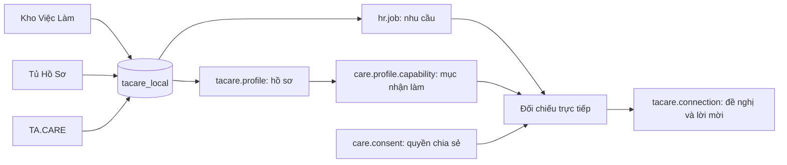

# Database và matching hiện tại — kiểm kê local 24/10/2026

> **Bản triển khai tiếp theo trong ngày:** [tin công khai, xác nhận thực hiện, sao/bình luận và bộ mẫu matching](research/public_jobs_work_reviews_2026-10-24.md) đã được triển khai local. Số liệu và trạng thái “chưa có” dưới đây là lịch sử ở thời điểm kiểm kê trước yêu cầu bổ sung.

> Cập nhật sau kiểm kê, 24/10/2026: đã sao lưu rồi xoá hai database local cũ `khovieclam_local` và `tuhoso_local`. Bảng kiểm kê bên dưới giữ lại trạng thái trước khi dọn. Hiện chỉ còn `tacare_local`, `postgres` và template hệ thống. Xem [cấu trúc source và biên bản dọn](source_structure.md).

Đối chiếu trực tiếp PostgreSQL local, cấu hình Odoo/Nginx và source đang có. Tài liệu phân biệt **đã có bảng**, **đã nối chức năng** và **đề xuất chưa triển khai**. Các số đếm không phải số production. Lần rà soát này không đổi schema, dữ liệu hoặc quyền chia sẻ.

## 1. Database thực sự tồn tại

| Database PostgreSQL | Dung lượng lúc đọc | Vai trò hiện tại |
| --- | ---: | --- |
| `tacare_local` | 53 MB | Database ứng dụng phục vụ cả Kho Việc Làm, Tủ Hồ Sơ và TA.CARE. Có 368 bảng public, gồm bảng Odoo và bảng addon. |
| `khovieclam_local` | 33 MB | Database local cũ: 258 bảng Odoo nền, một website cấu hình `localhost:8070`, không có bảng `care_*`/`tacare_*`. Hai addon TA.CARE không có trong danh sách module của database này. |
| `tuhoso_local` | 32 MB | Database local cũ: 258 bảng Odoo nền, một website cấu hình `localhost:8071`, không có bảng `care_*`/`tacare_*`. Hai addon TA.CARE không có trong danh sách module của database này. |
| `postgres` | Khoảng 7 MB | Database quản trị mặc định PostgreSQL, không phải kho nghiệp vụ sản phẩm. |

`template0`/`template1` là template PostgreSQL, không tính là database ứng dụng. Không xóa hoặc di chuyển database nào trong lần này.

`docker/local-config/tacare.conf` chỉ chọn `db_name = tacare_local`, `dbfilter = ^tacare_local$`. Nginx chuyển cả 8069/8070/8071 về cùng dịch vụ Odoo; cổng 8070/8071 hiện cũng không chọn hai database cũ. Không suy ra database đang dùng chỉ từ tên hoặc số cổng.

Trong `tacare_local`, ba bản ghi `website` gắn với đơn vị vận hành Kho, Tủ và TA.CARE. Có 4 `res.company`, bao gồm đơn vị mẹ. Đây là phạm vi vận hành/quyền Odoo. Doanh nghiệp đăng nhu cầu được biểu diễn bằng `res.partner` + `care.org.member`, không phải mỗi doanh nghiệp một database hoặc một `res.company`.

Triển khai cấu trúc hiện tại cần một database ứng dụng, filestore tương ứng và code addon khớp phiên bản; không cần tạo ba database theo ba website. Bản backup cũ hoặc database khôi phục thử không phải database đang phục vụ. Xem [chuẩn bị dữ liệu triển khai](deploy_data_preparation_2026-10-23.md); server không được xác minh trong lần này.

## 2. Các bảng và dữ liệu hiện có

Tên dưới đây là model Odoo; bảng PostgreSQL thường thay dấu chấm bằng dấu gạch dưới, ví dụ `tacare.profile` → `tacare_profile`. Mở rộng một model trong nhiều file vẫn dùng cùng bảng. Bảng nối Many2many và trường alias không phải kho nghiệp vụ riêng.

### Tài khoản, tổ chức, website

| Model | Dòng SQL | Nội dung |
| --- | ---: | --- |
| `res.users` | 34 | Tài khoản, active, role, company được phép và liên hệ. Bao gồm tài khoản hệ thống/public/inactive; không phải 34 người dùng thật đang hoạt động. |
| `res.partner` | 123 | Liên hệ cá nhân/doanh nghiệp và giới thiệu tổ chức; định danh bên thuê cá nhân hoặc tổ chức. |
| `res.company` | 4 | Đơn vị vận hành và phạm vi dữ liệu Odoo. |
| `res.groups` | 28 | Nhóm quyền, kết hợp ACL, record rules và controller. |
| `website` | 3 | Domain/company/cấu hình website trong cùng database. |
| `care.org.member` | 5 | `organization_id`, `user_id`, `company_id`, role, trạng thái, quyền quản lý nhu cầu và xử lý kết nối. |
| `care.auth.session` | 103 | Nhóm phiên trình duyệt phục vụ SSO, hiệu lực và thu hồi; số dòng không phải số phiên còn hiệu lực. |
| `care.auth.handoff` | 103 | Chuyển đăng nhập một lần, ngắn hạn, gắn trình duyệt; không liên quan phiên matching. |

### Kho Việc Làm: nhu cầu cần người thực hiện

| Model | Dòng SQL | Nội dung và mức tích hợp |
| --- | ---: | --- |
| `hr.job` | 15 | Nhu cầu thời vụ: chủ tài khoản/bên thuê, company/website, nội dung, số người, trạng thái, nghề, lịch, khu vực, giá và kỹ năng. Đã có form/quản lý/matching. |
| `care.job.revision` | 0 | Schema và luồng đề xuất/duyệt sửa tin; hiện không có bản ghi. |
| `care.job.requirement` | 0 | Tiêu chí bổ sung của cấu trúc Kho trước; không phải đầu vào đang dùng của matching thời vụ. |
| `hr.job.skill` | 0 | Kỹ năng native HR và cờ bắt buộc/trọng số; matching thời vụ đọc `flex_skill_ids`, không đọc trọng số này. |
| `care.job.sector` | 10 | Danh mục ngành tương thích của Kho. |
| `care.job.position` | 48 | Nhóm vị trí của cấu trúc trước; không phải danh mục so nghề đang dùng cho matching thời vụ. |
| `hr.applicant` | 0 | Bảng dependency HR giữ để tương thích; luồng thời vụ không tạo ứng tuyển tuyển dụng. |

Cả 15 nhu cầu có `care_opportunity_kind=flexible`, `tacare_status=published`; 14 bật `care_matching_enabled`, 1 tắt. Khi đọc, matching còn kiểm `is_published`, website/company và hạn tin.

### Tủ Hồ Sơ: hồ sơ và mục nhận làm

| Model | Dòng SQL | Nội dung và mức tích hợp |
| --- | ---: | --- |
| `tacare.profile` | 3 | Chủ hồ sơ, tên/tiêu đề/giới thiệu, trạng thái, phạm vi xem, phiên bản và dòng con. Một user được có nhiều hồ sơ. |
| `care.profile.capability` | 12 | Mỗi dòng là một mục nhận làm: nghề, mô tả, giá/cách tính, lịch, cách thực hiện, khu vực, kỹ năng, ảnh và trạng thái. Đây là đối tượng so với tin. |
| `tacare.profile.skill` | 0 | Kỹ năng cấp hồ sơ, mức độ và xác minh; khác kỹ năng trên từng mục nhận làm. |
| `tacare.profile.evidence` | 0 | Minh chứng: vai trò, mô tả, kết quả, URL, xác minh và phạm vi xem. |
| `tacare.profile.experience` | 0 | Quá trình làm việc có cấu trúc, gắn đúng `profile_id`; giữ model tương thích. |
| `tacare.profile.education` | 0 | Học tập có cấu trúc, gắn đúng `profile_id`; giữ model tương thích. |
| `care.capability.category` | 10 | Danh mục nghề/đầu việc dùng chung cho hai phía; mã, cha/con và mức rủi ro. |
| `care.availability` | 0 | Schema lịch ngày/tuần, giờ và timezone; chưa nối matching hiện tại. Matching đọc lịch `flex_*` trên mục nhận làm. |
| `care.service.area` | 0 | Schema vùng/tọa độ/bán kính; chưa tính bản đồ/khoảng cách. |
| `care.preference` | 0 | Schema ưu tiên, giá tối thiểu, khoảng cách, nghề loại trừ; chưa nối matching thời vụ. |
| `hr.skill` / `hr.skill.type` / `hr.skill.level` | 65 / 4 / 13 | Catalog dùng chung Odoo, không phải số kỹ năng đã khai trên hồ sơ. |

Cả 3 hồ sơ đang `active`, `scope=private`, không bật tuyển dụng. Trong 12 mục nhận làm, 11 `available`, 1 `paused`, tất cả `active=true`.

### TA.CARE: chia sẻ, matching và kết nối

| Model | Dòng SQL | Nội dung và mức tích hợp |
| --- | ---: | --- |
| `care.consent` | 0 | Quyền theo hồ sơ, purpose `discovery`/`matching`/`contact`, bên nhận, nhóm trường, thời hạn/thu hồi. Đã có cấp/thu hồi và kiểm tra khi đọc. |
| `tacare.connection` | 0 | Nối nhu cầu–hồ sơ, người gửi/nhận, đề nghị/lời mời, tin nhắn, phản hồi, quyền liên hệ, kết quả trao đổi. Đã có chức năng. |
| `tacare.notification` | 0 | Thông báo theo user/kết nối và cờ đã đọc; đã nối với kết nối. |
| `care.match.config` | 0 | Schema version thuật toán, weights/rules/taxonomy; chưa điều khiển thuật toán đang chạy. |
| `care.match.session` | 0 | Schema phiên matching, đầu vào khởi tạo, trạng thái/thời gian/idempotency; chưa có pipeline xử lý. |
| `care.match.input` | 0 | Schema snapshot đầu vào, version/hash/payload/consent; trang matching chưa ghi. |
| `care.match.result` | 0 | Schema kết quả, điểm/giải thích và hai snapshot đầu vào; trang matching hiện tính trực tiếp, chưa ghi bảng này. |
| `care.feedback` | 0 | Schema phản hồi sơ bộ: tác giả, kết quả matching **hoặc** kết nối, sao 1–5, text `reason`; chưa có đánh giá hai chiều sau hoàn thành. |

### Tài liệu, vận hành và bảng nối

| Model | Dòng SQL | Nội dung và mức tích hợp |
| --- | ---: | --- |
| `ir.attachment` | 848 | Metadata tệp của toàn Odoo gồm assets/ảnh/binary fields; không phải 848 tài liệu người dùng. File có thể nằm trong filestore. |
| `care.document` | 0 | Schema tài liệu private, FK hồ sơ/minh chứng/attachment, loại/trạng thái/thời hạn; chưa có upload tài liệu hồ sơ tích hợp. |
| `care.ocr.job` | 0 | Schema tác vụ OCR/xác nhận dữ liệu; chưa chạy OCR. |
| `care.audit.event` | 186 | Nhật ký bất biến, actor/đối tượng/thời điểm/thay đổi; một số luồng đã ghi, chưa bao phủ tất cả. |
| `care.integration.event` | 0 | Schema sự kiện/retry, chưa có worker/outbox vận hành. |

Bảng nối custom: `care_flex_job_skill_rel` **21**, `care_flex_capability_skill_rel` **20**; các bảng `care_flex_job_preferred_rel`, `care_flex_capability_preferred_rel`, `care_job_sector_res_partner_rel`, `care_preference_excluded_category_rel`, `tacare_profile_operator_rel` đều **0**. Đây là số cặp liên kết, không phải số người/kỹ năng duy nhất.

Các nhóm trên bao phủ toàn bộ bảng `care_*`/`tacare_*` hiện có và các bảng native trực tiếp liên quan sản phẩm. Phần còn lại trong 368 bảng là hạ tầng Odoo như metadata/module/ACL/views/mail/website và bảng nối native; không phải mỗi bảng là một database nghiệp vụ.

## 3. Thuật toán matching đã có

**Đã có gợi ý theo quy tắc, tính trực tiếp bằng Python và trả căn cứ đối chiếu.** Hàm `_care_compare_flexible()` trong [profile_comparison.py](../source/apps/tacare/addons/tacare_website/models/exchange/profile_comparison.py) được `_care_compare_profile()` gọi cho nhu cầu thời vụ. [Controller TA.CARE](../source/apps/tacare/addons/tacare_website/sites/tacare/routes.py) kiểm quyền rồi phục vụ cả phía cần người/nhận việc.

Trình tự:

1. Chọn nhu cầu thời vụ công bố, còn hạn, đúng website/company, bật matching. Bên thuê chỉ xử lý tin thuộc quyền tài khoản/tổ chức.
2. Phía cần người chỉ lấy hồ sơ active/user active, không private, có discovery và matching hiện hành cho bên thuê. Matching cần nhóm trường `profile` và `skills`. Phía nhận việc dùng hồ sơ mình chọn, yêu cầu consent matching theo luồng hiện có.
3. Trong từng hồ sơ, lọc mục nhận làm active, `available`, **cùng category ID** với tin. Không tự hiểu nghề gần nghĩa hoặc mở rộng category cha/con.
4. So từng mục. Xung đột đã khai (`unmet`) làm mục đó bị loại. Thiếu thông tin/cần xác nhận là `unknown`, không tự kết luận người đó không có khả năng.
5. Tính `rank = số dòng so sánh có result='met'`. Mỗi hồ sơ dùng bộ kết quả của mục hợp lệ có rank cao nhất; danh sách xếp rank giảm dần.

| Tiêu chí | Nhu cầu `hr.job` | Mục nhận làm `care.profile.capability` | Quy tắc hiện tại |
| --- | --- | --- | --- |
| Nghề/đầu việc | `flex_category_id` | `category_id` (alias `flex_category_id`) | Phải cùng ID mới so tiếp. |
| Cách thực hiện | `flex_mode` | `flex_mode` | Hai bên đã khai khác nhau thì loại; thiếu phía nhận là unknown. Chưa suy luận hybrid tương đương onsite/remote. |
| Tỉnh/thành | `flex_region_id` | `flex_region_id` | Nhu cầu không remote: đã khai khác tỉnh thì loại, thiếu thì unknown; không tính km. |
| Khoảng ngày | `flex_date_from/to` | `flex_date_from/to` | Không giao nhau thì loại; còn lại vẫn unknown vì chưa xác nhận lịch trống thực tế. |
| Ngày trong tuần | `flex_weekdays` | `flex_weekdays` | Khi cả hai có dữ liệu, ngày cần phải nằm hết trong ngày nhận; không bao phủ thì loại. |
| Khung giờ | `flex_time_from/to` | `flex_time_from/to` | Có dữ liệu hai phía: giờ nhận phải bao phủ giờ cần; không bao phủ thì loại. |
| Tiền công | `flex_rate_min/max`, `flex_pay_unit`, `flex_pay_basis` | `rate_min`, `flex_pay_unit`, `flex_pay_basis`, `currency_id` | Cùng đơn vị/phạm vi và offer là VND mới so; trần ngân sách (hoặc min nếu không có max) >= mức nhận tối thiểu. Không so được là unknown. |
| Kỹ năng | `flex_skill_ids` | `flex_skill_ids` | Trùng `hr.skill.id` thì met; chưa khai/trùng thì unknown, không tự loại. |
| Địa chỉ/phạm vi cụ thể | `flex_location` | `flex_location` | Hiện căn cứ để trao đổi, luôn unknown; chưa xác nhận đi lại/dụng cụ/đầu ra. |

`eligible=true` chỉ có nghĩa còn mục không gặp xung đột đã khai qua bộ lọc này; không chứng minh đủ mọi điều kiện, tay nghề xác minh, lịch trống hoặc đã nhận việc. Đơn vị `trip` bị loại khỏi thuật toán.

Ví dụ giả lập: nhu cầu dọn dẹp cùng tỉnh, thứ Hai 08:00–11:00, tối đa 100.000đ/giờ/người; mục nhận cùng nghề, thứ Hai 07:00–12:00, tối thiểu 90.000đ/giờ/người có căn cứ gợi ý. Giá nhận 130.000đ hoặc chỉ làm từ 09:00 sẽ bị loại. Kỹ năng chưa khai là unknown.

### Giới hạn hiện tại

- Không dùng AI/ML/embedding, không học hành vi, không áp dụng weights từ cấu hình hoặc trả điểm phần trăm. `total_score` là trường schema snapshot chưa vận hành.
- Chưa đưa sao đánh giá, số việc hoàn thành, tỷ lệ hủy, minh chứng xác minh, khoảng cách GPS hoặc lịch bận thực tế vào xếp hạng. `reputation_score` cấp hồ sơ chưa có quy trình tính từ đánh giá giao dịch.
- Chưa so `flex_duration` khi cùng ghi giá/ca hoặc giá/buổi; chưa xét `flex_min_hours`, quy đổi đơn vị/tiền tệ hoặc chi phí vật tư/đi lại. Cùng đơn vị giá chưa bảo đảm cùng phạm vi ca thực tế. Code tiền hiện dựa vào VND phía offer, chưa đối chiếu đầy đủ hai currency ID.
- Không dùng `flex_preferred_skill_ids`, kỹ năng cấp hồ sơ, học tập/lịch sử hoặc `care.job.requirement` trong nhánh thời vụ. Rank tăng theo số tiêu chí/kỹ năng có thể khớp; chưa phải mô hình chất lượng được hiệu chỉnh.
- Kết quả **chưa trả ID mục nhận làm thắng** (`capability_id`/`offer_id`). Kết nối chỉ giữ `job_id` + `profile_id`; cần thêm liên kết mục nhận làm cụ thể để gợi ý, lời mời và việc đã chốt cùng chỉ một dịch vụ.
- Chưa lưu lịch sử matching theo phiên hoặc có pipeline chạy nền. Hiện tải lại thì tính lại từ bản ghi gốc.

**Có dùng dữ liệu này để matching chưa?** Đủ chạy gợi ý theo quy tắc ở mức local/demo. Nhưng hiện ba hồ sơ đều private và không có consent: phía cần người chưa có hồ sơ hợp lệ để khám phá/gợi ý. Không tự bật public/consent; chủ hồ sơ phải chủ động cấp quyền. Chưa có dữ liệu hoàn thành/đánh giá để đo chất lượng ghép nối hoặc huấn luyện ML.

### Kiểm thử đã có và lần kiểm tra này

Repository có `dev_account_matching_check.py` cho nghề/khu vực/ngày/giờ/giá, unknown, trip, ACL và thu hồi consent; `dev_home_suggestions_check.py`, `dev_matching_profile_check.py`, `seasonal_browser_check.cjs` cho gợi ý/quyền/gửi-nhận. Các tài liệu [seasonal-only](research/implementation_seasonal_only_2026-10-22.md), [hub review](research/hub_review_2026-10-22.md), [sắp xếp doanh nghiệp](research/company_demo_reorganization_2026-10-23.md) ghi nhận kiểm tra local trước.

`dev_account_matching_check.py` còn giả định dữ liệu lịch sử 7 hồ sơ/20 tin, không phù hợp bộ 3 hồ sơ/15 tin hiện tại. Không chạy lại seed cũ để thỏa số đếm này.

Lần 24/10 chạy SELECT trong transaction READ ONLY để kiểm kê; và **20 ca giả lập trong bộ nhớ bằng chính hàm `_care_compare_flexible` trích từ source**, gồm xung đột, unknown, cờ cho phép đầu vào và rank: tất cả đạt. Không phải kiểm thử trình duyệt hoặc Odoo ORM end-to-end; hai loại này không chạy lại trong lần rà soát.

## 4. TA.CARE đọc gì để so sánh và hiển thị?

TA.CARE đối chiếu hai kho dữ liệu gốc trong cùng DB; không cần sao chép toàn bộ hồ sơ/tin sang bảng TA.CARE riêng.

| Thông tin cần hiện | Nguồn chính | Lưu tại tầng matching/kết nối |
| --- | --- | --- |
| Tiêu đề/mô tả nhu cầu, bên thuê, số người, lịch, khu vực, giá | `hr.job`, partner/user chủ tin | Tham chiếu `job_id`; snapshot điều khoản khi chốt là phần đề xuất. |
| Tên/tiêu đề/giới thiệu hồ sơ | `tacare.profile` | `profile_id`; kiểm phạm vi/consent từng nhóm dữ liệu. |
| Mục nhận làm, nghề, lịch, giá, kỹ năng | `care.profile.capability`, `care.capability.category`, `hr.skill` | Cần trả/gắn `capability_id`; hiện còn thiếu trong kết quả/kết nối. |
| Căn cứ khớp/chưa biết | Tính từ cặp nhu cầu–mục nhận làm | Hiện `comparisons`, `matched`, `missing`, `rank`, `eligible` trong bộ nhớ; chưa ghi `care.match.result`. |
| Lời mời/đề nghị, tin nhắn, trạng thái/thời điểm | `tacare.connection` | Lưu bền trong DB. Có vài snapshot tên/tiêu đề/kỹ năng, không phải snapshot đầy đủ điều khoản. |
| Email liên hệ | Liên hệ của tài khoản hồ sơ | Chỉ khi accepted và consent contact hiện hành cho đúng bên thuê, có field `email`; không đưa vào input đối chiếu hoặc snapshot công khai. |
| Sao/bình luận/số việc hoàn thành | Chưa có luồng nguồn hợp lệ | Bổ sung công việc hoàn thành và review; tổng hợp từ review đã công bố, không nhập tay điểm uy tín. |

Có thể đọc gộp theo ID bằng ORM khi hiển thị danh sách. ID/FK không tự cấp quyền: vẫn kiểm role, owner/tổ chức, company và consent ở server, kể cả URL chi tiết. Nếu sau này lưu snapshot, không dùng snapshot để tiếp tục tiết lộ dữ liệu đã thu hồi quyền.

## 5. Đánh giá hai chiều cần bổ sung

Gọi hai phía là **bên cần người làm/bên thuê** và **người nhận việc**; một cá nhân có thể đảm nhận cả hai vai ở những việc khác nhau.

`care.feedback` có `author_user_id`, `connection_id` hoặc `result_id`, `rating` 1–5, text `reason`. Chưa xác định bên được đánh giá, chiều đánh giá, dịch vụ đã làm và giao dịch hoàn thành; chưa có form/route, kiểm quyền người tham gia, chống trùng, công bố hoặc tổng hợp sao.

`tacare.connection.status=accepted` hiện là **đồng ý trao đổi**. Kết quả `discussed/reviewing/joined/stopped` chưa biểu diễn bắt đầu/hoàn thành có xác nhận hai phía. Không mở review chỉ dựa vào accepted/joined.

Thiết kế đề xuất, **chưa triển khai**:

| Đối tượng | Trường/quan hệ đề xuất | Mục đích |
| --- | --- | --- |
| Công việc đã chốt, ví dụ `care.work.order` | `job_id`, `buyer_partner_id`, người tạo có thẩm quyền, lịch cụ thể, số người cần, trạng thái, giá/phạm vi đã thống nhất | Tách trao đổi khỏi một lần thực hiện. Tin định kỳ có thể có nhiều lần thực hiện; mỗi lần tính chỗ riêng. |
| Người thực hiện, ví dụ `care.work.participation` | `work_order_id`, `connection_id`, `profile_id`, `capability_id`, provider user/partner, trạng thái, bắt đầu/kết thúc và xác nhận hoàn thành từng phía | Một đầu việc nhiều người vẫn biết ai thực hiện và ai đủ điều kiện nhận review. |
| Review giao dịch | Mở rộng `care.feedback` hoặc model chuyên biệt: `participation_id`, `author_user_id`, `author_side`, bên tác giả/bên được đánh giá, `rating`, `comment`, thời điểm, trạng thái công bố/kiểm duyệt | Hai review độc lập: bên thuê đánh giá người nhận và ngược lại. Feedback thuật toán theo `result_id` không tính vào sao giao dịch. |

Quy tắc server cần có:

1. Chỉ review lượt thực hiện đã hoàn thành theo quy trình xác nhận. Cần yêu cầu hoàn thành, xác nhận hai phía và xử lý bất đồng; không một bên tự đánh dấu để lấy quyền review.
2. Tác giả phải đúng người nhận hoặc người có quyền đại diện bên thuê trong giao dịch. Lưu actor user nhưng chủ thể bên thuê có thể là organization partner. Không suy chiều review theo sender/receiver vì cả hai bên có thể khởi tạo lời mời.
3. Tối đa một review mỗi phía/lượt thực hiện; unique `(participation_id, author_side)` ở DB. Không mỗi nhân viên doanh nghiệp một review; không tự review hoặc review người ngoài.
4. Sao 1–5, comment giới hạn độ dài, trạng thái công bố/kiểm duyệt và nhật ký thay đổi. Chưa có review thì hiện “Chưa có đánh giá”, không coi là 0 sao.
5. Review người nhận gắn đúng hồ sơ/dịch vụ; review bên thuê gắn đúng cá nhân/tổ chức. Nếu tổng hợp cấp tài khoản, nói rõ phạm vi; không tự chuyển uy tín sang mọi nghề/hồ sơ khác.
6. Có thể công bố sau khi cả hai bên đã review hoặc hết hạn để giảm trả đũa; thời hạn/chính sách sửa/ẩn cần chốt trước lập trình.

## 6. Nhu cầu cần một người và việc ẩn danh sách

Yêu cầu ẩn khi đang làm nên gắn với **chốt người thực hiện**, không gắn với một gợi ý hoặc phản hồi accepted hiện tại.

Luồng đề xuất: công khai → đề nghị/trao đổi → hai bên xác nhận làm việc → đang thực hiện → yêu cầu xác nhận hoàn thành → hoàn thành → đánh giá hai chiều. Hủy/bất đồng có trạng thái riêng.

- Cần 1 người: khi chốt người thực hiện, ngừng tiếp nhận cho lần thực hiện đó; nhu cầu ra khỏi tìm việc/gợi ý công khai và không nhận đề nghị/chốt mới. Chốt trước lúc bắt đầu tránh hai người cùng nhận một chỗ.
- Tin/kết nối/công việc vẫn có trong lịch sử và màn hình riêng của hai bên để trao đổi/xác nhận/review; không xóa hoặc ẩn khỏi người đang làm.
- Cần nhiều người: chỉ ngừng tiếp nhận khi đủ chỗ. Chỗ đã chốt/đang làm/hoàn thành của cùng một lần thực hiện đều đã sử dụng; hoàn thành không tự tạo chỗ mới. Hủy có thể trả chỗ theo chính sách mở lại.
- Chốt chỗ phải khóa nhu cầu/lần thực hiện và kiểm sức chứa trong cùng transaction để chống vượt số người do request đồng thời. Bộ lọc và route gửi/chốt đều kiểm ở server; chỉ ẩn CSS/nút không đủ.
- Không tắt toàn bộ hồ sơ vì nhận một việc. Khi có lịch bận thực tế, loại gợi ý trùng giờ; các khung khác vẫn có thể nhận việc.

Hiện chưa có work order/participation/lịch bận giữ chỗ/bộ đếm chỗ trên. `no_of_recruitment` là trường tương thích ghi số người cần; matching chưa trừ chỗ và accepted chưa tự ẩn tin. Không báo cơ chế này đã triển khai.

## 7. Thứ tự triển khai đề xuất

1. Giữ database/model/ID hiện có. Trả/gắn `capability_id` cụ thể, chuẩn hóa so thời lượng/phạm vi/tiền tệ và kiểm thử không phụ thuộc số lượng demo cố định.
2. Thêm việc đã chốt, người thực hiện, xác nhận hoàn thành và sức chứa/ẩn tin. Không đổi nghĩa accepted của kết nối cũ thành đã chốt việc.
3. Thêm sao/bình luận hai chiều, quyền tham gia, chống trùng, công bố và thống kê từ giao dịch hoàn thành.
4. Có dữ liệu thực tế rồi đánh giá chất lượng xếp hạng và việc đưa uy tín vào matching. Nếu cần lịch sử matching, nối `care.match.*` với version/hash/consent; không cần sao chép toàn bộ dữ liệu gốc để hiển thị.

Phạm vi lần này: kiểm kê và làm rõ thiết kế, chỉ thêm tài liệu. Không nâng addon, sửa DB, cấp consent, tạo dữ liệu mẫu, commit/push hoặc triển khai server.
