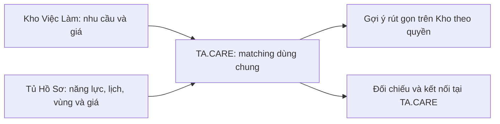

# Nghiên cứu mở rộng TA.CARE: tìm việc linh hoạt, C2C và matching

Ngày nghiên cứu: **19/10/2026**. Trạng thái: **nghiên cứu và đề xuất nghiệp vụ**. Không triển khai code, không thay schema, không gọi API có phí, không thay đổi database hoặc dịch vụ. [Phạm vi chủ dự án đã xác nhận](../project_scope.md) và [sổ nguồn](flexible_work_sources_2026-10-19.md) đi cùng báo cáo này.

## Kết luận để ra quyết định

TA.CARE nên được định nghĩa là hệ thống kết nối **nhu cầu công việc với người có khả năng thực hiện**, gồm hai phần: tuyển dụng hiện tại và tìm việc linh hoạt đang nghiên cứu. C2C là phần mở rộng hợp lý; mô hình đăng nhu cầu, hồ sơ năng lực và kết nối đã có tiền lệ thực tế. Tuy nhiên, thêm quyền cho cá nhân không thể chỉ bằng đổi nhãn “nhà tuyển dụng”.

Hướng phù hợp nhất để nghiên cứu tiếp là **đăng việc → nhận gợi ý có giải thích → gửi đề nghị/chào giá → hai bên xác nhận điều kiện**. Khi chưa có giữ lịch và giao dịch hoàn chỉnh, không quảng bá là đặt người làm tức thời. Tham khảo cơ chế đăng ngân sách/nhận chào giá từ [Airtasker](https://www.airtasker.com/us/how-it-works/), đối chiếu giá–lịch–địa điểm từ [Taskrabbit](https://support.taskrabbit.com/hc/en-us/articles/46260422073755-How-Do-I-Hire-a-Tasker), và nhận ca doanh nghiệp từ [Instawork](https://www.instawork.com/worker). Đây là tổng hợp đề xuất cho TA.CARE, không phải sao chép thuật toán của họ.

Ba điều phải tách: **ai đăng việc**, **việc được thực hiện theo cách nào**, **tiền được tính theo đơn vị nào**. Part-time không đồng nghĩa với C2C, và thanh toán theo tháng không tự biến một dịch vụ thành tuyển dụng nhân viên.

Khả thi ở cấp thiết kế: mở rộng hai phía cá nhân/doanh nghiệp; mẫu việc tại chỗ theo giờ/ca và theo đầu ra; hồ sơ có nhiều khả năng nhận việc; matching theo nghề–lịch–vùng–giá; gợi ý ngắn trên Kho. **Chưa đủ bằng chứng để xác nhận triển khai vận tải hành khách có thu tiền, chọn nhà cung cấp bản đồ cuối cùng, hoặc mở mọi nghề ngay từ đầu.**

## Cách nghiên cứu và cách hiểu mốc trên 80%

Không có toàn bộ hội thoại các session trước trong ngữ cảnh. Bối cảnh được khôi phục từ `AGENTS.md`, `docs/backend_local.md`, `docs/database_mapping.md`, `docs/kho_viec_lam_traceability.md`, tài liệu nghiên cứu/triển khai ngày 17/10 và source hiện tại. Những kết quả QA cũ được ghi nhận là **báo cáo của phiên trước**, không phải kiểm thử được chạy lại hôm nay.

Khảo sát có chủ đích **16 nền tảng**, gồm 12 nền tảng đọc được nội dung trực tiếp, 3 nền tảng có nội dung hữu ích từ chỉ mục nhưng mở trực tiếp bị hạn chế, và Mioto chỉ dùng như tham chiếu bổ sung có giới hạn. Không thể xác nhận đã tìm “tất cả website/app” trên thị trường. Mẫu này bao phủ các cách giao dịch liên quan; không phải thống kê thị phần hay khảo sát giá đại diện. Chi tiết truy cập nằm trong sổ nguồn.

Mỗi phần được rà soát hai lượt: (1) nguồn và nghiệp vụ; (2) tìm phản ví dụ đối với matching, quyền và trạng thái dữ liệu. Mốc người dùng yêu cầu được vận dụng thành **tỷ lệ tiêu chí nghiên cứu đã có câu trả lời**, không phải xác suất thành công dự án, độ chính xác matching hay chứng nhận pháp lý.

Mười tiêu chí dùng tại mỗi cổng nghiên cứu:

| Mã | Câu hỏi phải trả lời được |
| --- | --- |
| K1 | Phạm vi và điều không thuộc kết luận đã rõ chưa? |
| K2 | Có nguồn trực tiếp hoặc căn cứ repository phù hợp không? |
| K3 | Đã kiểm tra chéo bằng nguồn độc lập hoặc đối chiếu code–tài liệu chưa? |
| K4 | Đã xác định hai phía, chủ sở hữu và mục tiêu của luồng chưa? |
| K5 | Có dữ liệu đối ứng để matching hoặc cơ chế đánh dấu chưa biết không? |
| K6 | Đã xử lý khác đơn vị, điều kiện bắt buộc và các phản ví dụ chính chưa? |
| K7 | Đã chỉ ra ranh giới quyền, đồng ý chia sẻ và thông tin công khai chưa? |
| K8 | Có phương án kỹ thuật/nghiệp vụ và chỉ rõ phần hiện tại chưa có không? |
| K9 | Có cách kiểm nghiệm và điểm dừng cụ thể không? |
| K10 | Đã kiểm chứng ngoài thực tế bằng người dùng/đo đạc/tích hợp trong phạm vi kết luận chưa? |

K10 chưa đạt trong nghiên cứu bàn giấy này. Các phần thiết kế đạt K1–K9 là **9/10, tức 90% độ đầy đủ của kiểm tra nghiên cứu**, chỉ đủ làm đầu vào cho đặc tả/thử nghiệm tiếp theo. Đây không phải lời khẳng định “90% khả năng kinh doanh thành công”. Phần có điều kiện chặn chưa giải quyết sẽ bị giữ lại, dù có tiền lệ quốc tế. Bảng cổng và các điểm chặn ở cuối báo cáo.

## 1. Phạm vi B2C và C2C

Giữ cách gọi B2C/C2C của chủ dự án để trao đổi sản phẩm. Trong giao dịch mua dịch vụ, có tài liệu gọi chiều cá nhân bán dịch vụ cho doanh nghiệp là C2B; sự khác nhau về tên này không nên làm thay đổi nghiệp vụ.

| Tình huống | Bên có nhu cầu | Bên nhận việc | Phần sản phẩm |
| --- | --- | --- | --- |
| Doanh nghiệp tuyển nhân viên | Tổ chức | Cá nhân | Tuyển dụng hiện tại |
| Doanh nghiệp cần người phụ kho một buổi | Tổ chức | Cá nhân/nhóm đủ điều kiện | Tìm việc linh hoạt |
| Gia đình cần dọn nhà định kỳ | Cá nhân | Cá nhân hoặc bên cung cấp dịch vụ | Tìm việc linh hoạt, có C2C |
| Cá nhân cần thiết kế một poster | Cá nhân | Cá nhân | Tìm việc theo đầu ra, có thể từ xa |
| Cá nhân cần xe cùng tài xế | Cá nhân | Bên cung cấp vận tải đủ điều kiện | Nhánh theo hành trình, còn điều kiện chặn |

Không đồng nhất hộ kinh doanh, nhóm tự phát và doanh nghiệp về mặt tư cách hay giấy tờ. Nếu sau này hỗ trợ các bên đó, phải có loại chủ thể và người đại diện phù hợp; hiện chỉ là nhu cầu mở rộng có thể nghiên cứu.

### 1.1. Vai trò hành động

- **Người đăng nhu cầu:** đăng, sửa, dừng tin của chính mình; xem đề nghị gửi đến đúng tin; không đọc hồ sơ/liên hệ ngoài phạm vi được phép.
- **Người nhận việc:** quản lý hồ sơ/năng lực của mình, đặt điều kiện nhận việc, phản hồi và gửi đề nghị.
- **Người đại diện tổ chức:** thực hiện theo membership và capability hiện hành, không dùng quyền của tổ chức cho tin cá nhân.

Một cá nhân có thể vừa thuê dọn nhà vừa nhận làm thiết kế. Đề xuất dùng **một tài khoản, hai ngữ cảnh hành động**, vẫn kiểm tra chủ bản ghi. Việc này cần đặc tả quyền mới; không tự chuyển mọi tài khoản hiện tại thành business hoặc cấp quyền xem ứng viên.

### 1.2. Phản ví dụ đã kiểm tra

“Cá nhân đăng việc = business” thất bại vì tài khoản hiện có chỉ được đăng nhập ở các host theo role, và quyền liên hệ bị ràng buộc với tổ chức. “C2C = việc ngắn hạn” cũng thất bại vì gia đình có thể cần người làm nhiều tháng. Vì vậy giữ ba trục độc lập: chủ thể, cách hợp tác, đơn vị tiền.

**Cổng G1: K1–K9 đạt, K10 chưa đạt.** Đủ cơ sở nghiên cứu tiếp dữ liệu/luồng C2C; chưa phải quyền triển khai hay mở vận hành.

## 2. Các dạng việc và logic matching đối ứng

Các nhóm dưới đây là cách tổ chức dữ liệu đề xuất. Các nghề người dùng nêu vẫn là tình huống khảo sát, chưa được tự động đưa vào danh mục triển khai.

### 2.1. Theo giờ, ca, ngày và định kỳ

Người đăng mô tả việc cần làm bằng từ thông dụng: quét/lau sàn, vệ sinh bếp, nấu bữa gia đình, xếp hàng hóa. Chọn tác vụ gợi ý, đánh dấu điều thật sự bắt buộc; cho phép bổ sung mô tả. Không buộc hộ gia đình viết bản mô tả nhân sự chuyên nghiệp.

Đối chiếu với các gói thời lượng và khối lượng của [bTaskee](https://www.btaskee.com/vi-VN/giup-viec-nha-theo-gio/) và lịch lẻ/định kỳ của [JupViec](https://jupviec.vn/theo-gio). Các bên này có tổ chức đào tạo, hỗ trợ và vận hành dịch vụ riêng; không suy ra TA.CARE đã có những năng lực đó.

Tin cần xác định đủ **việc gì, ở đâu, lúc nào, bao lâu và mức tiền**. Tủ Hồ Sơ cung cấp đối ứng theo từng khả năng nhận việc, không dùng một mức giá chung cho mọi nghề.

| Yếu tố | Bên đăng nhu cầu | Bên nhận việc | Cách đối chiếu đề xuất |
| --- | --- | --- | --- |
| Tác vụ | Lau dọn và nấu ăn; bắt buộc hay ưu tiên | Nhận lau dọn; có/không nhận nấu ăn/chưa khai | Không suy lau dọn thành nấu ăn; thiếu khai là chưa biết |
| Khối lượng | Diện tích, số phòng, số suất ăn hoặc lượng hàng khi liên quan | Phạm vi và giới hạn nhận làm | Cần tương thích với thời lượng; không suy năng suất từ giá |
| Lịch | Ngày + khoảng giờ; một lần/định kỳ; khoảng linh hoạt | Khoảng rảnh đủ dài; ngoại lệ; thời gian di chuyển | Cần chứa trọn ca bắt buộc, không chỉ giao nhau vài phút |
| Giá | Ngân sách, đơn vị, tối đa cố định hay thương lượng | Mức tối thiểu chấp nhận; mức mong muốn; số giờ tối thiểu | So cùng đơn vị, cùng phạm vi, cùng cơ sở chi phí |
| Vị trí | Điểm thực hiện riêng tư + khu vực công khai | Vùng nhận việc và giới hạn đi lại | Điểm làm việc thuộc vùng nhận; xét đường đi nếu cần |
| Dụng cụ | Bên nào chuẩn bị, yêu cầu mang theo | Dụng cụ/phương tiện thực có thể mang | Không biết → cần xác nhận, không tự coi có |
| Kinh nghiệm | Có thực sự bắt buộc không? Tác vụ cụ thể nào? | Kinh nghiệm liên quan tự khai | Không lấy tổng năm đi làm làm kinh nghiệm mọi việc |

Ví dụ giả định theo đầu bài: ngân sách tối đa **30.000đ/giờ**, người nhận tối thiểu **40.000đ/giờ**, cả hai cố định → **xung đột giá**, dù ở gần và đúng lịch. Nếu tối thiểu là 30.000đ nhưng mong muốn 40.000đ thì 30.000đ có thể đáp ứng sàn, vẫn phải thể hiện chưa đạt mức mong muốn. Không tự thương lượng thay hai bên.

“120.000đ/ca 3 giờ” chỉ có thể quy ra 40.000đ/giờ để tham khảo nếu cùng một người, cùng phần việc và rõ phụ phí. “120.000đ/ca” chưa biết số giờ thì không quy đổi. Một ngày làm không mặc định bằng tám giờ; một tháng không mặc định bằng 26 ngày.

Định kỳ cần kiểm tra các lần trong thời hạn nhận việc và những ngày ngoại lệ. “Rảnh sáng thứ Hai” chưa đủ để kết luận nhận trọn tháng. Thay đổi lịch sau kết nối cần xác nhận lại; trạng thái accepted hiện có chưa phải giữ lịch hay đã thuê.

### 2.2. Theo đầu việc, sản phẩm hoặc dự án

Các mẫu có thể dùng cùng nền tảng kết nối nhưng so **đầu ra, số lượng, hạn hoàn thành, phạm vi bao gồm/không bao gồm và giá trọn gói**. [Upwork](https://support.upwork.com/hc/en-us/articles/211063418-How-hourly-and-fixed-price-contracts-are-different-on-Upwork) phân biệt hourly và fixed-price; [vLance](https://www.vlance.vn/gioi-thieu-cac-mo-hinh-thue-freelancer-cho-khach-hang) có đăng việc nhận chào giá và hồ sơ/sản phẩm đã làm. Đây là căn cứ cho nhiều cách nhận việc, không phải yêu cầu tích hợp hệ thống thanh toán của họ.

Đối với việc làm từ xa hoàn toàn, vị trí người nhận tại Hà Nội không phải lý do loại nhu cầu ở TP.HCM. Nếu cần đến chụp ảnh thực tế hoặc họp trực tiếp thì phần địa điểm vẫn áp dụng. Không mặc định mọi dự án đều remote.

### 2.3. Theo chuyến: tách ba nghiệp vụ khác nhau

1. **Thuê người lái xe của khách:** bán công sức lái, có thể tính giờ/ngày; tài xế không nhất thiết cung cấp xe.
2. **Thuê xe kèm tài xế để chở khách:** cung cấp cả phương tiện và hành trình, cần kiểm tra điều kiện vận tải.
3. **Đi chung hành trình và chia sẻ chi phí:** mục đích khác với bán chuyến xe thương mại. Không lấy mô hình đi chung làm căn cứ bỏ điều kiện của dịch vụ vận tải.

[inDrive City to City](https://blog.indrive.com/en-id/article/have-app-will-travel-indrive-city-to-city) có yêu cầu hành trình và giá đề xuất. [Chungxe có lái](https://thuexe.chungxe.vn/co-lai) có điểm đón/đến, thời gian và nhận báo giá. Riêng nhánh carpooling trong [điều khoản BlaBlaCar](https://legal.blablacar.com/en-gb/terms-and-conditions/) giới hạn theo chia sẻ chi phí, không được coi là cùng mô hình kinh doanh với thuê xe nguyên chuyến. Các nguồn nước ngoài không chứng minh được phép vận hành nghiệp vụ tương ứng ở Việt Nam.

Nếu nghiên cứu tiếp ví dụ TP.HCM → Lâm Đồng, hai bên phải cung cấp:

| Nhóm | Tin tìm xe/người lái | Hồ sơ năng lực/phương tiện |
| --- | --- | --- |
| Đối tượng thuê | Chỉ tài xế, xe + tài xế, nguyên xe hay ghép chỗ | Bên nhận thực sự cung cấp loại nào |
| Hành trình | Điểm đón/đến đủ cụ thể; điểm dừng; một chiều/khứ hồi; có chờ không | Khu vực đón, vùng nhận đến, chiều nhận/chuyến quay về |
| Thời gian | Giờ xuất phát, khoảng linh hoạt, thời gian về nếu có | Lịch trống cho toàn chuyến, thời gian đến đón và nghỉ/đệm cần thiết |
| Sức chứa | Số khách thực đi; hành lý; yêu cầu đặc biệt khi liên quan | Số khách chở được ngoài tài xế và sức chứa hành lý; không suy từ nhãn “7 chỗ” |
| Giá | Tổng ngân sách cho đúng hành trình; khoản bao gồm/không bao gồm | Báo giá cho hành trình đó; phụ phí; thời hạn giá; không dùng sàn chung 1–2 triệu như cam kết |
| Điều kiện cung cấp | Các giấy tờ/điều kiện thật sự áp dụng cho loại dịch vụ | Tình trạng kiểm tra, phạm vi, hạn hiệu lực; tài xế, xe, đơn vị cung cấp phù hợp |

Một xe ở TP.HCM nhận đi miền Nam có thể phù hợp hành trình đến Lâm Đồng dù điểm đến xa nhà tài xế; điều cần hạn chế là **khả năng đến điểm đón và vùng hành trình nhận chạy**, không lấy bán kính dọn nhà áp cho chiều dài chuyến.

**Cổng G2a (mẫu giờ/ca/đầu ra): K1–K9 đạt, K10 chưa đạt. G2b (vận tải): chưa đạt K6, K7, K8, K10.** Chỉ tiếp tục mô tả giả thuyết dữ liệu vận tải; không đưa nhánh đó vào đề xuất mở dịch vụ. Nghiên cứu độc lập về hồ sơ, bản đồ và gợi ý công khai vẫn tiếp tục; phần phụ thuộc việc mở vận tải được giữ lại.

## 3. Hệ thống hỗn hợp và khả năng mở rộng nghề

“Ai cần việc gì cũng có thể tìm kết nối” là tầm nhìn. Không nên chuyển thành lời hứa “mọi người đăng bất kỳ công việc nào và được tự động matching ngay”. Việc hợp pháp, thuộc phạm vi hỗ trợ, đủ dữ liệu và điều kiện vận hành mới có thể hiển thị/được gợi ý.

Đề xuất khung mở rộng danh mục thay vì một danh sách đóng chỉ có giúp việc và lái xe:

| Nhóm công việc khảo sát | Các chiều bổ sung cần nghiên cứu | Không suy diễn |
| --- | --- | --- |
| Dọn dẹp, nấu ăn | Khối lượng, tác vụ, dụng cụ, số suất ăn | Biết dọn không tự biết nấu; có ảnh bếp không chứng minh đã làm |
| Phụ kho, bốc xếp | Số người, khối lượng mỗi kiện, cầu thang, thiết bị, điều kiện an toàn | Không dùng giới tính làm đại diện khả năng làm việc |
| Chăm cây, công việc nông nghiệp | Loại cây/vật nuôi, diện tích/số lượng, kỹ thuật, mùa, vật tư, nguy cơ | Tưới cây không tự có năng lực xử lý hóa chất, thú y hoặc vận hành máy |
| Việc kỹ thuật tại nhà | Hạng mục, loại thiết bị, khảo sát, phụ tùng, phạm vi bàn giao | Sửa chữa nhỏ không tự đáp ứng mọi việc điện/làm trên cao |
| Sáng tạo, hỗ trợ số | Đầu ra, số lượng, quyền sử dụng, hạn, số lần sửa | Có máy tính không tự có kỹ năng nghiệp vụ |
| Chăm sóc người | Mức hỗ trợ, ca, người được chăm sóc, điều kiện cần thiết | Hỗ trợ sinh hoạt không tự là hành nghề y tế |
| Di chuyển/vận chuyển | Chỉ người lái hay cả xe, khách hay hàng, hành trình và tải | Không gộp vận tải khách, giao hàng, thuê xe tự lái |

Đây là danh sách kiểm tra nghiệp vụ, không phải các trường bắt buộc cho mọi người. Nghề rủi ro cao hoặc có điều kiện cần mẫu và quy trình riêng trước khi bật. Có thể cho nhập đề xuất nghề mới vào vùng chờ phân loại; không đưa một từ mới thẳng vào danh mục matching chuẩn.

### 3.1. Một hồ sơ, nhiều khả năng nhận việc

Giữ định hướng một người có một hồ sơ cá nhân; bên trong có các mục “Tôi nhận làm” riêng. Ví dụ người A nhận dọn nhà 60.000đ/giờ tại một vùng và nhận chăm cây 300.000đ/buổi ở vùng khác. Mỗi mục mang kỹ năng, đơn giá, khối lượng, lịch/vùng đặc thù và minh chứng phù hợp; dữ liệu cá nhân dùng chung. Các giá ở đây đều là ví dụ giả định.

Lịch nhận việc toàn cá nhân phải được kiểm tra xuyên các dịch vụ: không thể nhận dọn nhà và chăm cây cùng giờ. Năng lực của nhóm, số người và khả năng nhận nhiều việc đồng thời cần khai rõ; chưa có thì không suy có năng lực song song.

**Cổng G3: khung mở rộng có kiểm soát đạt K1–K9; mở tất cả nghề chưa đạt K6–K10.** Không phụ thuộc quyết định mở tất cả nghề để nghiên cứu form chung.

## 4. Nền tảng tham khảo và các trường phù hợp

### 4.1. Ma trận khảo sát

| Nền tảng | Đã thấy từ nguồn chính thức | Điều có thể học cho TA.CARE | Giới hạn |
| --- | --- | --- | --- |
| [Airtasker](https://www.airtasker.com/us/how-it-works/) | Mô tả việc, ngân sách, nhận chào giá, xem hồ sơ/đánh giá | Tin nhu cầu và đề nghị hai phía | Không mặc định cần triển khai escrow ngay |
| [Taskrabbit](https://support.taskrabbit.com/hc/en-us/articles/46260422073755-How-Do-I-Hire-a-Tasker) | Loại việc, địa chỉ, lọc lịch/giá, hồ sơ theo nghề | Kỹ năng, giá và thời gian cần đi cùng nhau | Không biết công thức xếp hạng riêng |
| [bTaskee](https://www.btaskee.com/vi-VN/giup-viec-nha-theo-gio/) | Thời lượng gói và phạm vi công việc | Gắn tiền với khối lượng và thời lượng | Mô hình vận hành dịch vụ, không tương đương sàn C2C mở |
| [JupViec](https://jupviec.vn/theo-gio) | Dịch vụ lẻ, định kỳ, tổng vệ sinh | Lịch lặp và ngoại lệ; gói khác phạm vi | Nội dung chỉ mục; mở trực tiếp timeout |
| [Việc Làm Tốt](https://www.vieclamtot.com/tags/giup-viec-nha-theo-gio-quan-thu-duc) | Tin có người đăng cá nhân/công ty, tiền theo giờ/tháng, khu vực | Tính quen thuộc của tin ngắn và giá công khai | Không suy ra chất lượng kiểm duyệt hoặc matching |
| [vLance](https://www.vlance.vn/gioi-thieu-cac-mo-hinh-thue-freelancer-cho-khach-hang) | Đăng việc, nhận chào giá, xem hồ sơ và sản phẩm | Nhiều cửa vào cùng nguồn cung năng lực | Trọng tâm freelancer, không chứng minh vận hành việc tại nhà |
| [Thumbtack](https://www.thumbtack.com/tx/san-antonio/dog-sitting) | Bộ lọc theo dịch vụ, nơi làm, báo giá từ người phù hợp | Hỏi trường đặc thù thay vì một form chung | Chỉ mục; mở trực tiếp cache miss; không xác nhận thuật toán |
| [Care.com](https://help.care.com/s/article/How-do-I-find-a-caregiver?language=en_US) | Đăng nhu cầu hoặc tìm hồ sơ; loại chăm sóc, ZIP, lịch một lần/lặp | Hai chiều tìm kiếm và lịch theo nhu cầu | Chỉ mục; trang trực tiếp không trả nội dung bài đầy đủ |
| [Wonolo](https://www.wonolo.com/workers) | Tìm công việc theo địa điểm, lịch và lĩnh vực | Người có thời gian rảnh tìm việc gần phù hợp lịch | Cơ chế lao động ở thị trường khác |
| [Instawork](https://www.instawork.com/worker) | Doanh nghiệp đăng ca; người lao động nhận theo lịch | B2C cũng có việc theo ca, không chỉ dài hạn | Không sao chép cơ chế kiểm tra/bảo hiểm quốc tế |
| [Upwork](https://support.upwork.com/hc/en-us/articles/211063418-How-hourly-and-fixed-price-contracts-are-different-on-Upwork) | Theo giờ và theo giá cố định/đầu ra | Tách cơ sở định giá và phạm vi giao việc | Công việc số không giải quyết mọi bài toán tại chỗ |
| [Fiverr](https://help.fiverr.com/hc/en-us/articles/360010558038-How-Fiverr-Works) | Gói dịch vụ và sản phẩm công việc | Khả năng nhận việc có thể có nhiều gói/phạm vi | Không biến mọi việc thành gói có giá cố định |
| [inDrive City to City](https://blog.indrive.com/en-id/article/have-app-will-travel-indrive-city-to-city) | Đề xuất hành trình/giá và lựa chọn đề nghị | Báo giá theo chuyến cụ thể | Không xác nhận điều kiện hoạt động tại Việt Nam |
| [BlaBlaCar](https://legal.blablacar.com/en-gb/terms-and-conditions/) | Carpooling chia sẻ chi phí; có phân biệt dịch vụ vận tải khác | Phải tách mục đích và loại hành trình | Carpooling không đại diện thuê xe thương mại |
| [Chungxe](https://thuexe.chungxe.vn/co-lai) | Form điểm đón/đến, thời gian, loại xe, báo giá | Thu thập hành trình trước chốt giá | Trang có nội dung cũ; không dùng bảng giá làm chuẩn hiện tại |
| [Mioto](https://www.mioto.vn/) | Có định hướng thuê tự lái/có tài xế trong chỉ mục | Nhắc kiểm tra thuê tài sản và thuê lao động là hai việc khác | Trang mở trực tiếp chỉ trả shell; không dùng để chốt form/thuật toán |

Không dùng số lượng người dùng, tỷ lệ lấp ca, giá quảng cáo hoặc cam kết an toàn do nền tảng tự công bố làm số liệu thành công cho TA.CARE. Mỗi thị trường có mô hình trách nhiệm khác nhau.

### 4.2. Form Kho Việc Làm cho phần linh hoạt

Bản nháp chỉ cần mô tả ngắn. Khi muốn đăng và nhận gợi ý, bổ sung dữ liệu tối thiểu theo loại việc. **Chưa đặt đây là đặc tả form đã duyệt.**

| Mã | Mục người dùng thấy | Dữ liệu đề xuất | Vai trò matching |
| --- | --- | --- | --- |
| N01 | Bạn cần người làm việc gì? | Tiêu đề; nhóm việc/tác vụ; mô tả ngắn | Xác định đúng khả năng nhận việc |
| N02 | Việc cần làm cụ thể | Tác vụ bắt buộc/ưu tiên; khối lượng; số người; đầu ra nếu có | So phạm vi và năng lực thực hiện |
| N03 | Làm ở đâu? | Tại chỗ/từ xa/hành trình; khu vực công khai; điểm riêng tư đã xác nhận | Vùng phục vụ, đường đi, nhánh từ xa |
| N04 | Khi nào và trong bao lâu? | Ngày giờ, thời lượng, linh hoạt/lặp, hạn nhận đề nghị | Lịch đủ trọn khoảng cần; tin quá hạn không gợi ý |
| N05 | Bạn dự kiến trả bao nhiêu? | Số tiền hoặc khoảng số; tiền tệ; đơn vị; cho một người/nhóm; tối đa cố định hay có thể thương lượng | So giá khi cùng cơ sở; không để một chuỗi tiền tự do là dữ liệu duy nhất |
| N06 | Những điều cần chuẩn bị | Dụng cụ/vật tư, điều kiện tiếp cận, yêu cầu đặc thù khi cần | Tránh gợi ý đúng nghề nhưng không làm được tại bối cảnh đó |
| N07 | Ai đăng và ai được xem? | Cá nhân/tổ chức được ủy quyền; phạm vi nội dung công khai; trạng thái tin | Quyền chủ tin và dữ liệu được phép sử dụng |

N01–N05 là năm mục nghiệp vụ chính, không phải năm ô duy nhất. N06 chỉ mở câu hỏi liên quan đến loại việc. Không bắt người dọn nhà nhập học vấn, CV hoặc KPI. N07 dùng tài khoản và ngữ cảnh có sẵn, không yêu cầu đăng lại thông tin cá nhân không cần thiết.

Tin thuộc nhánh việc linh hoạt có trả công nên có **mức tiền tham chiếu cùng đơn vị** trước khi công khai; có thể là ngân sách dự kiến cần chào giá. “Chỉ thỏa thuận” không đủ cho mục tiêu hiển thị giá của nhánh này. Nếu một dịch vụ chưa thể đưa ra con số có ý nghĩa, giữ nháp hoặc để khu vực cần tư vấn; không tự điền giá 0. Luồng tuyển dụng hiện tại không bị thay đổi bởi đề xuất này.

### 4.3. Form Tủ Hồ Sơ

| Mã | Mục | Dữ liệu | Matching / hiển thị |
| --- | --- | --- | --- |
| H01 | Tôi nhận làm | Một hoặc nhiều mục khả năng nhận việc; tác vụ; giới hạn; kỹ năng | Đối ứng N01–N02; tách giá/lịch/vùng theo dịch vụ |
| H02 | Tiền công mong muốn | Tối thiểu chấp nhận, mong muốn, đơn vị, tiền tệ, giờ tối thiểu, chi phí bao gồm | Đối ứng N05; mức mong muốn không thay cho sàn |
| H03 | Khu vực tôi nhận việc | Điểm xuất phát do người dùng chọn; nhiều vùng nhận việc; bán kính/thời gian đi lại nếu có | Đối ứng N03; không công khai nhà ở |
| H04 | Khi nào tôi có thể làm | Khoảng rảnh ngày/tuần; thời hạn; ngoại lệ; thời gian đệm | Đối ứng N04; không suy luôn rảnh nếu chưa khai |
| H05 | Kinh nghiệm và điều kiện | Mô tả việc đã làm; dụng cụ; giấy tờ khi cần cho đúng nghề | Thông tin tự khai; giấy tờ chưa kiểm tra không thành “đã xác minh” |
| H06 | Hình ảnh/sản phẩm đã làm | Tùy chọn; ảnh/link; chú thích phần việc, thời điểm, phạm vi được chia sẻ | Hỗ trợ tin cậy; không phải điều kiện chung hay điểm thưởng theo số ảnh |
| H07 | Quyền chia sẻ | Hiển thị hồ sơ; xử lý matching; chia sẻ minh chứng; liên hệ theo đúng bên nhận | Các quyền độc lập, có thể thu hồi |

Tạo hồ sơ nháp không cần hoàn tất mọi mục. Khi người dùng bật nhận gợi ý tại chỗ, hỏi trước H01–H04, cho biết mục còn thiếu. Nếu chưa khai lịch/giá/vị trí, vẫn có thể lưu hồ sơ nhưng không gắn nhãn đã phù hợp đầy đủ.

### 4.4. Cấu trúc giá cần đối xứng

Tách **đơn vị tính tiền**, **lịch thực hiện** và **kỳ thanh toán**. Ví dụ 60.000đ/giờ, làm 3 giờ mỗi thứ Hai và trả cuối tháng là ba thông tin khác nhau. Không dùng “tháng” ở kỳ thanh toán để so với giá công việc theo tháng.

Nhóm giá cơ bản: theo giờ, ca, ngày, tháng, đầu việc/sản phẩm hoặc gói dự án; chuyến là nhánh riêng còn điều kiện chặn. Việc theo tấn, mét vuông, số cây… chỉ thêm khi có quy tắc khối lượng tương ứng, không đưa một đơn vị “khác” vào so sánh tự động.

Chỉ đối chiếu số tiền khi biết tiền tệ, đơn vị tính, số lượng, phạm vi công việc và cơ sở chi phí phù hợp. Phân biệt tiền bên thuê trả với khoản người nhận còn lại; chi phí đi lại, vật tư, phí nền tảng, cầu đường/đỗ xe nếu áp dụng phải rõ đã gồm, chưa gồm hoặc chưa biết. Không tự áp nhãn gross/net của lương nhân viên cho mọi dịch vụ.

Tổng dự kiến có thể tính từ đơn giá × số đơn vị/giờ tối thiểu đã biết, cộng khoản bắt buộc đã rõ. Nếu còn phần phải khảo sát, ghi “ước tính” và cần chào giá. Không dùng một công thức báo giá chung cho mọi nghề hoặc mọi cung đường.

### 4.5. Ảnh minh chứng tùy chọn

Nên hỗ trợ ảnh như chủ dự án gợi ý. [Fiverr phân biệt tác phẩm tự thêm với sản phẩm từ giao dịch trên nền tảng](https://help.fiverr.com/hc/en-us/articles/4413134063633-Using-your-Fiverr-Portfolio); đây là cách tham khảo để tách nguồn bằng chứng.

Đề xuất mỗi minh chứng có tên việc, phần mình đã làm, thời gian gần đúng, ảnh/link, chủ thể cho phép sử dụng và phạm vi xem. Ảnh trước/sau hữu ích nếu có cùng bối cảnh; không bắt buộc mọi người phải có. Không có ảnh không bị coi là không có năng lực.

Không tự cấp nhãn xác minh chỉ vì tải ảnh lên. Tách “người dùng tự đăng”, “có xác nhận công việc” và “đã được kiểm tra theo quy trình cụ thể”; chỉ dùng nhãn sau khi có quy trình tương ứng. Không tạo đánh giá giao dịch từ một kết nối accepted.

Khi triển khai upload: cần loại bỏ metadata vị trí, xử lý định dạng/dung lượng/nội dung, quyền đọc file trên server và quyền gỡ ảnh. Không để địa chỉ nhà, mặt trẻ em, giấy tờ hoặc tài sản của khách xuất hiện công khai ngoài sự cho phép phù hợp. Đây là yêu cầu thiết kế, **upload ảnh/CV và xác minh chưa được triển khai trong phiên này**.

**Cổng G4: K1–K9 đạt, K10 chưa đạt.** Các trường đã có đối ứng và quy tắc chưa biết; còn phải thử với người dùng để giảm công nhập và tránh hỏi quá nhiều.

## 5. Vị trí, bán kính và nhà cung cấp bản đồ

### 5.1. Các nền tảng có dùng Google Maps không?

Có bằng chứng trực tiếp về việc dùng Google Maps Platform, ví dụ [Rapido công bố tích hợp Mobility services](https://mapsplatform.google.com/resources/blog/how-rapido-is-building-customer-and-rider-trust-in-india-with-google-maps/). Điều đó chứng minh tính khả dụng trong một hệ thống di chuyển, không chứng minh mọi nền tảng tìm việc dùng cùng công nghệ.

[Taskrabbit cho người nhận việc vẽ vùng làm việc khép kín](https://support.taskrabbit.com/hc/es-es/articles/46260459320603-C%C3%B3mo-dibujar-el-mapa-de-tu-zona-de-trabajo), còn [Care.com mô tả tìm theo khu vực ZIP và lịch](https://help.care.com/s/article/How-do-I-find-a-caregiver?language=en_US). Hai nguồn này chứng minh cách tổ chức phạm vi địa lý; không công bố đủ để kết luận nhà cung cấp bản đồ hoặc bán kính nội bộ của họ.

### 5.2. Tách bốn chức năng

1. **Tìm/chọn địa chỉ:** autocomplete, geocoding và ghim xác nhận. Tên tỉnh không đủ xác định một nơi làm tại chỗ.
2. **Hiển thị bản đồ:** giúp người dùng chọn vùng/điểm. Không bắt buộc phải hiển thị bản đồ ở mọi danh sách.
3. **Lọc vùng:** hệ thống TA.CARE tự kiểm tra điểm có thuộc vùng/bán kính mà người nhận chấp nhận hay không, trên dữ liệu được phép sử dụng.
4. **Ước lượng đường đi:** route/matrix cho quãng đường và thời gian theo phương tiện; đây là chi phí API khác với tải bản đồ.

Nút hoặc iframe “mở Google Maps” không tạo thành matching theo bán kính. API Nearby Search tìm địa điểm của nhà cung cấp không tự biết hồ sơ lao động trong DB TA.CARE; phải truy vấn dữ liệu của chính hệ thống.

### 5.3. Quy tắc phù hợp địa lý

- Công việc tại chỗ: điểm làm thuộc **vùng nhận việc** của mục dịch vụ đang đối chiếu. Nếu có giới hạn đi lại bắt buộc, kiểm tra riêng từ điểm xuất phát được chọn đến nơi làm.
- Vùng nhận việc là nơi người dùng sẵn sàng phục vụ, không nhất thiết là nhà ở. Cho chọn nhiều vùng, vùng loại trừ hoặc phạm vi theo nghề khi cần.
- Không tự mở rộng phạm vi khi thiếu người. Có thể đề nghị người dùng mở rộng và yêu cầu họ chủ động chọn.
- Khác tỉnh không tự loại nếu vẫn gần và thuộc vùng nhận; cùng tỉnh không tự đạt vì phạm vi tỉnh có thể rất lớn. Không chỉ so tên địa phương.
- Làm từ xa hoàn toàn bỏ qua khoảng cách vật lý; việc kết hợp/trực tiếp áp dụng phần địa điểm tương ứng.
- Theo chuyến: xét vùng đón + vùng nhận đến + toàn lịch chuyến. Không dùng chiều dài hành trình làm khoảng cách đi làm tại chỗ.
- Không có tọa độ hoặc độ chính xác quá thô: ghi chưa đủ dữ liệu; không coi tọa độ mặc định 0,0 là vị trí thật, không báo khoảng cách chính xác từ tâm tỉnh.
- Không có quyền GPS vẫn cho nhập/chọn địa điểm thủ công. Giai đoạn này không cần theo dõi vị trí trực tiếp hoặc nền liên tục.

### 5.4. Bán kính khởi đầu để thử nghiệm

Các giá trị sau là **giả thuyết sản phẩm do báo cáo đề xuất**, không phải bán kính được các nền tảng công bố hoặc chuẩn đã được kiểm chứng ở Việt Nam. Người dùng phải thấy và sửa được trước khi lưu.

| Bối cảnh | Gợi ý để người dùng bắt đầu chọn | Cần kiểm tra tiếp |
| --- | --- | --- |
| Việc tại chỗ ngắn trong đô thị | Gợi ý 5 km; lựa chọn 3/5/10 km | Lợi ích tiền công so với chi phí/thời gian đi lại |
| Ca nửa ngày/cả ngày | Gợi ý 10 km; lựa chọn 5/10/20 km | Đường đi, phương tiện, giờ cao điểm |
| Ngoại thành/nông nghiệp | Tự chọn vùng hoặc 10/20/30 km | Tên địa chỉ thực tế, đường vào và phạm vi người nhận chấp nhận |
| Việc theo chuyến | Vùng/giới hạn đến điểm đón do bên cung cấp chọn | Tuyến nhận chạy và khả năng hoàn tất chuyến; không có bán kính điểm đến chung |
| Việc từ xa hoàn toàn | Không dùng giới hạn km | Hạn hoàn thành và lịch trao đổi nếu cần |

Có thể hỏi giới hạn thời gian đi lại thay cho hoặc cùng khoảng cách; mốc 30 phút chỉ là lựa chọn thử nghiệm. Nếu người dùng đặt cả hai làm bắt buộc thì phải thỏa cả hai. Đường qua sông, cầu ít, phà hoặc đường cấm có thể khiến hai điểm gần trên bản đồ khó đến; khoảng cách đường chim bay chỉ dùng lọc sơ bộ.

### 5.5. Phương án kỹ thuật ở mức nghiên cứu

Luồng đề xuất: **lọc quyền/consent/tin còn hiệu lực → đúng loại việc và kỹ năng → lịch/giá → vùng địa lý sơ bộ → kiểm tra đường đi cho danh sách rút gọn → giải thích kết quả**. Thứ tự lọc rẻ có thể điều chỉnh theo dữ liệu nhưng không bỏ điều kiện quyền.

Lọc bán kính không bắt buộc gọi Google. Với tập nhỏ có thể dùng phép đo địa lý phù hợp trong backend; khi cần tải lớn, PostgreSQL + PostGIS là lựa chọn có chỉ mục. [ST_DWithin với geography dùng mét](https://postgis.net/docs/ST_DWithin.html). Đây là khả năng công nghệ, không phải bằng chứng PostGIS đã được cài hoặc đã kiểm tra trong Docker hiện tại. Không sửa DB hay thêm dependency trong nghiên cứu này.

Dữ liệu đầu vào địa lý cần có nguồn, độ chính xác, thời điểm xác nhận và trạng thái chưa biết. Không mặc định tọa độ lấy từ bất kỳ API nào cũng được lưu vĩnh viễn hoặc dùng xuyên người dùng.

[Google Routes Compute Route Matrix](https://developers.google.com/maps/documentation/routes/compute_route_matrix) trả khoảng cách/thời gian theo cặp điểm. Có giới hạn tối đa 625 phần tử cho một số chế độ và 100 với transit/TRAFFIC_AWARE_OPTIMAL; chia batch và kiểm tra trạng thái từng cặp. Không có đường đi là trạng thái riêng, không quy thành 0 km. Mẫu báo lỗi, fallback và hạn mức phải được kiểm tra khi tích hợp thật.

Không chỉ lấy 20 người gần nhất rồi coi danh sách đó là mọi khả năng: người gần nhưng sai lịch có thể che người phù hợp xa hơn trong vùng. Con số 20 ở phần chi phí là giả định tính tiền; thuật toán rút gọn cần kiểm tra đủ điều kiện, bù thêm ứng viên khi API không trả được đường và đo phần bị bỏ sót.

### 5.6. So sánh phương án bản đồ

| Phương án | Căn cứ đã xác nhận | Điều còn phải kiểm tra trước chọn |
| --- | --- | --- |
| Google Maps Platform | Có Places/Geocoding, Maps và Routes/Matrix; tài liệu giá và điều khoản công khai | Chất lượng địa chỉ thực địa, chế độ xe phù hợp, chi phí SKU, quyền lưu/tái sử dụng dữ liệu |
| Goong | [Matrix v2](https://help.goong.io/kb/rest-api-v2/distance-matrix-rest-api-v2/distance-matrix-v2/) có thời gian/khoảng cách và loại phương tiện | Đơn vị tính phí từng API/gói, giới hạn, quyền lưu tọa độ/ETA, điều khoản hiển thị và thử địa chỉ |
| VIETMAP | [Matrix v4](https://maps.vietmap.vn/docs/map-api/matrix-version/matrix-v4/) có ma trận khoảng cách/thời gian; [tài liệu](https://maps.vietmap.vn/docs/vi/map-api/overview/) giải thích transaction | Chế độ phương tiện và giới hạn theo gói, chất lượng thực địa, hợp đồng lưu dữ liệu, báo giá |
| Nền dữ liệu OSM và dịch vụ tự vận hành/thương mại | Có thể xây giải pháp theo bộ dữ liệu/nhà cung cấp thích hợp | Chi phí vận hành, chất lượng địa chỉ, tile/routing/geocoder và giấy phép riêng; không coi OSM là một API miễn phí trọn gói |

API công cộng [Nominatim](https://operations.osmfoundation.org/policies/nominatim/) giới hạn tối đa 1 request/giây và cấm dùng cho autocomplete phía client. Vì vậy không đề xuất dùng endpoint công cộng này cho ô tìm địa chỉ toàn hệ thống.

**Khuyến nghị:** dùng Google làm phương án đối chiếu tài liệu; đánh giá Goong và VIETMAP trên cùng bộ địa chỉ Việt Nam, rồi chọn theo kết quả và quyền sử dụng dữ liệu. Chưa có cơ sở xác nhận bên nào tốt nhất cho TA.CARE hoặc chốt hợp đồng/API.

### 5.7. Chi phí có thể kiểm tra lại

Theo [bảng giá Google chính thức](https://developers.google.com/maps/billing-and-pricing/pricing) đọc ngày nghiên cứu, ở bậc đầu: Matrix Essentials miễn phí 10.000 phần tử/tháng, sau đó 5 USD/1.000; Pro miễn phí 5.000, sau đó 10 USD/1.000; Enterprise miễn phí 1.000, sau đó 15 USD/1.000. Dynamic Maps: 10.000 lượt miễn phí rồi 7 USD/1.000; Geocoding: 10.000 rồi 5 USD/1.000. Giá tính theo SKU và lưu lượng, cần kiểm tra lại lúc mua.

Ví dụ tính toán **chỉ tiền matrix**, không phải dự toán tổng: 1.000 lượt tìm/tháng × 20 cặp đường đi/lượt = 20.000 phần tử. Nếu toàn bộ dùng một SKU và chưa dùng hạn mức miễn phí cho mục đích khác: Essentials khoảng **50 USD**, Pro **150 USD**, Enterprise **285 USD**. Chưa gồm map loads, gợi ý địa chỉ, place details, geocoding, thuế và các chi phí khác.

[Quy tắc billing Routes](https://developers.google.com/maps/documentation/routes/usage-and-billing) tính matrix theo **số điểm đầu × số điểm đến**, không theo một HTTP request; traffic-aware kích hoạt Pro, two-wheel routing có thể thuộc Enterprise theo các tính năng dùng. Cần xác nhận hỗ trợ chế độ xe và SKU của cấu hình thật. Không dùng giá Essentials để ước lượng mặc định cho mọi người đi xe máy.

Goong có [giá công khai](https://goong.io/bang-gia/), nhưng chưa xác nhận cách một matrix nhiều phần tử được quy đổi vào hợp đồng của TA.CARE, nên không đưa ra so sánh “rẻ hơn X%”. VIETMAP công bố matrix n×m tính n×m transaction trong tài liệu; giá gói vẫn phải đối chiếu riêng. Chưa đăng ký tài khoản, lấy key hoặc tiêu tiền.

Khi triển khai cần hạn mức mỗi người/lượt, API key giới hạn mục đích, gọi routing phù hợp từ server, giới hạn quota và cơ chế ngắt khi hết ngân sách. Giới hạn số HTTP request không đủ để hạn chế số phần tử matrix.

### 5.8. Điều khoản và quyền riêng tư của vị trí

[Chính sách Geocoding](https://developers.google.com/maps/documentation/geocoding/policies) và [Routes](https://developers.google.com/maps/documentation/routes/policies) hạn chế lưu/tái sử dụng nội dung, cho phép lưu place ID theo quy định; có yêu cầu attribution và hiển thị bản đồ. Không ghép mặc định dữ liệu Google với bản đồ của bên khác.

[Điều khoản dịch vụ Google hiện hành, ngoài EEA](https://cloud.google.com/maps-platform/terms/maps-service-terms) có quy định cache tọa độ 30 ngày và ngoại lệ Geocoding có điều kiện cho chức năng trực tiếp của người dùng, với cô lập dữ liệu theo người dùng. Không suy ngoại lệ đó tự cho phép xây kho tọa độ dùng matching xuyên người dùng. Cần xác nhận quyền sử dụng cho kiến trúc cụ thể; ETA/kết quả đường đi cũng không mặc định được cache theo thời hạn tùy ý. Không đổi nhãn dữ liệu Google thành “người dùng xác nhận” để bỏ điều khoản.

Thiết kế ưu tiên dữ liệu người dùng tự cung cấp từ nguồn được phép, tách khỏi nội dung API và có vòng đời riêng. Ghim xác nhận là cần cho chất lượng, nhưng không tự giải quyết giấy phép dữ liệu. Đây là một điều kiện quan trọng khi chọn nhà cung cấp.

Công khai khu vực gần đúng; điểm nhà/điểm làm chính xác chỉ đọc khi đúng mục đích và đúng bên được phép. Không trả tọa độ riêng tư hoặc khoảng cách quá chi tiết trong HTML/API/ảnh/analytics cho khách. Việc chọn nhiều điểm rồi suy ngược nơi ở cần được xét trong thiết kế chống dò tìm. Quyền xem địa điểm của tin và quyền xem liên hệ hồ sơ là hai quyền khác nhau.

### 5.9. Cách kiểm chứng trước khi chốt

Chuẩn bị tối thiểu 100 địa điểm công cộng/địa điểm giả được kiểm soát, phủ đô thị, ngoại thành, nông thôn, ranh giới tỉnh, địa chỉ cũ/mới và điểm cần đi vòng. Không gửi địa chỉ cá nhân thật để thử nhà cung cấp khi chưa có căn cứ xử lý phù hợp.

Đo trên cùng bộ mẫu: địa chỉ có tìm được không, ghim có được người kiểm tra chấp nhận không, đường/loại xe có hợp lý không, thời gian phản hồi, lỗi, đơn vị tính phí và quyền dữ liệu. Mốc nghiệm thu đề xuất: ít nhất 90/100 địa chỉ được người kiểm tra chấp nhận; 0 lỗi nghiêm trọng về lộ dữ liệu/ghép sai miền; các ca đường không có lối đi và giới hạn bắt buộc đều được xử lý đúng. Ngưỡng này do dự án đề xuất, chưa đo, không đại diện toàn Việt Nam.

**Cổng G5a (kiến trúc lọc vị trí): K1–K9 đạt, K10 chưa đạt. G5b (chọn nhà cung cấp cuối): chưa đạt K6–K8 và K10 cho cấu hình/hợp đồng thực tế.** Không chốt nhà cung cấp hoặc tuyên bố đã tích hợp.

## 6. Matching chính ở TA.CARE, gợi ý ngắn và giá ở Kho

Đã lưu đây là yêu cầu của chủ dự án trong [phạm vi sản phẩm](../project_scope.md). Đề xuất dùng **một nguồn dữ liệu, một chính sách matching**, nhiều nơi hiển thị theo quyền. Số lượng thẻ gợi ý ngắn và cách trình bày là đề xuất chưa duyệt.

| Ngữ cảnh | Kho Việc Làm nên hiển thị | TA.CARE nên cung cấp |
| --- | --- | --- |
| Khách chưa có hồ sơ | Tin đang mở, khu vực, lịch, tiền cùng đơn vị; liên kết tạo hồ sơ | Giải thích cách kết nối, tạo điều kiện để nhận gợi ý cá nhân |
| Người nhận việc đã có hồ sơ/consent | Khoảng 3–5 việc được gợi ý; lý do đúng việc/vùng/lịch; dữ liệu còn thiếu | Danh sách đầy đủ, điều chỉnh điều kiện và giải thích chi tiết |
| Người đăng tin hợp lệ | Trong không gian quản lý tin: vài hồ sơ/dịch vụ nhận việc đúng quyền | Đối chiếu, gửi đề nghị/chào giá và quản lý kết nối |
| Khu vực giới thiệu cho nhà đầu tư/marketing | Số liệu tổng hợp phù hợp quyền hoặc ví dụ có nhãn “minh họa” | Không dùng hồ sơ cá nhân thật làm dữ liệu quảng bá mặc định |

Nếu muốn trưng bày cặp kết nối thật công khai, phải có sự cho phép phù hợp của các bên đối với đúng nội dung và mục đích quảng bá, cùng cách thu hồi/gỡ hiển thị. Đồng ý xử lý matching nội bộ không tự là đồng ý đưa cặp hồ sơ lên trang thu hút nhà đầu tư. Giới hạn 3–5 thẻ là giả thuyết trình bày, không phải số lượng đã được chứng minh tăng chuyển đổi.

Giá cần có đơn vị ngay trên thẻ: “40.000–60.000đ/giờ”, “240.000đ/ca 4 giờ, 1 người”, hoặc “ngân sách dự kiến cho đầu việc”. Giá theo chuyến chỉ xuất hiện khi nhánh được duyệt và có phạm vi hành trình rõ. Không dùng giá người nhận tự khai làm giá đã được khách chấp nhận.

Khách chưa có hồ sơ không có đủ dữ liệu để gọi một tin là “phù hợp với bạn”. Có thể dùng tin “gần khu vực bạn chọn” hoặc “việc đang cần người”; mẫu diễn giải matching phải ghi rõ là minh họa. Không tạo hồ sơ/tin giả hoặc tỷ lệ thành công giả để thu hút nhà đầu tư.

Đề xuất quy tắc: cùng cặp tin–hồ sơ–dịch vụ, cùng phiên bản đầu vào và cùng quyền người xem phải cho kết luận nhất quán trên Kho và TA.CARE. Khi giá/lịch/vùng/consent thay đổi hoặc tin đóng, gợi ý phải được tính lại hoặc vô hiệu; không giữ teaser cũ vì mục tiêu marketing. Không dựa vào việc ẩn tên để coi cặp dữ liệu là đã ẩn danh an toàn.

Đặt matching chính ở TA.CARE không yêu cầu chuyển bản sao hồ sơ qua lại giữa ba domain. Backend chung có thể thực hiện logic dùng chung; đăng nhập giữa các domain vẫn cần giải pháp riêng nếu muốn liền mạch. Hiện dùng chung tài khoản chưa tạo thành SSO.

**Cổng G6: K1–K9 đạt, K10 chưa đạt.** Có thể chuyển sang đặc tả gợi ý dùng chung khi được yêu cầu; tác động tới đăng ký/giữ chân/đầu tư chưa được kiểm chứng.

## 7. Chính sách matching chung đề xuất

Không dùng tổng số từ khóa trùng làm kết luận phù hợp. Đề xuất các lớp:

1. **Được phép xử lý:** đúng người xem/chủ thể, consent hiện hành đúng mục đích/trường/bên nhận, tin/hồ sơ/dịch vụ còn hiệu lực. Không đủ quyền thì không xử lý hoặc không tiết lộ, không tính điểm bù.
2. **Điều kiện bắt buộc:** phạm vi việc, lịch, vùng, ngân sách, số người/phương tiện và điều kiện nghề thật sự cần. Biết rõ xung đột thì không đưa vào nhóm đề xuất phù hợp; người dùng vẫn có thể khám phá tin công khai theo quyền.
3. **Chưa đủ thông tin:** tách khỏi dữ liệu xác nhận không đáp ứng. Cho biết cần hỏi gì; không gọi là đủ điều kiện, đặc biệt khi liên quan giấy phép bắt buộc.
4. **Ưu tiên:** sau khi qua điều kiện cứng mới sắp xếp theo mức độ rõ căn cứ, lịch ưa thích, khoảng cách/thời gian, mức mong muốn và bằng chứng có liên quan. Tín hiệu ưu tiên không cứu một xung đột bắt buộc.
5. **Giải thích và xác nhận:** hiển thị căn cứ, nguồn tự khai/kiểm tra, thời điểm cập nhật và mục cần hai bên đồng ý. Không tự quyết định thuê hoặc cam kết giá.

Các trạng thái giao diện nên là “Có căn cứ phù hợp để trao đổi”, “Cần bổ sung/xác nhận”, “Có điều kiện không đáp ứng” và “Không được xử lý/hiển thị”. Không hiển thị phần trăm phù hợp tại Kho; không gọi số tiêu chí trùng là xác suất thành công.

Hồ sơ mới không có lịch sử giao dịch vẫn có thể được đề xuất nếu có đủ dữ liệu cần thiết. Số ảnh, tuổi, giới tính, tình trạng hôn nhân hoặc thông tin không liên quan không tự trở thành tiêu chí xếp hạng. Bất kỳ điều kiện đặc thù hợp pháp nào cũng cần được giải thích theo công việc, không tự suy từ nhóm người.

Để giảm nhập liệu, dùng danh mục tác vụ và từ đồng nghĩa đã duyệt. “Dọn vệ sinh”, “lau dọn” có thể được chuẩn hóa cùng một khả năng nếu phạm vi tương ứng được xác nhận; không để AI tự suy ra người đó nhận nấu ăn, có xe hoặc có giấy phép. AI có thể gợi ý cách phân loại để người dùng sửa, chưa cần là nền tảng quyết định matching.

### 7.1. Những tình huống đã rà soát bằng quy tắc trên giấy

Đây là kiểm tra tính nhất quán nghiệp vụ của đề xuất, **không phải automated test hay kết quả của engine đang chạy**. “Kết luận” là hành vi cần có khi triển khai.

| Mã | Tình huống giả định | Kết luận cần có |
| --- | --- | --- |
| M01 | Dọn nhà ở TP.HCM, người chỉ nhận tại Hà Nội | Xung đột vùng; không đề xuất dù trùng kỹ năng |
| M02 | Cùng tỉnh nhưng cách xa, ngoài vùng nhận | Xung đột vùng; tỉnh trùng không đủ |
| M03 | Hai bên khác tỉnh nhưng điểm làm trong vùng nhận | Không loại chỉ vì khác tỉnh |
| M04 | Khoảng cách thẳng gần nhưng đường đi vượt giới hạn bắt buộc | Không gắn nhãn phù hợp; chỉ rõ đường đi |
| M05 | Thiết kế remote, hai phía ở Hà Nội/TP.HCM | Không loại theo khoảng cách |
| M06 | Hybrid có buổi phải tới nơi | Kiểm tra vị trí cho buổi trực tiếp |
| M07 | Từ chối cấp GPS nhưng đã chọn điểm thủ công | Vẫn đối chiếu được theo chất lượng điểm khai |
| M08 | Vị trí thiếu/0,0 mặc định/tâm tỉnh | Chưa đủ thông tin; không tính như điểm chính xác |
| M09 | Ca 8–11h, người rảnh 10–12h | Không đủ ca; giao nhau không đủ |
| M10 | Ca 8–11h, người rảnh 7–12h, có đủ thời gian đến | Có căn cứ phù hợp lịch; còn kiểm tra điều kiện khác |
| M11 | Rảnh tuần nhưng bận một ngày trong chuỗi định kỳ | Không xác nhận nhận trọn chuỗi |
| M12 | Đã có việc kết thúc 8h ở xa, việc mới bắt đầu 8h | Không coi đủ lịch khi thiếu thời gian di chuyển |
| M13 | Ca qua đêm hoặc khác múi giờ | Chuẩn hóa ngày giờ, không cắt sai ở 24h |
| M14 | Ngân sách tối đa 30k/h, sàn người nhận 40k/h, giá cố định | Xung đột giá |
| M15 | Ngân sách 30k/h, sàn 30k/h, mong muốn 40k/h | Có thể đáp ứng sàn; ghi chênh mong muốn |
| M16 | 120k/ca so với 40k/h nhưng không rõ số giờ | Chưa so được |
| M17 | 120k/3 giờ/1 người, cùng phạm vi và chi phí đã rõ | Có thể quy đổi tham khảo 40k/h; vẫn cần xác nhận |
| M18 | Cùng số tiền nhưng một bên cho nhóm, một bên mỗi người | Không so như cùng đơn vị |
| M19 | Một giá gồm vật tư, giá còn lại chưa gồm | Chưa so được tổng tiền cho cùng phần việc |
| M20 | Giá tính giờ nhưng trả cuối tháng | So đơn giá giờ; không so với lương tháng |
| M21 | Cần lau dọn và nấu ăn; chỉ khai lau dọn | Nấu ăn chưa biết; không suy đáp ứng |
| M22 | Người nhận xác nhận không nấu ăn, tin bắt buộc nấu | Xung đột tác vụ |
| M23 | Có ảnh nhưng chưa kiểm tra; người khác không có ảnh | Không tự xác minh người có ảnh hoặc loại người không ảnh |
| M24 | Cần giấy tờ nghề, hồ sơ ghi mô tả không có xác nhận hiệu lực | Chưa đủ điều kiện xác nhận phù hợp nghề đó |
| M25 | Xe mang nhãn 7 chỗ, chưa rõ số khách/hành lý | Chưa kết luận đủ chỗ |
| M26 | Tin 1,2 triệu/chuyến, hồ sơ ghi 1–2 triệu cho nhiều tuyến | Chưa có báo giá đúng tuyến; không chốt giá tự động |
| M27 | Xe nhận đón TP.HCM đi Lâm Đồng, nằm trong phạm vi đã khai | Không loại vì điểm đến xa; vẫn giữ chặn nghiệp vụ vận tải |
| M28 | Chỉ nhận lái xe của khách, tin cần cả xe và tài xế | Xung đột loại cung cấp |
| M29 | Người A vừa đăng nhu cầu vừa nhận việc | Không tự ghép với chính mình; quyền từng bản ghi độc lập |
| M30 | Cá nhân không thuộc tổ chức thử xem liên hệ của kết nối tổ chức | Từ chối; không mở rộng consent ngầm |
| M31 | Thu hồi consent, tin dừng hoặc giá/lịch thay đổi | Gợi ý/chi tiết liên quan tính lại hoặc chặn ngay theo quyền |
| M32 | Khách chưa có hồ sơ xem trang Kho | Có tin/giá công khai, không tuyên bố cá nhân hóa giả |
| M33 | Cùng dữ liệu nhưng Kho nói phù hợp, TA.CARE báo xung đột | Lỗi chính sách/phiên bản phải sửa, không chấp nhận |
| M34 | Nhà cung cấp không trả được đường hoặc hết quota | Báo chưa đủ dữ liệu đường đi, không đổi thành gần/0 km |
| M35 | Đổi từ dọn nhà sang chăm cây | Dùng đúng giá/lịch/vùng/minh chứng của khả năng chăm cây |
| M36 | Tin chưa có người nhận trong vùng | Không âm thầm mở rộng; đề nghị chủ động đổi phạm vi |

Các phản ví dụ đã làm thay đổi đề xuất: bỏ so tỉnh đơn giản; bỏ sắp hạng trước lọc điều kiện cứng; tách giá tối thiểu và mong muốn; tách vị trí đón và vùng đến; không gọi accepted là đặt lịch; không coi ảnh là xác minh; không coi teaser cho khách là cá nhân hóa.

## 8. Đối chiếu với hệ thống đang có

Đã đọc source hiện tại; không giả định trường có sẵn đồng nghĩa có tính năng sử dụng được.

| Thành phần | Hiện trạng có bằng chứng trong repository | Khoảng trống cần đặc tả, chưa sửa |
| --- | --- | --- |
| Tài khoản/host | `tacare_account_access/models/res_users.py`: role business/candidate và host riêng | Một cá nhân có hai ngữ cảnh; quyền đăng tin C2C và đăng nhập các site |
| Đăng/quản lý tin | `controllers/live.py`: kiểm tra business, tổ chức và capability | Chủ tin cá nhân; ủy quyền; vòng đời tin theo loại việc; không giả tổ chức |
| Hồ sơ | `models/profile.py`: một hồ sơ/user; có nghề mong muốn, kỹ năng, giá tối thiểu | Nhiều khả năng nhận việc, mỗi khả năng có giá/lịch/vùng; không đổi ràng buộc một hồ sơ ngầm |
| Giá | `models/hr_job.py`, `profile.py`: giờ/tháng/dự án, cấu trúc lương | Ca/ngày/đầu việc/chuyến; đơn vị mỗi người/nhóm; kỳ thanh toán tách đơn giá; chi phí dịch vụ |
| Năng lực nhận việc | `profile_details.py`: `care.profile.capability` có rate_min/max | Chưa có đơn vị giá và UI hoàn chỉnh cho nhánh này |
| Lịch | `care.availability` có lịch tuần/ngày, giờ cùng ngày | Chưa có luồng hoàn chỉnh, ngoại lệ/qua đêm/đệm/giữ lịch và tranh chấp đồng thời |
| Vùng phục vụ | `care.service.area`, tọa độ/bán kính trên hồ sơ | Chưa có luồng bản đồ/route matching; cần xử lý nguồn điểm, chưa biết, vùng nhiều phần |
| Đối chiếu thật | `profile_comparison.py` trả met/unmet/unknown; kỹ năng chủ yếu theo tên; tỉnh theo ID; rank đếm điều kiện met | Chưa phải lọc cứng theo lịch/giá/vùng C2C; không dùng rank hiện tại để hứa đã giải quyết các ca trên |
| Matching có lưu kết quả | `matching.py` có model config/session/input/result | Theo tài liệu hiện hành, tính live; chưa có worker/snapshot flow tích hợp |
| Consent | `privacy.py`: discovery/matching/contact; recipient public/members/organization; contact chỉ organization | Cấp cho cá nhân cụ thể chưa có; cần mở rộng đúng bên nhận, từng mục đích và trường |
| Kết nối | `connection.py`, controller: gắn tin/hồ sơ, quyền doanh nghiệp/ứng viên | Không tự tạo `hr.applicant` cho mọi việc C2C; tách kết nối trao đổi khỏi báo giá/đặt lịch/giao dịch |
| Minh chứng | `tacare.profile.evidence` có mô tả/link/visibility; document metadata có sẵn | Chưa có upload ảnh/CV, xử lý metadata và xác minh hoàn chỉnh |
| Kho/TA.CARE | Có trang matching và danh sách ứng viên theo tin cùng backend | Teaser cá nhân hóa công khai/chính sách giới hạn dữ liệu cần đặc tả mới |

Về lưu trữ, tuyển dụng tiếp tục dùng Odoo chuẩn và các model đang có. Phần dịch vụ cần ranh giới khái niệm riêng; không quyết định ngay rằng tất cả phải là `hr.job` hoặc phải tạo một model mới. Viết đặc tả chủ thể, quyền, vòng đời và dữ liệu đối ứng trước, rồi đối chiếu [database_mapping.md](../database_mapping.md). Giữ model/XML ID, không sửa Odoo core, không chạy migration chỉ để thử ý tưởng.

## 9. Các điều kiện pháp lý/vận hành có thể ảnh hưởng tính khả thi

Đây là xác định vấn đề cần giải quyết theo mô hình thực tế, không phải kết luận dự án đã đáp ứng điều kiện vận hành. Không áp giấy phép của nước ngoài vào Việt Nam và không coi nhãn “C2C” là căn cứ miễn nghĩa vụ.

| Vấn đề | Nguồn chính thức đã kiểm tra | Ý nghĩa cho quyết định |
| --- | --- | --- |
| Quan hệ lao động hay dịch vụ | [Bộ luật Lao động 45/2019/QH14](https://datafiles.chinhphu.vn/cpp/files/vbpq/2019/12/45.signed.pdf), Điều 13 | Tên “cộng tác viên/part-time” không tự quyết định bản chất quan hệ; cần đối chiếu nội dung quản lý và trả công |
| Hoạt động giới thiệu/kết nối việc làm | [Luật Việc làm 74/2025/QH15](https://xaydungchinhsach.chinhphu.vn/toan-van-luat-viec-lam-119250711173403835.htm), [Nghị định 352/2025/NĐ-CP](https://congbao.chinhphu.vn/van-ban/nghi-dinh-so-352-2025-nd-cp-468351.htm) | Cần xác định phạm vi cung cấp dịch vụ việc làm, không mặc định sàn đăng tin được miễn điều kiện |
| Sàn dịch vụ/thương mại điện tử | [Luật 122/2025/QH15](https://vanban.chinhphu.vn/?classid=1&docid=216503&pageid=27160&typegroupid=3), hiệu lực 01/07/2026 | Phải đánh giá theo chức năng đăng bán/chào giá/giao kết/thu tiền thực tế, không chỉ viện dẫn quy định cũ |
| Dữ liệu hồ sơ, liên hệ, ảnh và vị trí | [Luật 91/2025/QH15](https://congbao.chinhphu.vn/van-ban/luat-so-91-2025-qh15-45578.htm), [Nghị định 356/2025/NĐ-CP](https://vanban.chinhphu.vn/?classid=1&docid=216387&pageid=27160&typegroupid=4) | Cần đánh giá mục đích, căn cứ xử lý, bên nhận/API, vòng đời và việc công khai teaser |
| Vận tải hành khách | [Nghị định 158/2024/NĐ-CP](https://chinhphu.vn/?classid=1&docid=212082&orggroupid=2&pageid=27160), có [sửa đổi 218/2026/NĐ-CP](https://vanban.chinhphu.vn/?classid=1&docid=218537&pageid=27160) hiệu lực 10/08/2026 | Cần đọc bộ quy định hiện hành và xác định vai trò nền tảng/bên cung cấp, không chỉ kiểm tra GPLX và ảnh xe |

Đối với văn bản PDF scan/lỗi truy cập toàn văn đã nêu trong sổ nguồn, chỉ xác nhận được metadata và vấn đề cần thẩm định, không suy đã hoàn tất rà soát từng điều/khoản. Đặc biệt vận tải và chức năng thu tiền chưa qua cổng này. Việc kết nối trước, chưa thu tiền, cũng không tự chứng minh mọi nghĩa vụ được miễn.

Các quyết định vận hành còn cần người chịu trách nhiệm: điều kiện tài khoản, xác thực hai phía, kiểm duyệt việc/ảnh, báo cáo vi phạm, hủy và không đến, tranh chấp, thời hạn dữ liệu, cơ chế phản hồi, nghĩa vụ giá/phí/thuế theo mô hình. Không đặt mức giá 30–40 nghìn/giờ làm mức sàn chung; cần kiểm tra quy định áp dụng và thực tế địa bàn khi chọn nhóm việc.

## 10. Cổng quyết định và lộ trình tiếp theo

### 10.1. Kết quả rà soát nghiên cứu

“Đạt” dưới đây nghĩa là **đủ cơ sở viết đặc tả/thử nghiệm tiếp**, không phải đủ điều kiện phát hành. Tất cả điểm là độ đầy đủ câu trả lời theo K1–K10 ở đầu tài liệu; không phải phần trăm độ chính xác matching.

| Phần | Lượt kiểm tra 1 | Lượt kiểm tra 2 / điều đã sửa trong đề xuất | Kết quả |
| --- | --- | --- | --- |
| G1: C2C cùng B2C | Có tiền lệ và hai phía rõ | So role/host/consent hiện hành; tách quyền cá nhân | K1–K9: 9/10; chuyển tiếp nghiên cứu |
| G2a: giờ/ca/đầu ra | Giá, lịch, phần việc có đối ứng | Khác đơn vị, ca chỉ giao một phần, lịch lặp, sàn/mong muốn | K1–K9: 9/10; chuyển tiếp nghiên cứu |
| G2b: mở vận tải | Có mô hình quốc tế và form trong nước | Chưa giải quyết đủ giấy tờ, vai trò pháp lý, kiểm tra/báo giá và vận hành | K1–K5, K9: 6/10; giữ lại, không mở |
| G3: khung nhiều nghề | Có thể mở rộng theo phần chung + đặc thù | Tách việc có điều kiện, không auto matching mọi nghề | Khung K1–K9: 9/10; mọi nghề còn giữ lại |
| G4: trường/ảnh minh chứng | Trường đôi phía có mục đích cụ thể | Phân biệt ảnh tự khai, thiếu dữ liệu và xác minh; giảm câu hỏi không liên quan | K1–K9: 9/10; còn thử form thực tế |
| G5a: vị trí | Có công nghệ vùng và route/matrix | Phản ví dụ đường vòng/giáp tỉnh/remote/tuyến đón; quota và dữ liệu riêng | K1–K9: 9/10; còn đo thực địa |
| G5b: chốt API/provider | Ba phương án có tài liệu kỹ thuật | Chưa benchmark, chưa chốt quyền dữ liệu/hợp đồng và cấu hình | K1–K5, K9: 6/10; chưa chọn cuối |
| G6: teaser + giá ở Kho | Backend chung, mục đích rõ | Không cá nhân hóa giả; consent hiện hành; đồng bộ kết luận hai site | K1–K9: 9/10; chưa đo hiệu quả thu hút |

Phần chưa đạt trên 80% **không bị ép nâng điểm**. Không thực hiện bước phụ thuộc việc phê duyệt nhánh đó. Các nhánh độc lập được nghiên cứu đến hết để trả lời trọn yêu cầu. Bản thân nghiên cứu chưa đủ để khẳng định toàn bộ phần mở rộng sẵn sàng triển khai trên 80% theo nghĩa thực nghiệm.

### 10.2. Thứ tự triển khai đề xuất nếu có yêu cầu sau này

1. Chốt đặc tả phần linh hoạt và ranh giới vai trò nền tảng; rà điều kiện vận hành/pháp lý liên quan. Bảo toàn phần tuyển dụng hiện tại.
2. Thử form với hai phía, ưu tiên nhóm việc tại chỗ thông thường và việc theo đầu ra đã đủ điều kiện. Không tự mặc định dọn dẹp luôn là nhóm không có rủi ro hay miễn quy định.
3. Đặc tả quyền cá nhân–cá nhân, consent cho bên nhận cụ thể, chủ tin và nhiều khả năng nhận việc; thiết kế ma trận quyền trước khi mở write route.
4. Thử bản đồ/giấy phép dữ liệu/giá trên bộ mẫu chung, chốt nhà cung cấp sau khi có kết quả.
5. Xây matching theo điều kiện cứng + chưa biết + ưu tiên; đưa bộ tình huống ở trên vào kiểm thử phù hợp khi có code. Kiểm tra nhất quán Kho/TA.CARE.
6. Pilot có kiểm soát, đo chất lượng kết nối, dữ liệu còn thiếu, chi phí và xử lý sự cố. Mở rộng từng nhóm khi qua cổng tương ứng.
7. Chỉ sau đó xét booking/giữ lịch/thanh toán, rồi nhánh vận tải khi đã giải quyết điều kiện riêng. Không coi thứ tự này là lịch cam kết.

### 10.3. Cách đo mốc 80% có ý nghĩa khi thử thực tế

Chưa có dữ liệu người dùng trong nghiên cứu này. Đề xuất sau này lấy tập nhu cầu–hồ sơ có phép dùng, cân bằng các nhóm việc/địa bàn; để hai người đánh giá nghiệp vụ độc lập phân loại và giải quyết bất đồng. Chốt quy tắc trước khi chạy, có mẫu kiểm tra chưa dùng để chỉnh luật.

- **Precision@5:** tỷ lệ gợi ý trong năm vị trí đầu được đánh giá là đáng liên hệ theo đầy đủ điều kiện đã biết. Có thể đặt mục tiêu lớn hơn 80%; báo cả cỡ mẫu/khoảng bất định, không tuyên bố từ vài ca đẹp.
- **Vi phạm điều kiện cứng:** phải là 0 trong bộ nghiệm thu, gồm sai vùng cố định, sai lịch, giá cố định xung đột, giấy tờ bắt buộc chưa đạt. Không cho độ chính xác trung bình che những lỗi này.
- **Độ bao phủ:** bao nhiêu nhu cầu có người đủ điều kiện thực sự mà hệ thống tìm được; báo riêng tình huống thị trường chưa có nguồn cung. Không tăng precision bằng cách bỏ hết ca khó.
- **Hữu ích kinh doanh:** tỷ lệ đề nghị được phản hồi, kết nối được chấp nhận, điều kiện được hai bên xác nhận, việc hoàn thành khi đã có cơ chế xác nhận. Accepted connection không tính là việc hoàn thành.
- **Công nhập và chi phí:** thời gian hoàn thành form, tỷ lệ thiếu giá/lịch/vùng, chi phí API theo lượt tìm thành công, sự cố và thời gian xử lý.

Đây là kế hoạch kiểm chứng, chưa chạy khảo sát, benchmark API hoặc đo độ chính xác matching trong phiên này.

## 11. Những gì đã thực hiện và giới hạn phiên nghiên cứu

- Đọc tài liệu các phiên trước và các phần source liên quan tài khoản, tin, hồ sơ, capability, lịch, vùng, consent, kết nối và matching.
- Tìm kiếm và mở nguồn chính thức của các nền tảng, tài liệu bản đồ, bảng giá và văn bản liên quan; ghi rõ nguồn chỉ đọc được qua chỉ mục/lỗi truy cập.
- Rà soát hai lượt từng nhóm kết luận, lập 36 tình huống đối chiếu nghiệp vụ và danh sách điều kiện chặn.
- Ghi nhận phạm vi dài hạn vào `docs/project_scope.md`; tạo báo cáo và sổ nguồn riêng để các phiên sau đọc lại.
- Không chạy Docker/Odoo, không kiểm thử HTTP/ORM mới, không sửa code/schema, không tạo tài khoản/tin/hồ sơ, không dùng dữ liệu cá nhân thật, không upload hoặc gọi API bản đồ có phí; không push/deploy.

Các thay đổi code/tài liệu cũ đã có trong working tree trước phiên được giữ nguyên. Nghiên cứu này không xác nhận trạng thái production, nhu cầu thị trường, hiệu quả đầu tư, khả năng xác minh ảnh hay tính hợp pháp cuối cùng của từng loại dịch vụ.
