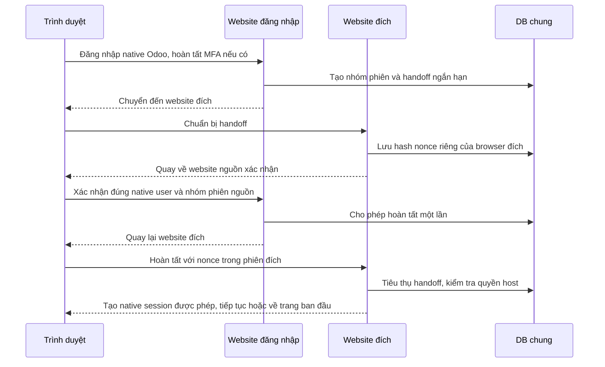

# Đăng nhập và đăng xuất đồng bộ — 20/10/2026

Triển khai trên **local Odoo 19 / `tacare_local`**, theo yêu cầu mới của chủ dự án. Đây là thay đổi nghiệp vụ đăng nhập, thay thế yêu cầu đăng nhập riêng từng website trước đó. Không push, không deploy, không truy cập production.

## Hành vi

| Tài khoản | Đăng nhập ở đâu | Sau khi hoàn tất đăng nhập | Đăng xuất |
| --- | --- | --- | --- |
| Admin hệ thống | Kho, Tủ hoặc TA.CARE | Cùng tài khoản trên cả ba | Thu hồi cả ba trong trình duyệt đó |
| Doanh nghiệp | Kho hoặc TA.CARE | Cùng tài khoản trên Kho + TA.CARE | Thu hồi cả hai |
| Ứng viên | Tủ hoặc TA.CARE | Cùng tài khoản trên Tủ + TA.CARE | Thu hồi cả hai |

- Website ngoài quyền chỉ có trang chủ công khai, không được cấp phiên đăng nhập sử dụng chức năng.
- Đổi tài khoản đồng bộ tài khoản mới và xóa phiên cũ ở website ngoài phạm vi mới. Ví dụ admin → doanh nghiệp: Kho + TA.CARE chuyển sang doanh nghiệp, Tủ về khách.
- Thu hồi có hiệu lực trên máy chủ ngay khi đăng xuất. Tab đang mở cập nhật trong khoảng 3 giây khi hiển thị hoặc khi được đưa về foreground/focus. Không chờ tab cập nhật mới chặn yêu cầu chức năng.
- Nhóm phiên thuộc **một lần đăng nhập trong một trình duyệt**. Thiết bị hoặc browser context đăng nhập độc lập không bị đăng xuất theo.
- Các phiên Odoo cũ được chuyển sang luồng đồng bộ khi mở trang chủ/chức năng được phép. Đăng nhập JSON-RPC cũng được đồng bộ khi mở trang sản phẩm tiếp theo.
- Không thay bố cục ba website, quyền hồ sơ/tổ chức hoặc thuật toán matching.

## Cách triển khai

Cookie Odoo vẫn là cookie HttpOnly riêng từng host. Không thể dùng một cookie chung cho cả `.vn` và `.com`; ứng dụng tạo các phiên native riêng rồi liên kết bằng nhóm phiên máy chủ.

Sau xác thực đầy đủ, trình duyệt đi qua các chuyển hướng first-party giữa các host cố định. Không dùng iframe hay yêu cầu third-party cookie. Các bước trung gian chỉ trả redirect và kết thúc tại website/chức năng ban đầu.

Website thứ ba ngoài quyền vẫn được đi qua bước xóa phiên cũ trong trình duyệt, nhưng không được cấp phiên tài khoản mới. Điều này tránh còn phiên admin trên Tủ khi đổi sang doanh nghiệp.

## Hai model kỹ thuật mới

| Model | Nội dung | Quyền |
| --- | --- | --- |
| `care.auth.session` | User, vai trò lúc đăng nhập, nonce/stamp kiểm tra hiệu lực native credential, hạn dùng, thời điểm thu hồi | Portal không được đọc/ghi/tạo; thao tác nội bộ chỉ sau xác thực, ràng buộc đúng nhóm |
| `care.auth.handoff` | Hash handle, nhóm phiên, origin nguồn, danh sách đích, phase, hash nonce browser, hạn 3 phút | Portal không có ACL trực tiếp; controller kiểm tra handle, phase, origin, source session và target nonce |

Đây là dữ liệu xác thực, không phải `care.match.session` hay dữ liệu hồ sơ/công việc. Không đổi tên model nghiệp vụ, không reset mật khẩu. Thời hạn nhóm phiên lấy cấu hình native `sessions.max_inactivity_seconds` tại lúc tạo; nhóm cũng hết hiệu lực khi hết hạn tuyệt đối, bị thu hồi, user bị khóa, thay credential/MFA hoặc thay vai trò. Handoff được vacuum theo transient model; nhóm quá hạn thêm 7 ngày được dọn bởi autovacuum.

## Các chốt kiểm tra

- Chỉ tạo nhóm sau khi `request.session.uid` đã được Odoo xác thực đầy đủ. Phiên `pre_uid` đang chờ OTP không được cấp SSO.
- Giữ nguyên form/controller native cho mật khẩu, CSRF, CAPTCHA và TOTP. Website nhận hoàn tất native session chỉ sau bằng chứng nguồn đầy đủ và binding browser đích.
- Không truyền mật khẩu, mã phiên native, native session token hay credential stamp qua URL. Handle trong URL không đủ để đăng nhập: còn cần nonce của browser đích và phiên nguồn đúng nhóm.
- Chỉ redirect giữa allowlist origin cố định; không nhận tùy ý một callback host từ client. Đường dẫn quay về giới hạn vào sản phẩm và hỗ trợ tiền tố ngôn ngữ Odoo.
- Handoff có thời hạn, phase một lần, so sánh hash nonce và row lock khi chuyển trạng thái; không dùng lại callback đã tiêu thụ.
- Response xác thực/status có `Cache-Control: private, no-store`; handoff dùng `Referrer-Policy: no-referrer` và không cho nhúng iframe.
- Đăng xuất native `/web/session/logout` và JSON-RPC `/web/session/destroy` cùng thu hồi nhóm. Các route ghi thu hồi được đánh dấu read/write để không mất thay đổi trong readonly retry.
- Mỗi yêu cầu kiểm tra lại nhóm phiên. Thu hồi không phụ thuộc vào việc trình duyệt có đi tiếp sang website khác hay không.
- Đăng xuất khi đang đổi tài khoản và chờ MFA vẫn thu hồi nhóm cũ. Hủy MFA không cấp quyền cho tài khoản đang chờ.
- JavaScript cập nhật tab bằng GET; không tự gửi lại POST mật khẩu trên trang đăng nhập lỗi. Tab phục hồi từ bfcache tiếp tục kiểm tra trạng thái.

## Local và phạm vi kiểm tra

Các origin local:

- http://khovieclam.localhost:8069
- http://tuhoso.localhost:8069
- http://tacare.localhost:8069

Code có allowlist canonical production `https://khovieclam.vn`, `https://tuhoso.com`, `https://tacare.vn`, nhưng **chưa kiểm thử hay triển khai trên production**. Các host phải truy cập được và dùng cùng DB/Odoo session store như kiến trúc hiện tại. Nếu một đích mất kết nối, chuỗi redirect có thể bị gián đoạn; không coi chuỗi dang dở là đã đồng bộ đủ các website. Thu hồi nhóm ở máy chủ vẫn chặn phiên đã cấp dù các tab khác chưa cập nhật.

## Kiểm tra đã thực hiện

- `sso_browser_check.cjs`: ma trận 17 tổ hợp đăng nhập/đăng xuất (admin 3×3, doanh nghiệp 2×2, ứng viên 2×2), cùng user trên các website được phép, cookie host riêng, website ngoài quyền là khách.
- Cùng script: form popup native, các tab đang mở, chặn chức năng sau thu hồi, đổi admin → doanh nghiệp → ứng viên, trình duyệt thứ hai độc lập, đăng xuất JSON-RPC native, bắt buộc phiên nguồn, nonce browser đích và chống replay.
- `sso_mfa_browser_check.cjs`: chạy với một tài khoản QA TOTP tạm; đúng mật khẩu vẫn chưa đăng nhập website nào, OTP hợp lệ mới đồng bộ hai website; đăng xuất và hủy MFA khi đổi từ admin đều thu hồi đúng nhóm. Tài khoản và contact QA đã xóa sau kiểm tra.
- `sso_legacy_browser_check.cjs`: phiên đăng nhập native qua JSON-RPC được chuyển sang SSO khi mở trang chủ đầu tiên, vẫn đúng phạm vi hai website.
- `dev_sso_check.py`: kiểm tra rollback về chủ nhóm, hạn dùng, thu hồi và chặn portal đọc/tạo/ghi dữ liệu SSO.
- `authentication_browser_check.cjs`: popup, quyền 2/3, thư viện admin 20 hồ sơ, ứng viên hai hồ sơ riêng, cấm hồ sơ người khác, phiên gắn vào host sai vẫn bị chặn.

Các kiểm tra Python/XML/JavaScript, probe HTTP ba trang chủ/đăng nhập, bundle JS đang phục vụ và `dev_profile_library_check.py` cũng đạt. Tổng nghiệp vụ vẫn 20 công việc, 20 hồ sơ; hai ứng viên được yêu cầu vẫn có hai hồ sơ mỗi tài khoản, các credential hiện có không đổi.

CAPTCHA giữ hook native và không dùng khóa dịch vụ thật trong test. Kiểm tra trình duyệt dùng Chrome local. Không tự coi kết quả này là kiểm thử mọi trình duyệt, reverse proxy hay TLS production.

## File chính và vận hành

- Addon `tacare_account_access`: `models/auth_session.py`, `models/ir_http.py`, `controllers/sso.py`, ACL kỹ thuật và script kiểm tra.
- Addon `tacare_website`: `controllers/main.py`, data session user trên layout và `static/src/js/session_sync.js`.
- Phiên bản: account access `19.0.3.0.0`, website `19.0.7.0.0`.
- Backup local trước sửa: `backups/sso_20261020/`, gồm DB dump, nguồn và diff; bị Git ignore.
- Update local đã chạy: `-u tacare_account_access,tacare_website --stop-after-init`, sau đó restart `tacare`. Không sửa Odoo core hay cấu hình DNS/TLS.
- Fixture bí mật MFA chỉ nằm trong runtime bị ignore, quyền 0600; đã xóa cùng tài khoản QA. Không đưa mật khẩu/OTP/cookie vào tài liệu, fixture commit hay ảnh.

Tài khoản hiện có và dữ liệu demo nghiệp vụ tiếp tục được giữ. Các bản ghi phiên, handoff và native device log từ kiểm tra là dữ liệu kỹ thuật có vòng đời dọn riêng.
